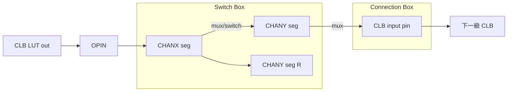

# 07.6 FPGA 的繞線資源圖：SwitchBox、ConnectionBox 與 RRG 遍歷

## 一張出廠就畫好的圖

ASIC 詳細繞線的搜尋域是工具自己定義的網格，DRC 規則由工具逐條檢查；FPGA 恰好相反——繞線資源是矽上實體存在的開關與線段，出廠時就固定了，工具的任務不是「畫線」，而是「決定每個可程式化開關的通斷」。這個差異決定了 FPGA 繞線的全部面貌：繞線問題等價於在一張事先已知的有向圖上做資源分配。要把這件事講清楚，得先看這張圖在晶片上長什麼樣。

現代 FPGA 的互連架構由邏輯塊（CLB：LUT+FF+進位鏈）陣列與其間的繞線通道（channel, segment）構成，連接由兩種可程式化開關塊承擔。連接盒（connection box, CB）決定「通道裡的線段能不能接進邏輯塊的輸入腳」；開關盒（switch box, SB，也叫 switch matrix）決定「相鄰通道的線段之間能不能轉接」。以 iCE40 這類小型架構為例：每個 SB 覆蓋水平與垂直線段的交會點，內部是一個由 mux 構成的矩陣，每個輸出到若干輸出的組合可以透過配置位元接通；CB 則把通道線段 mux 到 CLB 的 LUT 輸入。線段本身的分佈（segment distribution）——長度為 1 tile 的短線與跨 4、8 tiles 的長線各占多少比例——直接決定繞線的 delay 與可繞性：短線多則靈活但每跳的開關延遲累積，長線快但犧牲彈性。1990 年代多倫多大學的 Betz 與 Rose 用 VPR 對這些架構參數做了系統性的架構探索（`W` 通道寬度、`Fs` 開關靈活度、`Fc_in`/`Fc_out` 接腳靈活度），這套參數語言至今仍是描述 FPGA 架構的通用詞彙。

## RRG：把整顆晶片變成一張圖

有了這些實體結構，繞線工具需要一個統一的資料結構來描述它：繞線資源圖（routing resource graph, RRG）。RRG 的定義是：圖的節點是繞線資源——每一段線段（CHANX/CHANY wire）、每一個邏輯塊輸入輸出接腳（IPIN/OPIN）、必要時還有 sink/source 虛擬節點；圖的邊是「開關」——一條 CHANX 線段經由 switch box 接到一條 CHANY 線段，就是一條帶權邊（權重含 switch 的延遲與電容）；線段經由 connection box 接到 IPIN，同理。於是「把訊號從 block A 的輸出繞到 block B 的輸入」就形式化為「在 RRG 上從 A 的 OPIN 為源、B 的 IPIN 為匯找一條路徑」；多端點線網是一棵以 OPIN 為根、各 IPIN 為葉的樹。RRG 把 7.1 的迷宮、7.2 的 A*、7.4 的協商繞線全部放到同一個介面上：繞線演算法根本不需要知道晶片長什麼樣，只需要一張 RRG。

VTR 進一步把 RRG 標準化成檔案格式：架構描述檔（XML 架構語言，定義 block 型別、segment 長度、switch 類型與 `Fs`/`Fc`）經由 `genfasm`/rr_graph 產生器編譯成 rr_graph 檔（現為 XML 或壓縮的二進位格式），VPR 讀入後即可繞線。這個格式讓「架構定義」與「繞線演算法」徹底解耦：研究者換一個 FPGA 架構，只需要重新生成 rr_graph；新的繞線演算法，只需吃同一張圖。這也是 VTR 成為學界標準平台的制度性原因——它把比較基準固定在圖的介面上。

## 繞線演算法：在 RRG 上協商

在 RRG 上，FPGA 繞線的主流程就是 7.4 的 PathFinder：每條線網先各自用 Dijkstra/A* 找 (b+h)·p 最小的樹；對超容資源累積歷史成本、提高當下成本；迭代直到無超容。幾個 FPGA 特有的細節值得點出。其一，成本基本項 $`b_n`$ 以 delay 為單位而非長度：過一個 switch 的延遲（其電阻電容，由 Elmore 模型近似）與走一段長線的延遲差異巨大，時序驅動繞線因此天然融在 cost 裡。其二，資源容量在 FPGA 上幾乎總是 1：一條實體線段被兩個訊號同時使用就是短路，沒有「可以擠一擠」的餘地，這使得超容狀態的定義簡單而嚴格。其三，RRG 通常極大——一顆中型 FPGA 的節點數可達千萬級——因此實作上要做增長式建圖（lazily expand 從 sink/source 可達的部分）與剪枝；Tor（VTR 的繞線器）在這方面有大量工程細節。

與 ASIC 比較，差異可以濃縮成一句話：ASIC 繞線在「工具自定義的網格 + 數千條 DRC」上工作，FPGA 繞線在「晶片固定的 RRG + 唯一的合法性定義（開關通斷）」上工作。前者最難的是規則與 pin access，後者最難的是資源緊張下的收斂；而 PathFinder 的協商機制恰好是為後者量身訂做——資源固定、容量為一、可反覆重繞。這也解釋了一個歷史現象：7.4 提到的 negotiated congestion 在 FPGA 世界一統天下、在 ASIC 世界則要到 2020 年代才被重新引入——因為 ASIC 的詳細繞線域不是一張預先給定的圖，協商機制缺少天然的操作對象。

## RRG 與位元流的閉環

繞線在 RRG 上選定的每條邊，最終都要兌現成一個配置位元：某個 switch box 裡某個 mux 的選擇線、某個 connection box 的通斷位元。因此 RRG 的每條邊在架構描述裡都綁著一個位元流位置（bit position），繞線完成後由位元流產生器（如 VTR 的 genfasm、IceStorm 的工具鏈）把「選了哪些邊」翻譯成配置檔。這個閉環對小型工具鏈的意義是：RRG 不只是繞線演算法的輸入，也是架構知識的唯一真相來源——只要圖建對了，繞線結果就一定可以被「寫進」晶片。反過來，如果 RRG 與真實開關網路有出入（例如漏了某個 mux 的禁止組合），繞線器會選出一條硬體上不存在的路，燒進晶片就是斷線或短路；這是 FPGA 工具鏈除錯最陰險的一類 bug，也說明了為何社群依賴 IceStorm 這類逆向工程成果來保證圖的正確性。

## 回到本書：小型工具鏈的設計啟示

這段歷史對 veryl2chip 這類小型 FPGA toolchain 的設計有直接的啟示。要把 Veryl（或任何 HDL）寫出的設計放到 iCE40/ECP5 上，工具鏈的最後一跳就是「在這顆晶片的 RRG 上做協商繞線」：不必自建 RRG——iCE40 的 rr_graph 可由 IceStorm 的 chipdb（如 `chipdb-5k.txt`，以 `VERYL_EDA_CHIPDB` 指定）取得，正如 VPR 讀 rr_graph 一樣；繞線引擎本身可以是一個精簡版 PathFinder——cost 用 (base + history) × present，容量為一，A* 以曼哈頓距離為啟發式，迭代到無超容。規模小到數千節點時，這個「教科書級」的實作就足以繞完一個 counter 到一顆 5K 的 iCE40，本書第 01 章的範例正是這樣一路走來的。迷宮搜尋的六十餘年歷史，最後沉澱成這樣一條工程路徑：Lee 的波前、Hart 的啟發式、McMurchie 與 Ebeling 的協商、Betz 與 Rose 的資源圖——四個時代的想法疊在一顆幾美元的 FPGA 上。
