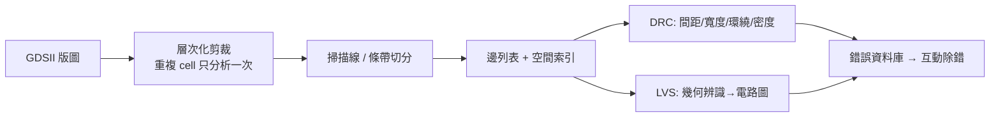

# 8.1 DRC 與 LVS：掃描線演算法與幾何計算的較量

實體驗證（physical verification）是 EDA 產業中最「笨」但最「重」的領域。說它笨，是因為它做的事情本質上只是兩件事：檢查幾何圖形是否違反設計規則（design rule check, DRC），以及檢查版圖電路與網表是否一致（layout vs. schematic, LVS）。說它重，是因為每一次先進製程 node 的推進，設計規則手冊（DRM）的頁數就暴增一次，一顆七奈米晶片的版圖資料量可以達到數百 GB，而驗證一次可能要跑上數天到數週的 CPU 時間。這一章要講的，就是這門「幾何計算的軍備競賽」如何從 1970 年代的暴力窮舉，演化成今天以掃描線、空間索引與平行化為核心的工業級演算法。

## 設計規則檢查的本質

一條典型設計規則寫起來像這樣：「金屬一的最小線寬為 0.14 μm；兩條金屬一線段的間距不得小於 0.14 μm；metal via 的四周環繞金屬的覆蓋量（enclosure）每邊至少 0.05 μm」。對於一個擁有數億個多邊形的版圖，天真的做法是對每一對圖形做兩兩比較，這是 $`O(n^2)`$ 的複雜度， $`n = 10^8`$ 時完全不可行。實體驗證演算法的整部歷史，幾乎就是一部「如何把兩兩比較的候選對數量降到接近線性」的歷史。

最早的突破口來自計算幾何的一個經典觀察：一條垂直掃描線從左到右掃過整個版圖，任何時刻只需維護「目前與掃描線相交的線段」這個小集合，新事件（線段起點、終點、交點）到來時只需查詢鄰居，而不必檢查全世界的圖形。這就是所謂的 plane sweep 或 scanline 技術。1979 年，Jon Bentley 與 Derick Ottmann 在史丹佛發表的論文 "Algorithms for Reporting and Computing Geometric Intersections"（發表於 IEEE Transactions on Computers）給出了用平衡樹與事件佇列實作的 $`O((n+k)\log n)`$ 平面線段求交演算法， $`k`$ 為交點數。這篇論文的意義遠超出 DRC 本身——它證明了幾何問題可以透過維持「動態活躍集合」把複雜度從平方壓到對數，這個思想後來滲透到整個 EDA：留白檢查（spacing check）就是「求所有距離小於 $`s`$ 的圖形對」，在掃描線上把每個圖形膨脹 $`s/2`$ 後求交即可；寬度檢查（width check）則是先對每個多邊形做內縮（inward offset）再檢查內縮結果是否出現碎裂或反轉。專利的佈局也在此時成形：幾何引擎的實作方式成為廠商互告的戰場，這也是為什麼後來各家 DRC 引擎的核心資料結構長相迥異——不是學不出來，而是繞開專利。

## Berkeley 的 Magic 與 corner stitching

在商用工具成熟之前，學界的里程碑是加州大學伯克利分校的 John Ousterhout（後來以 Tcl/Tk 與分散式系統聞名）在 1980 年代開發的 Magic 版圖編輯器。Magic 的核心不是求交演算法，而是一套名為 corner stitching 的版圖資料結構：把整片版圖以 tile（矩形磚）表示，每個 tile 記錄指向右下角與左上角鄰居的指標，任何區域查詢（例如「這個點屬於哪一層的哪個 tile」「這個矩形附近有哪些圖形」）都可以沿著指標串鏈以接近常數時間完成。Ousterhout 1984 年的論文 "Corner Stitching: A Data-Structuring Technique for VLSI Layout Tools" 展示了互動式 DRC 的可能性——設計者畫下一筆，Magic 只增量檢查被修改的局部區域，而不是整片晶片。

另一條路線是 tile-based（或掃描線 batch）式 DRC：把版圖切成垂直條帶（stripe），在條帶內維護一維的活躍邊列表，跨條帶的圖形用長邊跨越處理。這種 edge-based 的表示法是後來所有商業 DRC 引擎的骨幹。它的好處是記憶體可控、可以串流處理，壞處是規則語義變得複雜——「最小面積」、「密度檢查」、「notch」（同層凹口）這類規則在純邊表示下需要特殊處理，這直接催生了後來 DRC 語言的複雜化。Ousterhout 本人後來回憶，Magic 的互動式體驗改變了設計者的心理模型：DRC 從「tape-out 前的大掃除」變成「邊畫邊驗」的日常習慣，這個 UX 上的變化其實比演算法本身對產業的影響更深。

## 從 Dracula 到 Calibre 的霸權轉移

商業化方面，Cadence 的 Dracula 是 1980 年代末到 1990 年代的實體驗證標配，它是典型的 batch 工具：讀入 GDS、跑 DRC/LVS、輸出錯誤資料庫，然後用互動式 viewer（後來整合進 Virtuoso）除錯。但真正建立現代實體驗證秩序的是 Mentor Graphics 的 Calibre。Calibre 於 1990 年代中期崛起，其成功因素有三：一是引擎本身——它的層次化處理（hierarchical analysis）能識別重複單元（cell）的幾何上下文，如果一個 cell 在所有出現位置的上下文一致，只需分析一次，這讓記憶體與執行時間隨層次性而非圖形總數成長，對標準單元庫佔九成面積的數位晶片是數量級的加速；二是語言——SVRF（Standard Verification Rule Format）成為 foundry 交付規則檔的事實標準，台積電、聯電等晶圓廠直接交付 Calibre 格式的 runset，這形成了極強的生態鎖定：換工具意味著換掉整條供應鏈介面；三是時機——深次微米時代（0.25 μm 以下）設計規則從幾十條暴增到數百條，加上 antenna rule、density rule 等製造性規則的加入，只有層次化引擎撐得住，Dracula 等老一代工具逐漸退出。Cadence 後續以 PVS（Physical Verification System，2010 年代推出）與 Tempus 等工具反攻，Siemens（收購 Mentor 後）的 Calibre 至今仍占實體驗證市場的最大份額。這段歷史說明 EDA 的一個規律：最好的演算法不一定贏，綁定 foundry 資料格式的工具才會贏。

## LVS：把幾何變回電路，再比對兩張圖

LVS 的問題比 DRC 更深一層，因為它不是幾何問題而是圖論問題。流程分兩半：前半從版圖萃取出電路——辨識導體層（金屬、多晶矽、擴散區），找到電晶體（poly 與 diffusion 交疊處）、電阻、電容與連通關係，把幾何堆疊翻譯成一張 netlist；後半把這張 netlist 與設計者的邏輯 netlist 比對，判定它們是否描述同一個電路。

比對在數學上是圖同構（graph isomorphism）問題的變體——而且是要「找映射」的帶標籤版本。圖同構的一般複雜度未定（既未證明多項式，也不在已知 NP-complete 類別中，2015 年 Babai 給出了準多項式 $`n^{O((\log n)^c)}`$ 演算法），但電路圖同構有強大的結構可用：真實電路不是隨機圖，而是高度規律的。因此實用 LVS 演算法幾乎都是 partitioning/refinement 式的：先對所有節點依局部特徵打上初始標籤（電晶體型態、連接的層數等），反覆用「鄰居的標籤多重集」細化標籤（這正是 Weisfeiler-Lehman 演算法的思路），直到標籤穩定；此時兩張圖中標籤相同且數量一致的節點群自動形成候選分割，若全程無衝突，同構映射直接讀出；若出現對稱或模糊，才用搜尋回溯解決。這個「不變式細化」策略比任何通用同構求解器都快，因為大多數錯誤在細化的第一輪就讓兩邊的節點群數量對不上，直接報出 local mismatch。實務上 LVS 報錯的難點從來不是「有沒有錯」而是「錯在哪」——工程師拿到的是開路（open）、短路（short）、少元件（missing device）三類問題，好的 LVS 會做錯誤局部化，把 mismatch 傳播收斂到最小可疑區域，這個除錯體驗的工程投入不亞於核心演算法。

LVS 成為標配還有一個制度性原因：它防守的是「版圖與網表不符」這類可能直接導致晶片報廢或（更糟糕的）功能篡改的錯誤。在 IP 授權與晶圓代工模式下，客戶交付 GDS 給 foundry 前，foundry 要求 LVS clean 作為交接條件；這使 LVS 從內部品管變成供應鏈契約的一部分。當 Calibre LVS 成為所有 foundry 認可的工具，霸權就完成了閉環。

## 結語與預告

掃描線把平方變成對數，層次化把圖形總數變成唯一圖形數，不變式細化把圖同構變成線性細化——DRC 與 LVS 的演算法史，本質上是在「幾何規模以摩爾定律成長」的壓力下不斷更換複雜度根基的歷史。但修好幾何還不夠：當製程進入 0.25 μm 以下，決定電路速度的不再是電晶體而是連線的電阻電容，而這些寄生參數在版圖萃取出來之前根本不存在於任何 netlist 裡。下一節我們就來看寄生參數萃取：從嚴格求解馬克斯威爾方程組的邊界元素法，到表驅動的 pattern-based 快速模型。
