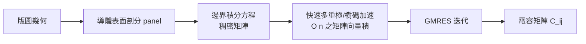

# 8.2 寄生參數萃取：從邊界元素法到 Pattern-based 快速模型

1980 年代末，晶片設計者開始注意到一個令人不安的現象：閘延遲隨製程縮小而穩定變快，但連線延遲幾乎不變，甚至在某些層上變慢。原因是兩條相反的曲線——電晶體尺寸縮小讓閘電容下降，但連線在縮小線寬的同時，線電阻 $`R`$ 以約每代 1.5–2 倍上升，而線間距縮小讓耦合電容 $`C`$ 相對於基底電容的比例不斷提高。到了 0.25 μm（約 1997 年）之後，互連延遲正式主導時序路徑，一片「邏輯正確」的晶片如果萃取不出準確的寄生 RC，靜態時序分析（STA）算出來的頻率就是童話。這一節講的就是如何從版圖幾何中把 $`R`$ 、 $`C`$ 算出來，以及這個計算如何在「準確」與「跑得完」之間妥協出工業可行的答案。

## 嚴格解：場求解器與邊界元素法

寄生電容的本質是靜電場問題：給定導體的幾何與電壓，解拉普拉斯方程 $`\nabla \cdot (\epsilon \nabla \phi) = 0`$ ，再由電荷 $`Q = \oint \epsilon \nabla \phi \cdot d\vec{S}`$ 求電容矩陣 $`C_{ij} = Q_i / V_j`$ （其他導體接地時）。有限元素法（FEM）需要對整個空間做體網格，對含有大量薄長金屬線的版圖來說網格品質是噩夢。1980 年代的突破是回到邊界：拉普拉斯方程的解完全由邊界上的電位與法向電場決定，因此只需在導體表面剖分面元（panel），用格林函數建立邊界積分方程

$$
\phi(\vec{x}) = \int_S G(\vec{x}, \vec{x}') \sigma(\vec{x}')\, dS', \qquad G = \frac{1}{4\pi\epsilon |\vec{x} - \vec{x}'|}
$$

再數值求解表面電荷分佈 $`\sigma`$ 。這就是邊界元素法（BEM），其自由度只有 FEM 的表面部分，對層狀介質（矽基底—氧化層—金屬的平板結構）還可以把多層介質併入解析的格林函數，進一步省掉介面剖分。

問題在於 BEM 生成的稠密矩陣是 $`O(n^2)`$ 儲存、 $`O(n^3)`$ 直接求解，導體一多就崩潰。1989 年，MIT 的 Jacob White 與其學生 Keith Nabors 發表 FastCap：用多重極展開（multipole expansion）把「遠處面元群對某點的作用」用少數幾個展開係數近似，配合層次化的空間樹（四元樹/八元樹），把矩陣向量積從 $`O(n^2)`$ 壓到 $`O(n)`$ （準確到可容忍誤差），再用廣義最小殘量法（GMRES）這類 Krylov 迭代法求解。FastCap 是「快速演算法 + 迭代線性代數」在 EDA 中最經典的示範，其思想直接承襲 1987 年 Rokhlin 的快速多重極法（FMM），而 White 團隊把它工程化到了可以直接用於版圖寄生分析的程度。FastCap 至今仍以開源形式被教學與研究廣泛使用，它是所有「場求解器（field solver）」的祖師爺；後續商業場求解器（如 Synopsys、Cadence 與 Silvaco 的產品）在多層介質、導體損耗與頻變效應上不斷擴充，但邊界積分 + 快速求和的骨架未變。

## 從嚴格到快速：2D、2.5D 與 pattern-based

場求解器雖然快，仍然只適合「點查」——設計者對某條關鍵線或某個特殊結構求一次精確值。全晶片萃取面對的是數億條線段，每條都要在毫秒內出值。工業解法是承認互連結構高度重複，把「幾何 pattern → 寄生值」的映射做成表。

最早的 2D 萃取假設每條線是無限長的橫截面：算出單位長度的線電容與基底電容，乘上長度即得總電容。這在連線遠長於線距時尚可，但完全忽略線端效應（fringe）與鄰線的有限長度。2.5D 方法（代表性工作是 1990 年代 Cadence 與 IBM 的一系列論文，概念上以 1993 年 O'Brien 與 Savarino 的 coupling 網路化簡為先聲）把每個導體的電容拆成「對基底」與「對左右鄰線」兩種單位長度分量，從查表得到這些係數後，再以局部幾何計算線端修正，最後組裝成集總電容網路。它比 2D 準確、比 3D 快兩到三個數量級，成為 0.18 μm 時代的主流。真正的 3D 查表式萃取則是把空間切成小立方塊，用場求解器預先計算大量典型 3D 結構（via、轉角、交錯線、多條平行線）的寄生值建成資料庫，萃取時對版圖做模式匹配（pattern matching），找到對應的表項插值出值。Synopsys 的 Star-RC、Cadence 的 Quantus、以及收購 Simplex/小于模式比對路線的諸多工具，最終都收斂到這個架構。它的準確性由兩件事保證：一是 foundry 提供的寄生模型卡（parasitic model card）——製程開發時用 TCAD 模擬與矽測試結構（test structure, 如 kelvin 結構與梳齒狀電容）實測，回歸出模型；二是工具的 pattern 庫覆蓋率，這變成商業機密與技術壁壘。

萃取出的 RC 網路還要「變小」才能交給 STA：一條 net 可能有數百段 RC，直接送進時序分析太慢。標準做法是化簡為少數幾個電容與幾個電阻的集總模型——最簡單的是 total C（全部電容合併、電阻視為 0），進一步是星網（ $`\pi`$ 模型：兩個電容夾一個電阻）或派網（多分支的 Elmore 延遲等效），更講究的用漸近波形估測（AWE，Pillage 與 Rohrer 於 1990 年發表於 IEEE Trans. CAD）或矩陣匹配做高階化簡。準確度與模型階數之間的取捨，直接對應到 sign-off 的嚴格程度：早期掃描用 $`\pi`$ 模型，最終 sign-off 用高階模型甚至保留原始 RC 段數。

## SPEF 與寄生資料的經濟學

寄生結果的交換格式 SPEF（Standard Parasitic Exchange Format）由 Cadence 在 1990 年代提出、後進入 IEEE 1481 標準，如今是 STA 與寄生工具之間的通用語言：每條 net 記錄化簡後的電容、電阻網路，耦合電容以「capacitance to another node」形式列出，供 crosstalk（串擾）與 delta-delay 分析使用。SPEF 的存在本身就是制度性分工的證據——萃取（物理域）與時序（邏輯域）是不同工具、不同團隊、甚至不同公司，標準格式讓兩者可以像 DLL 介面一樣解耦。

同樣制度化的還有上游：foundry 對每個製程 node 交付的不只是設計規則，還有一整套寄生模型——每層金屬的厚度、線寬偏差、介電常數、溫度與製程角落（corner，如 RC 最壞的 slow/cmax corner 與最快的 fast/cmin corner）變體。這些模型是數百萬美元 TCAD 與矽驗證的產物，是 foundry 最核心的智慧財產之一，客戶拿到的是編譯過、不可閱讀的加密形式。這形成了一種資料經濟：EDA 工具的準確性上限由 foundry 模型決定，foundry 的良率承諾依賴客戶用認證過的萃取工具——工具、模型、製程三者互相認證，構成先進製程生態的信任鏈。任何第三方想在這條鏈上插一腳（例如新創公司做開源萃取），都必須先解決「拿不到 foundry 加密模型」的雞生蛋問題，這也解釋了為什麼學界開源工具（如 FastCap、以及後來的 3D 場求解器如 fastercap）多半只能做點驗證而難以進入量產 sign-off 流程。

## 結語與預告

寄生萃取的故事是一場「物理精度→工程速度」的翻譯：BEM 與 FastCap 提供了真理的定義，pattern-based 表驅動法把真理封裝成查表，SPEF 把結果送進時序引擎，foundry 的加密模型卡則定義了整條信任鏈的地基。但即使時序算準了，還有一個更隱蔽的威脅：設計者改了一行 RTL，重新綜合、佈局繞線之後，怎麼確保新的 gate-level netlist 與原來的 RTL 「一模一樣」？人工比對數百萬個邏輯閘是不可能的，這需要形式化的證明。下一節我們來看等價性檢查（LEC）：BDD、SAT 與 cut-point 三種思想的商業化競賽。
