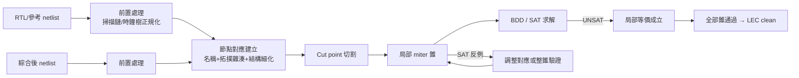

# 8.3 等價性檢查 LEC：BDD、SAT 與 Cut-point 的商業化

1980 年代末，ASIC 設計流程出現了一個結構性裂縫：設計者寫的是 RTL 或邏輯閘，但為了滿足時序、面積與可測性，會反覆做綜合、最佳化、掃描鏈插入（scan insertion）、時鐘樹合成（CTS）與工程變更（ECO）。每一個步驟都可能改寫 netlist，而任何一次改寫如果出錯，晶片就會在「功能上」而不只是「時序上」錯——模擬很難捕捉這類錯誤，因為改動往往是局部且看似無害的。產業需要的是一個數學保證：證明兩個電路在所有輸入組合下輸出完全相同。這就是組合等價性檢查（combinational equivalence checking, CEC），也是形式驗證第一個大規模商業化的戰場。

## Miter 與問題的形式化

給定兩個組合電路 $`C_1, C_2`$ ，標準的建模方式是 miter（1990 年由 Brand 與 MIT 的 Jacob White 在論文 "Proving Register Transfer Level Circuit Designs Correct"（發表於 ICCD）中系統化，名稱來自英文 mitre，指兩物相接的斜角接頭）：把兩個電路的對應輸入接在一起，輸出各接一個 XOR，再 XOR 起來送進一個「看門狗」輸出。等價性成立若且唯若 miter 的輸出在任何輸入下都不為 1——換句話說，等價性檢查被轉換成一個可滿足性問題：「是否存在輸入使 miter 輸出為 1」。這個轉換看似簡單，卻把整個問題嫁接到布爾函數的表示法上，之後二十年的演算法史就是「用什麼表示法、怎麼讓它規模化」的歷史。

## BDD 時代：規整性的力量與崩塌

第一個大突破是布爾決策圖（binary decision diagram, BDD）。BDD 概念可追溯到 1959 年 Lee 與 1978 年 Akers，但使其成為實用工具的是 1986 年 Randal Bryant（CMU）的論文 "Graph-Based Algorithms for Boolean Function Manipulation"：他把 BDD 限制為「變數順序固定的化簡有根有向無環圖」（ROBDD），證明了在此規範下每個布爾函數有唯一表示，從而兩個函數相等當且僅當它們的 BDD 圖同構——等價性檢查變成一次圖的合併比較，是線性時間的操作。配合 Bryant 給出的 apply 運算（兩個 BDD 的 AND/OR/XOR 可在 $`O(|B_1||B_2|)`$ 時間完成），1990 年前後 BDD 迅速席捲形式驗證：符號模擬（symbolic simulation）用 BDD 一次表示所有輸入下的電路行為，再比較兩電路的輸出 BDD 是否同構。Ken McMillan 與 Jerry Burch 在 CMU 與後來 Cadence 的工作把 BDD 推廣到時序驗證（符號模型檢驗），Bryant 本人與 Ed Clarke、Ken McMillan 共享了 2007 年圖靈獎——獲獎理由正是模型檢驗，而 BDD 是它的引擎。

但 BDD 有致命弱點：大小強烈依賴變數順序，某些函數（如乘法器）在任何順序下都是指數大小。對綜合後的電路，兩邊 netlist 的內部結構差異巨大，符號模擬的中間 BDD 會爆炸。實務上 BDD-based CEC 大約只能可靠處理數萬到十萬個邏輯閘，而 1990 年代末的 ASIC 已經有數百萬閘。

## Cut point 與結構相似性：讓問題變小

真正讓 LEC 工業化的不是更強的求解器，而是「假設」。工程師觀察到：綜合與 ECO 改動的是局部，兩個 netlist 絕大多數內部節點其實對應同一個函數。於是演算法先建立兩電路節點間的候選對應（透過名稱匹配、拓撲雜湊、以及 Weisfeiler-Lehman 式的結構細化——這與 LVS 用的 refinement 是同一思想在邏輯域的重現），然後在對應處「剪斷」電路：假設這對內部節點等價，把它們當作新的輸入（cut point），把一個大問題切成許多小問題遞迴驗證。每個小問題的 miter 只含局部錐（logic cone），BDD 或 SAT 都能輕鬆處理。如果所有切割點的局部等價都成立，由歸納法全域等價成立；如果某個切割點不成立，可以嘗試把它換成不同的對應、或退回不假設而整錐驗證。

關鍵在於：cut point 是「假設」而非「證明」，如果假設錯了，驗證結果可能是誤判（unsound 的風險）。工程上的解法是分層驗證——先驗證切割點本身，或用混合策略：先做廉價的假設，遇到矛盾再升級為嚴格驗證。這個「結構相似性引導的局部驗證」哲學，是所有商業 LEC 工具的共同基因，也是它們與學界通用求解器的本質差異。

## SAT 崛起與商業化的競賽

SAT 求解器的成熟改變了遊戲。1996 年 João Marques-Silva 與 Karem Sakallah（當時在密西根大學，Marques-Silva 後來任職於英特爾與葡萄牙 INESC-ID）提出 GRASP，系統化了兩條關鍵技術：衝突學習（conflict-driven clause learning, CDCL，學到的子句加入避免重複搜尋）與非時序回溯（non-chronological backtracking，直接回溯到最早相關決策層）。2001 年 Moskewicz 等人在普林斯頓發表 Chaff，以高效資料結構（watched literals）與新的分支啟發式（VSIDS）把 SAT 推進到百萬子句規模。對 LEC 而言，SAT 的優勢是：不需要全域變數順序、天然支援切割後的局部錐、而且 UNSAT（證明不可滿足）的過程本身就是等價性的證明。2000 年代初，BDD 與 SAT 在工具內開始混合使用——小的錐用 BDD 一次算完，大的錐用 SAT，兩者共用切割框架。

商業化的時間線值得仔細梳理，因為它充滿了日本產業與美國新創的交錯。最早把等價性檢查做成產品的是三菱電機（Mitsubishi Electric）：其內部工具在 1990 年代中期被分拆出來成為 Verity 公司（1995 年前後成立於加州，技術源自三菱電機北美研究院的 Masahiro Fujita 等人的工作），產品 Veracity 是 BDD 為基礎的早期商業 LEC。幾乎同時，新罕布夏的 Chrysalis Symbolic Design（1995 年成立，創辦人包括來自 Gateway/Verilog 圈的工程師）推出 Design VERIFYer，主打「符號模擬 + 結構比對」。真正的格局確立者是 Synopsys：Synopsys 收購了三菱電機相關的 LEC 技術與團隊，於 1999–2000 年推出 Formality，日後成為 ASIC 流程最廣泛使用的 LEC 工具；Cadence 則在 2003 年收購 Verplex Systems（1997 年成立，產品 LeoCheck 的引擎以先進的組合驗證技術著稱），改名為 Conformal，與 Formality 形成雙寡頭。這波收購潮有一個共同背景：2000 年前後深次微米設計的 ECO 數量暴增，加上 IP 授權模式興起，客戶需要證明「買來的 IP + 自己的 glue logic」與規格一致，LEC 從「可選的品管」變成「簽核流程的必要步驟」。

## 制度性原因：為什麼 LEC 成為 mandatory

LEC 進入 sign-off 清單不是技術自然演化的結果，而是流程治理的結果。其一，IP 整合：SoC 時代一片晶片由數十個授權 IP 組成，整合時的介面改寫、power intent 插入（UPF 的 power gating 電路）都會動 netlist，只有形式方法能給出「改完還是對的」的可審計證據。其二，ECO：tape-out 前的邏輯修補往往在幾天內完成，沒有時間重新跑全迴歸模擬，LEC + ECO place-and-route 的組合成為標準作業。其三，低功耗與多模多角（MMMC）驗證：同一個 netlist 在不同 power mode 下的行為需要形式化比對。其四，auditability：簽核是一種責任分擔的儀式——設計公司、IP 供應商與 foundry 各自簽字，LEC 報告是可歸檔的數學文件，比「跑過十萬個模擬案例」更接近「證明」。這四件事讓 LEC 從錦上添花變成流程中不可省略的閘門，也解釋了為什麼這個市場容得下 Formality 與 Conformal 兩個高價工具長期共存——客戶用兩家交叉驗證，本身就是一種風險對沖。

## 結語與預告

等價性檢查的故事有三個教訓。第一，表示法的唯一性（BDD 的 canonical form）與求解器的學習能力（SAT 的 CDCL）是兩條不同的技術路線，工業工具最終混合兩者。第二，「假設內部等價再驗證」的 cut point 策略，是用問題結構換求解難度的典範——這個思想後來滲透進形式驗證的每個角落。第三，商業化的關鍵不是誰的演算法最先進，而是誰最早嵌入 sign-off 流程並建立交叉驗證的產業慣例。下一位主角把問題從邏輯域拉回物理域的最末端：當 193 奈米的光要用來印 65 奈米以下的圖形，光學物理與運算數學必須聯手——這就是 OPC 與 ILT 的故事。
