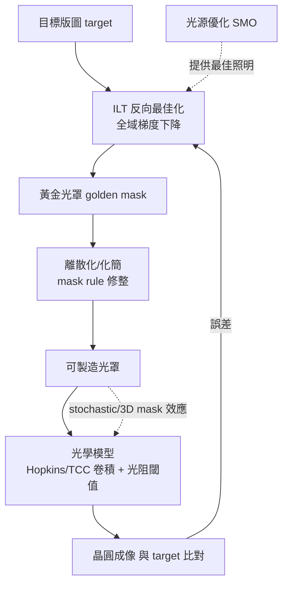

# 8.4 OPC 與 ILT：當微影的光波長追不上線寬

半導體製程有一個持續二十年的尷尬：微影（lithography）用的光源波長，遠大於要印的圖形尺寸。193 奈米的 ArF 準分子雷射（1990 年代商用，取代 248 奈米的 KrF）一路服役到 7 奈米節點，中間要印的關鍵尺寸卻從 250 奈米縮到 50 奈米以下——意味著我們長期在用波長的四分之一甚至更短的光去成像，靠的是浸潤式微影（immersion，2000 年代初由台灣出身的林本堅在台積電推動而普及，將 193 奈米縮短到等效 134 奈米）加上計算微影（computational lithography）硬撐。計算微影是 EDA 中數學密度最高的領域：它把光學成像的物理、數值最佳化與晶片版圖編織在一起，而 OPC（optical proximity correction，光學鄰近效應修正）與 ILT（inverse lithography technology，反向微影技術）就是這個領域的兩代主角。

## 為什麼會「印不像」：Hopkins 理論與部分同調

要修正，先要能預測。微影成像的數學基礎是 1940 年代英國物理學家 H. H. Hopkins 建立的部分同調成像理論：光罩上的圖形經照明系統（部分同調光源，可用光源點的機率分佈描述）、投影鏡頭（有限數值孔徑 NA，等價於空間頻域的低通濾波）與光阻（非線性閾值反應）三段處理後，最終在晶圓上形成的圖形與光罩圖形之間存在系統性偏差。空間頻域的觀點最直觀：投影鏡頭只能讓空間頻率 $`f \le NA/\lambda`$ 的成分通過，密集細線的高頻資訊被濾掉，結果是線端退縮（line-end pullback）、密集線變窄而孤立線變寬（iso-dense bias）、二維角落圓化。一維週期結構還可以靠改變照明（離軸照明 off-axis illumination，如 annular 與 quadrupole 光源）把繞射階次「搬」進鏡頭通帶，但任意二維版圖必須靠修改光罩圖形本身來補償——這就是 OPC：在光罩上加上比關鍵尺寸更小的輔助圖形（sub-resolution assist features, SRAF）、把線端加上錘頭（hammerhead）擴張、對轉角加斜角、對線寬做 bias 調整，使得最終印出來的圖形「回到」設計者想要的形狀。

## 規則式到模型式 OPC，與光罩資料量的爆炸

第一代 OPC（1990 年代中後期，代表工具包括 TransCast/Mentor 的 Calibre 系列前身與 Avant! 系工具）是規則式的：找到「孤立線」「密集線」「線端」等 pattern，套用預先算好的補償規則。它的問題是規則空間組合爆炸且不精確。第二代是模型式 OPC（model-based OPC，2000 年前後成熟）：把微影系統建模成線性不變濾波 + 閾值函數——光罩影像卷積 kernel（由 Hopkins 理論與部分同調的 TCC，transmission cross coefficient 展開得到）得到空中間影像（aerial image），經光阻模型閾值化得到抵抗輪廓（resist contour），再以最佳化迴圈調整光罩圖形讓抵抗輪廓貼合目標：

$$
\min_{\text{mask}} \sum_{\text{sample}} \left( \text{Edge}(\text{aerial}(\text{mask})) - \text{target} \right)^2, \quad \text{s.t. MEEF, mask rule constraints}
$$

實作上把光罩切成網格，每個格點決定「透光或不透光」（或灰階後量化），迭代中計算每個邊緣誤差對相鄰格點的梯度，做梯度下降式的移動。這個流程的計算量是可怕的：一片 45 奈米光罩有 $`10^{10}`$ 量級的網格點，而捲積核的作用範圍意味著每個邊的更新依賴鄰域。工業解法與 DRC 一脈相承：層次化（重複 cell 只算一次）、區域平行化、以及用 shot-count 與 mask rule 檢查收尾。真正的後果是經濟性的：OPC 之後，一片先進節點的 MEBES/單一圖層光罩資料從數十 GB 暴漲到數 TB，光罩寫入時間與光罩成本同步上升——一片 7 奈米晶片的全套光罩超過 1000 萬美元，OPC 與多重圖形（multi-patterning）直接推動了「光罩佔總設計成本三分之一」的時代。計算微影的算力需求也成為 NVIDIA GPU 進入 EDA 的前哨：2020 年前後，NVIDIA 與 ASML、Synopsys 合作把 OPC 的高斯求和搬上 GPU，速度提升 40 倍以上，這是算力產業與 EDA 產業融合的標誌性事件。

## 多重圖形：SP 與 SADP/SAQP 的幾何代數

當單次 193 奈米成像的解析度極限（ $`\frac{1}{2} \cdot \lambda/NA \approx 38`$ 奈米半間距，浸潤式極限約 38–40 奈米）被突破需求，產業選擇了用多張光罩分次曝光：SADP（self-aligned double patterning，自對準雙重圖形）用側壁沉積與蝕刻把間距減半，SAQP 再減半一次；LELE（litho-etch-litho-etch）則把圖形拆到兩張光罩。這對 EDA 的要求是新的圖形分解（decomposition）演算法——把一張版圖「著色」到兩三張光罩上，使得每張光罩上的圖形間距大於單次曝光極限，這本質上是一個圖著色問題（衝突圖的 2/3/4-coloring，衝突點之間連邊），NP-hard，工業解法以區域著色 + 相容性修補（merge、stitch、cut）為主，加上「顏色對齊顏色」的可製造性規則（color-to-color spacing）。多重圖形讓設計規則進一步惡化：一維的 SADP 把金屬層變成近乎固定的柵狀結構，設計者被「全柵化」（gridded layout）約束，這是 20 奈米之後標準單元結構趨於僵直的物理根源，也直接推動了 EUV 的呼聲。

## EUV 改變遊戲，ILT 與 ML 興起

13.5 奈米極紫外光（EUV）的發展史是一部設備產業的壟斷史：光源技術經歷 1980 年代美國國家實驗室（AT&T Bell Labs 與勞倫斯利佛摩的激光電漿研究）、1990 年代的 EUV LLC 財團（英特爾、摩托羅拉、AMD 聯合出資，集合 Sandia、勞倫斯利佛摩與勞倫斯柏克萊國家實驗室研發原型）到 1999 年被 ASML 收購整合，ASML 用二十餘年時間獨佔了 EUV 微影設備市場，如今是全球唯一能出貨 EUV 機台的公司，一台 High-NA EUV 超過 3.5 億美元。EUV 把波長縮短到 13.5 奈米、數值孔徑推到 0.33（High-NA 到 0.55），單次成像能力大增，但物理並沒有變簡單：EUV 光源功率有限（250–500W），光阻的 stochastic noise（光子散粒雜訊與化學隨機性）成為新型誤差源，3D 光罩效應（光罩上的斜坡吸收層與多層膜導致非線性成像）使得傳統的「薄光罩」模型失效，OPC 模型必須升級為嚴格電磁場求解（FDTD/RCWA）。這些都是 ILT 發展的背景。

ILT 的哲學是把問題反過來：與其「給定光罩，模擬成像，再修補」（前向問題），不如直接求解「什麼光罩能讓成像最接近目標」（逆向問題），把它寫成嚴格的非線性最佳化，用光學與光阻模型對整個光罩做全域梯度下降。學界的先聲是 1990 年代末 Numerical Technologies（成立於 1995 年，以相位偏移微移 mask 與 OPC 工具起家，2003 年被 Synopsys 收購）與 Yuri Granik 等人對反問題表述的探索；把它推進到嚴格全域最佳化並商業化的是 Luminescent Technologies（2002 年成立於美國加州），該公司將 ILT 表述為大規模非線性最佳化問題，於 2005 年前後發表 ILT 概念，並在 2010 年代與台積電、三星合作量產化。ILT 的好處是「更接近目標、process window 更大、更抗 random variation」，代價是光罩圖形被「碎形化」——彎曲的線條、無數小特徵，使光罩資料量再翻數倍，且對光罩寫入機（e-beam writer）的解析度要求更高。這逼出了新的折衷：以 ILT 為黃金解，再用離散化與化簡（如「ILT 監督下的 OPC」）把資料量壓回可製造範圍。

2020 年代，機器學習進入了這個領域，有兩條路線：一是把 ILT 本身改寫成神經網路問題——用卷積網路學習「目標版圖 → 光罩」的映射，訓練資料由傳統 ILT 生成，推理速度比迭代式 ILT 快數十倍，代表性工作包括 2018–2021 年間 ASML、Cadence、台積電與學界（如 NTU 與 NTHU 的團隊）發表的一系列 CNN-ILT 論文；二是用 ML 加速微影模型的關鍵計算（kernel 求和、光阻模型），NVIDIA 的 cuLitho（2023 年與 ASML、TSMC、Synopsys 合作發表）是這條路的代表。有趣的是，這是繼 OPC 之後 EDA 與設備產業第二次深度互相驅動：光刻機的每一代升級（浸潤→EUV→High-NA）都重新定義了計算微影的問題，而計算微影的演算法能力反過來延長了每代設備的壽命、推遲了對更短波長光源的需求——這個正回饋圈讓「計算」成為微影進步的第二引擎，也是 EDA 從「輔助工具」升格為「製造關鍵路徑」的最強證據。

## 結語

回顧這一章的四節，可以看見一條清晰的主線：物理驗證（DRC/LVS）管理的是「形狀」，寄生萃取管理的是「電」，等價性檢查管理的是「邏輯」，計算微影管理的是「光」。四者共同構成了從設計到晶圓的信任鏈，而每一環的演算法史都是「物理→數學→工程→產業結構」的四層翻譯。當我們在下一章回到設計流程的整體視角時，這條信任鏈將成為理解整個 EDA 產業經濟學的骨架。
