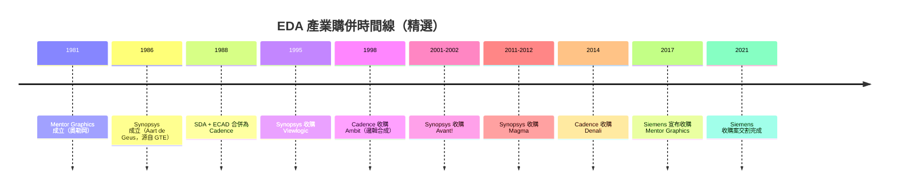

# 09.1 EDA 產業的寡占史：三十年購併與三巨頭的形成

## 一個「小而關鍵」的產業

電子設計自動化（Electronic Design Automation, EDA）是一個奇特的產業：全球市場規模不過一百多億美元，僅相當於一家中型半導體公司的年營收，但整個電子產業——從手機 SoC 到資料中心 GPU、從車用 MCU 到太空級 FPGA——都必須透過 EDA 工具才能把 RTL 程式碼變成可以送進晶圓廠的 GDSII 檔案。EDA 是半導體供應鏈上游的「起子與扳手」，市場小、毛利高、客戶黏性極強，而且先進製程的 signoff 幾乎只認少數幾家公司的工具結果。這種「戰略價值遠大於營收規模」的特性，正是它經過三十年購併後收斂成三巨頭的根本原因。

## 1980 年代：DA 公司的草創年代

EDA 的前身是「設計自動化」（Design Automation, DA），最早依附於 IBM、Bell Labs 等大公司內部的 CAD 部門，以及 CMU、Berkeley 的學術研究。1980 年代初，一群工程師看出 IC 設計即將爆發，紛紛出來創業：1981 年，Gary Bocock 等人在奧勒岡州 Beaverton 創立 Mentor Graphics，以研發 PC 板與 IC 設計工具起家；同期 Daisy Systems（位於 Mountain View）與 Valid Logic Systems（1981 年，San Jose）先後成立，並主打「 workstation + 軟體」的整機方案，這三家當時被稱為 DA 三劍客。Daisy 甚至在 1987 年一度成為成長最快的高科技公司，卻因封閉硬體平台在開放工作站浪潮下迅速崩落，1990 年代初被 Intergraph 收購。Daisy 與 Valid 的興衰說明了 EDA 產業的第一條鐵律：軟體價值終將與硬體綁架脫鉤。

真正定義現代 EDA 的兩家公司都在 1980 年代後半成型。1986 年，Aart de Geus 與多位同事離開 GTE Labs，在北卡 Research Triangle 創立 Synopsys（初名 Optimal Solutions），帶著在 GTE 累積的邏輯合成技術，於 1987 年推出 Design Compiler。邏輯合成本身並非 Synopsys 獨創——IBM 內部的 LSS（Logic Synthesis System）、Berkeley 的 MIS 都早有研究——但 Synopsys 是第一家把它做成商業產品、直接吃 RTL 並吐出閘級網表的公司。這一步把「工程師手畫電路圖」的工作流程整個替換掉，等於創造了一個全新的市場。1988 年，SDA Systems 與 ECAD 合併成立 Cadence Design Systems，把類比模擬、版圖編輯與最早的 place-and-route 整合起來；再透過 1989 年收購 Tangent（Tangate 布局繞線系統）拿到了 Gate Ensemble 與 Cell3，Cadence 成為 1990 年代初晶片實體設計工具的霸主。

## 1990 年代： consolidation 的第一波

進入 1990 年代，工具之間的資料格式與 design flow 縫合成本越來越高，客戶希望買「一條 flow」而不是二十家公司的單點工具，購併成為產業結構調整的主要機制。Synopsys 在 1995 年以約 2.4 億美元收購 Viewlogic 的系統業務，補上模擬與板級設計；Cadence 在 1998 年買下 Ambit Design Systems，取得 BuildGates 邏輯合成工具，正式對 Synopsys 的核心堡壘發起挑戰。物理驗證領域則整併出兩個重量級名字：Cadence 的 Dracula 與之後買進來的 Diva，以及 Mentor 的 Calibre。Calibre 在 1990 年代末逐漸成為 DRC/LVS 的事實標準，直到今天 signoff 物理驗證仍由 Calibre 主導——這說明單點工具若在關鍵節點形成壟斷性信賴，其壽命可以超過整條產品線的更迭。

## 2001 年：Avant! 事件與「整條 flow」的完成

1990 年代後半最關鍵的變數是 Avant! Corporation。Avant! 源自 1986 年成立的 Arcsys，創辦人包括從 Cadence 離職的工程師；1990 年代中後期爆發了著名的商業機密訴訟案——多名前 Cadence 員工被控將原始碼帶往 Arcsys/Avant!，Cadence 提起刑事告訴並勝訴，Avant! 高層多人入獄服刑，這是 EDA 史上最戲劇化的法律事件。但撇開訴訟不談，Avant! 的技術實力驚人：其 Apollo place-and-route 與 Milkyway 資料庫在深次微米時代被多家大廠視為超越 Cadence 的選擇。2001 年底，Synopsys 宣布以約 9.5 億美元股票收購 Avant!（2002 年完成交割），一舉獲得實體設計、物理驗證（Star-RC、Hercules）與 Milkyway 平台。這筆購併讓 Synopsys 從「合成公司」蛻變為「全 flow 公司」，Galaxy 平台直接對決 Cadence 的 SoC Encounter。同時期 Cadence 則在 2003 年經歷了著名的財務醜聞與重述報表風波，兩巨頭的氣勢在此消彼長。

## 2000 年代：Magma 的興衰——第四名為何活不下去

2000 年前後一度存在挑戰三巨頭的第四勢力。1997 年由前 Synopsys 工程師 Rajeev Madhavan 在加州創立的 Magma Design Automation，以「整合式 RTL-to-GDSII」概念推出 Blast Fusion，用統一的 timing-driven 資料模型打破點工具縫合，2001 年掛牌後市值一度衝上數十億美元，是 EDA 史上成長最快的新星。然而先進製程的 signoff 壁壘、大客戶的 flow 慣性，以及自身產品擴張失焦，讓 Magma 營收在 2008 年金融海嘯後掉入谷底；2011 年 Synopsys 展開敵意購併，2012 年初以約 5 億美元完成收購，Magma 的技術（如 fine-grain timing 分析）被吸收進 Synopsys 的 flow。Magma 的消失象徵 EDA 產業結構的封閉：signoff 認證需要晶圓廠多年的共同驗證，新進者幾乎不可能補足這段時間差。

## 2016-2021：三巨頭的最後一塊拼圖

Mentor Graphics 長期是第三名，Calibre 在物理驗證的地位難以撼動。2016 年 11 月，德國西門子宣布以 45 億美元收購 Mentor Graphics（2017 年完成），交易到 2021 年完成整合，成為 Siemens EDA（Siemens Digital Industries Software 下的 EDA 業務）。買方不是半導體公司而是工業巨頭，意義深遠：汽車電子、自駕與系統級驗證（模擬、嵌入式軟體、功能安全）成為 EDA 的新戰場。至此 Synopsys、Cadence、Siemens EDA 三巨頭格局底定，三家合計吃掉全球約七到八成市場。Cadence 在 2014 年收購 Denali（記憶體 IP 驗證）等動作則顯示三巨頭也持續向 IP 與系統設計延伸，以「工具 + IP + 服務」的複合模式提高客单價。

## 經濟結構：為什麼寡占如此穩固

EDA 的 TAM 小（全球約 150-200 億美元）、但相對於動輒上億美元的先進製程 NRE 與數十億美元的晶圓廠投資，工具費用微不足道；設計失敗一次的代價卻以千萬到億美元計，客戶因此極度風險趨避，只買「被驗證過」的工具。晶圓廠（台積電、三星、Intel）的 signoff 認證清單長期只含三家公司的工具，這是一種由製造端與設計端共同維護的制度性壁壘，而非單純技術領先。結果是：毛利率 80% 以上、訂閱制收入可預測、購併成為唯一的成長引擎。三十年來數百筆購併沒有創造出有效競爭，反而把每個子市場（合成、模擬、P&R、物理驗證、formal）都收斂成一或兩家的準壟斷。

## 地緣政治：EDA 成為戰略物資

2020 年代，EDA 的戰略價值被地緣政治正式「定價」。2022 年 10 月，美國商務部 BIS 發布出口管制新規，將先進製程（含 GAAFET）相關的 ECAD/EDA 軟體納入對中國的管制清單；2022 年 8 月已先禁止對中國供應 GAAFET 用 EDA。三星、台積電的先進節點對中國設計公司關閉，對應的 signoff 工具也一併斷供。中國則以華大九天（Empyrean，源自 1980 年代的熊貓系統）、概倫電子、芯華章等回應，並大力資助開源 EDA 作為繞道選項。EDA 從此不只是商業軟體，而是如同光刻機與先進製程一樣的戰略管制物資——這是 1980 年代 DA 創業先驅們未曾預料的歷史定位。

寡占帶來的高價與封閉，正是開源 EDA 運動的動機；下一節將看到，從 Berkeley 的學術工具到 OpenROAD，開源陣營如何一步步挑戰這個三十年不變的產業結構。
