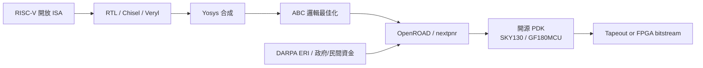

# 09.2 開源 EDA 的崛起：從 VTR、ABC 到 OpenROAD 與 RISC-V 生態

## 學術工具傳統：Berkeley 的基因

開源 EDA 並非新鮮事，它的基因來自大學實驗室長達四十年的工具傳統。Berkeley 是這個傳統的核心：1980 年代的邏輯化簡工具 Espresso（Richard Rudell、Alberto Sangiovanni-Vincentelli），成為後世所有合成器的基礎元件；其後的 SIS（Sequential Interactive Synthesis? 實為 Synthesis of Interactive? 通稱 sequential synthesis system）把兩層化簡擴展到多層與時序電路；版圖編輯器 Magic（1980 年代中，John Ousterhout 等人）則是第一代可自由散布的實體設計工具，其「corner stitching」資料結構至今仍被教科書引用。這些工具以學術授權流通，培養了整整一代 EDA 研發者——今天三巨頭的許多核心工程師，就是在 Berkeley 工具上寫出人生第一個 placement 的。

另一條重要的學術線是 FPGAs 與架構探索工具。多倫多大學（UToronto）與 Berkeley 合作的 VPR/VTR（Verilog to Routing，Jonathan Rose、Jason Luu 等人）提供了開放的 FPGA 布局繞線研究平台；Berkeley 的 ABC（Alan Mishchenko，2000 年代起）以 AIG（And-Inverter Graph）為核心資料結構，在邏輯最佳化與技術映射上至今仍是業界最快的研究工具，並被許多商業與開源合成器內嵌。這些工具的共同特徵是：演算法核心公開、工程化程度參差、缺少 signoff 級的物理驗證——它們證明了演算法可以被共享，但沒有回答「開源能否做出完整可用的 flow」。

## Yosys 與 nextpnr：個人英雄開啟的完整 flow

2013 年前後，德國工程師 Clifford Wolf 以個人專案形式發表了 Yosys，一個以 Verilog 前端加可擴充合成 pass 架構的開源合成器。Yosys 的關鍵設計是把合成過程拆成可腳本化、可插拔的中間表示（RTLIL），讓任何人都能寫自己的最佳化 pass 或 FPGA 架構後端。它先服務 iCE40 這類被 reverse engineering 出 bitstream 格式的小型 FPGA（IceStorm 專案同樣由 Wolf 主導），突然之間，工程師第一次可以用全開源工具鏈把 Verilog 燒進真實晶片。接著在 2017 年前後，Wolf 又與社群共同發起 nextpnr，一個支援多種 FPGA 架構的可移植開源 place-and-route，取代了 arachne-pnr；nextpnr 由 Clifford Wolf 主導架構並有社群（包含 David Shah 等主要貢獻者）共同開發，逐步支援 Lattice iCE40、ECP5，乃至後來的些許更大型元件。Yosys + nextpnr 證明了一件三巨頭不願承認的事：P&R 演算法的門檻沒有想像中高，「高到無法開源」的其實是先進製程 signoff，而非演算法本身。

## OpenROAD 與 DARPA 的制度性投入

把開源 EDA 從 FPGA 玩具推向 ASIC 真實戰場的，是美國國防部的制度性資金。2018 年，DARPA 啟動 Electronics Resurgence Initiative（ERI），其中 IDEA（Intelligent Design of Electronic Assets）與 POSH（Partially-Reconfigurable? 實為 Chiplets 內涵的自動化設計）等計畫明文要求工具自動化與開放流通；OpenROAD 由 UCSD 的 Andrew Kahng 與後續團隊承擔，目標是「RTL-to-GDSII in 24 hours, no human in the loop」。OpenROAD 的策略聰明之處在於不重造輪子：前端沿用 Yosys，邏輯最佳化接 ABC，實體設計則整合 Kahng 團隊多年研究的演算法——global placement（RePlAce 系的電流場方法）、詳細放置（TritonPlacer）、時鐘樹（TritonCTS）、繞線（TritonRoute），組成一條名為 OpenROAD-flow-scripts 的完整 flow。2020 年，Google 與 SkyWater Technology 宣布開源 SKY130 PDK（SKY130 是 SkyWater 代工的 130nm 製程，源自其收購的 Cypress fab），把「製程設計規則公開」這塊最後的拼圖補上；EFinity? 不——配套的 OpenLane（由 Efabless 的 Uri Shaked 等人推廣）讓任何人可以用 `make` 一鍵把設計送到真實流片，Efabless 的 Caravel/MPW 多專案晶圓 shuttle 更把流片成本壓到數百美元。

## RISC-V 生態與開源 EDA 的互相餵養

開源 EDA 之所以能形成「生態」而不只是「工具集」，關鍵在於 RISC-V。2010 年，Berkeley 的 Krste Asanovic 與 David Patterson 等人啟動 RISC-V 計畫，2014 年前後正式公開第五代 RISC ISA，並成立 RISC-V Foundation（2015，後改名 RISC-V International）。RISC-V 把「指令集」這一層開放，開源 EDA 把「設計工具」這一層開放，兩者形成完美互補：學生與新創用 Yosys/OpenROAD 設計 RISC-V 核心，RISC-V 核心的流行又反過來提供開源 flow 最好的測試載體與教學題材。Berkeley 自己的 Rocket、BOOM 核心，以及 SiFive 的商業化（2015 年創立），示範了「開放 ISA + 商業 IP + 開源工具」的三層結構如何在封閉 ISA 的夾縫中長出整個生態。流程反饋也真實發生：開源 flow 的大量使用暴露了工具缺陷，吸引更多貢獻者，這正是開源軟體三十年來熟悉的飛輪。

## 台灣與中國的動向，以及對教育與新創的意義

亞洲對開源 EDA 的投入近年快速升溫。台灣的國家晶片系統設計中心（CIC/NARLabs）長期提供學界 EDA 授權與 shuttle 服務，近年也開始關注開源 PDK 與教學流程；多所大學把 Yosys/OpenROAD/VTR 納入數位 IC 設計課程，因為這些工具讓學生「不必等授權就能開始」。中國在 2022 年出口管制之後，更把開源 EDA 視為戰略選項：開源之夏類型的資助、南京開源 EDA 實驗室（2023 年成立）、以及企業內部對 Yosys 系工具的投入都明顯加碼，但進展受限於先進製程 signoff 與 PDK 開源不可得——開源 EDA 能解放 130nm 級的設計自由，卻暫時碰不到 5nm 的戰場。

對教育而言，開源 EDA 的意義是革命性的：過去教 VLSI 課程只能用簡化玩具或受限授權，現在學生可以直接對真實 PDK 做完整設計到 GDSII 的練習，甚至流片。對新創而言，開源 flow 把進入成本降到接近零，使小團隊能在成熟製程上做出物聯網、類比混合訊號與 RISC-V 客製化晶片。但必須誠實地說：開源 EDA 目前無法替代三巨頭在先進節點的 signoff、時序分析精度與模擬能力，它改變的是「長尾」而非「塔尖」——然而正如 RISC-V 從教學指令集長成地緣政治議題，這條長尾的成長速度可能超出所有人預期。

開源 EDA 之外，三巨頭與 Google 都在找同一個答案：用機器學習讓設計自動化跳脫「人調參數」的瓶頸。下一節將進入 ML 進入 EDA 的論戰現場。
