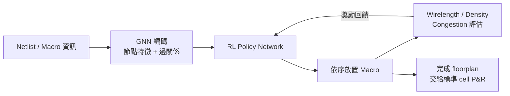

# 09.3 機器學習進入 EDA：Google 的 RL 擺放論戰與 GNN 預測

## 早期的 ANN 與學習式設計研究

機器學習進入 EDA 並非 2021 年才有的事。早在 1990 年代就有以類神經網路做組合最佳化與繞線預測的嘗試，2000 年代則有以 ANN 預測電路面積、功耗與 delay 的研究（如以 regression model 取代昂貴的 SPICE 模擬）。這些早期工作共同的困境是：訓練資料太少、特徵工程繁瑣、模型泛化能力差，難以跨製程與跨設計使用。EDA 主流方法論仍然是「人類設計演算法 + 啟發式參數調校」，機器學習停留在學術的邊緣。情況在 2010 年代後半改變：GNN（Graph Neural Networks）的成熟剛好對上 EDA 的本質——晶片是圖，網表是圖，placement 也是圖；而大公司累積了內部數萬顆晶片的設計資料，第一次讓「以資料規模換取演算法優勢」變得可行。

## Google 的 Nature 論文：RL 做 macro placement

2021 年 6 月，Google 在 Nature 發表論文《A graph placement methodology for fast chip design using reinforcement learning》，作者包括 Anna Goldie（Google Brain）與 Azalia Mirhoseini，資深作者為 Jeff Dean，並與 Google Tensor 處理器（後來的 Pixel 手機 SoC）團隊合作。論文宣稱：以深度強化學習（policy 由 GNN 編碼晶片狀態，以 PPO 類演算法訓練）進行 macro placement（大型區塊如 SRAM、IP 的 floorplanning），能在 6 小時內產出比人類 floorplanner 更好的布局，甚至「在數小時內超越人類耗時數週的成果」。論文以 TPU 設計為測試載體，並暗示此方法已用於 Google 自研晶片的實際設計，被媒體廣泛報導為「AI 自己設計晶片」的里程碑。同時期商業公司也快速跟進：Synopsys 的 DSO.ai（2020 年發表）以 RL 在搜尋空間中調校 place-and-route 參數，宣稱能提升 PPA 並大幅減少工程師 tuning 時間；Cadence 於 2021 年推出 Cerebrus，同樣以 ML 驅動的參數搜尋自動化其 flow。三巨頭的產品化路線很一致：ML 不是取代演算法，而是「tune 演算法的演算法」。

## 論戰：Kahng 與 UCSD 的重現與質疑

2022 年起，這篇論文遭遇學界系統性的檢驗。UCSD 的 Andrew Kahng 團隊（含 Igor Markov 等研究者，Markov 後來更成為最激烈的批評者）發表系列論文，指出原論文的可比性存在重大問題：RL 方法與人類工程師的比較使用了不同約束條件、不同的前置處理（例如 pre-placed hard macros 的程度不同）、以及對 baseline 的設置不盡公平；更關鍵的是，在相同條件下，傳統的 simulated annealing 或商業工具搭配簡單 heuristics，可以達到與 RL 相當甚至更好的結果，而 RL 需要先以「教師」資料（來自人類或商業工具的 placement）做預訓練。Kahng 團隊以開源 RePlAce 與自己的評估框架重現了實驗，2023 年的後續論文更直接指出 Nature 論文的結論在公平比較下不成立，並推動了關於 reproducibility 與 benchmark 公平性的公開辯論；Nature 論文也經歷了修訂，補充說明（加註與更正）承認部分表述需要釐清，但未撤稿。這場論戰的意義超出論文本身：它暴露了 ML 論文進入工程領域時的「評估政治學」——baseline 怎麼設、約束怎麼給、什麼叫「打敗人類」，每一個選擇都可以讓結論天差地遠。對 EDA 研究者而言，這是一堂寶貴的課：工程領域的 reproducibility 標準必須比 ML 會議更嚴格，因為晶片是要流片的。

## GNN 預測：比取代更有說服力的路線

論戰的另一面是：GNN 做「預測」這條路線的成果穩健得多。典型的應用包括：在 placement 完成前預測 routing congestion（避免繞線器擁塞導致的 iteration）、預測 IR drop（電壓降熱點）與 dynamic power density 熱點、預測 timing 違例的位置、以及點雲式的 DRC hotspot 辨識（與其說是 GNN，更常見的是以 CNN/GNN 混合的 hot spot classifier，如 Cadence 與學界合作的工作）。這些預測模型讓工程師在設計早期「繞線前就知道哪裡會爆」，把原本需要跑一整夜 P&R 才能得到的回饋縮短到秒級，等於壓縮了 design iteration 的循環時間。這條路線之所以成功，是因為它尊重既有演算法的地位：模型不做決策，只做「便宜的代理模擬」（surrogate model），決策仍由成熟的 P&R 演算法執行。

## 辯證：ML 是取代演算法，還是 tune 演算法？

回到產業結構層面，目前的事實是：三巨頭商業化產品（DSO.ai、Cerebrus、Siemens 的 Solido ML 系列做變異分析）走的都是「ML 調參 / ML 加速模擬」路線，而非「ML 直接做 placement」。原因有三。第一，晶片設計的可驗證性要求極高，RL policy 的隨機性與不可解釋性在 signoff 流程中是負資產。第二，商業工具的演算法已高度成熟，RL 的搜尋空間若被正確定義，只是在既有的演算法空間中找參數，增益有上限；Google 論文試圖跳過這個限制直接學 policy，結果就是遭遇了評估方法的反噬。第三，訓練資料的取得成本極高且深度綁定公司內部設計，難以形成開放 benchmark，這使得 ML-in-EDA 的學術進展緩慢而碎片化。比較務實的共識正在形成：ML 的最大價值在於縮短 iteration、在於 surrogate model、在於把工程師的 tuning 經驗編碼化；完全自動化設計（no human in the loop）仍是 OpenROAD 與 DARPA 的願景，而非今天的現實。有趣的是，這場論戰也證明了一件事：當新方法宣稱超越既有方法時，開源與可重現的比較框架才是唯一的裁判——這正是 OpenROAD 與學術社群正在建立的基礎設施。

ML 讓設計演算法更聰明，但它仍在 2D 的平面佈局上打轉。當產業走向 chiplet 與 3D 堆疊，空間本身的維度改變了，下一節將看到 placement 問題如何被重新發明。
