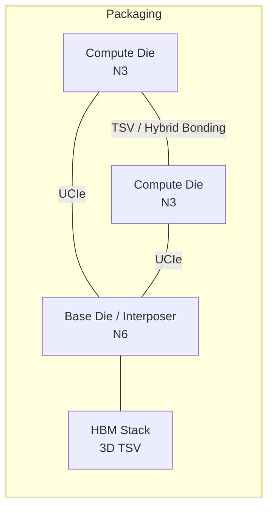

# 09.4 Chiplet 與 3D-IC：切割、熱傳導與堆疊擺放的新問題

## Dennard Scaling 終結與摩爾定律的經濟學轉折

要理解 chiplet，必須先理解兩個「終結」。第一個是 Dennard scaling 的終結：1974 年由 IBM 的 Robert Dennard 提出的縮放定律保證電晶體縮小時功耗密度不變，但約 2005-2007 年間，漏電流與電壓極限使這條定律失效，晶片無法再靠製程縮小同時變快又省電——多核心與暗矽（dark silicon）時代於是開啟。第二個是摩爾定律的經濟學轉折：28nm 之後，先進製程的晶圓成本、光罩組數與 IP/驗證的 NRE 指數級上升，一顆 5nm SoC 的總設計成本達數億美元，3nm 更高；單一 die 若整合所有功能，良率隨面積急遽下降（yield 與面積呈指數劣化），而且不同 IP 適合不同製程（邏輯要 3nm、SRAM 可以 28nm? 實務上 SRAM 縮放已幾乎停滯、類比與 RF 則偏好成熟製程）。當「把所有東西放進一顆大 die」在經濟上不再合理，把大 die 切成多個小 die 再互連的 chiplet 路線就從異端變成主流。

## AMD EPYC 的成功示範與 UCIe 標準

系統性的示範來自 AMD。2017 年推出的第一代 EPYC（Naples）開始採用多 die 封裝，2019 年的 Rome（第二代）正式確立 chiplet 架構：8 顆 7nm CCD（core complex die）+ 1 顆 12nm IOD（I/O die），以 AMD 自研的 Infinity Fabric 在封裝內互連。這個架構讓 AMD 以成熟、良率高的設計快速堆疊出 64 核產品，同時降低單一 die 的良率風險，是 AMD 在伺服器市場反超 Intel 的技術基礎。蘋果的 M 系列 Ultra 則以兩顆 die 的 Silicon Interconnect（本質上是極大面積的 2.5D 堆疊）展示另一種路線。2022 年 3 月，Intel 聯合 AMD、Arm、台積電、三星、微軟、Meta、Google、高通等成立 Universal Chiplet Interconnect Express（UCIe）聯盟，發布 UCIe 1.0 規範，為 die-to-die 介面定義物理層（含 bump pitch、die 佈局）、協議層（直接映射 PCIe/CXL）與軟體模型。這是 die 界面的「PCIe 時刻」：過去每家廠用私有互連（AMD 的 Infinity Fabric、Intel 的 EMIB/AIB、Marvell 的 SerDes），UCIe 使「向不同供應商購買 die 並在同一封裝組裝」的制度條件成立，等於為 chiplet 建立了供應鏈的合約標準。台積電的 CoWoS（2.5D，矽中介層）、InFO（扇出型封裝）與 SoIC（3D，hybrid bonding）則提供了製造端的製程選項；TSV（through-silicon via）讓 die 之間垂直通電，hybrid bonding 則把互連密度推到每平方毫米數百萬個接點，bandwidth 密度遠超任何封裝級 SerDes。

## EDA 的新問題：維度改變，演算法重新發明

Chiplet 對 EDA 的衝擊不是「又一個新工具」，而是核心演算法的前提被改變。傳統 placement 在 2D 平面上做二次線長最小化（ $`\min \sum_{i,j} w_{ij}\lVert x_i-x_j\rVert^2`$ ），配合電場式或非線性最佳化求解；3D 堆疊把放置空間擴展為多層 die，演算法必須同時處理層內與層間的線長（層間以 TSV 或 microbump 連接，成本與 2D 繞線完全不同量級）、每層的供电網域、以及垂直方向的熱耦合。熱傳導成為一等公民問題：stack 中下層 die 的熱必須穿過上層才能散出，熱阻與堆疊順序密切相關，「熱感知的 floorplanning」（thermal-aware floorplanning）從選配變成必需，EDA 工具必須在 placement 階段就耦合電熱聯合模擬。跨 die 時序簽核則是另一個深水區：die 邊界上的 path 跨越不同的製程角、不同的電壓域與封裝寄生，傳統 STA 假設單一 die 單一 corner 的模型不再成立，必須引入 die-to-die 的介面模型與多 die 聯合的 signoff flow。D2D 繞線（含 bump 規劃、RDL 佈線、中介層 routing）則催生了新的工具類別。這些問題的共同特徵是「系統級的耦合」：原本可以在單一 die 內局部化求解的問題，現在跨 die、跨製程、跨供應商，EDA 工具必須從「平面幾何的處理者」升級為「多物理場、多 die 系統的協調者」。

## 系統公司自研與 EDA 需求的形變

需求端也在改變。蘋果自研 A/M 系列、Google 自研 TPU 與 Tensor、Tesla 自研 FSD 晶片、AWS 有 Graviton 與 Trainium——系統公司成為先進製程最大的客戶群。這些公司沒有傳統 IDM 的晶片設計組織慣性，卻有軟體公司的自動化文化，它們對 EDA 的需求有三個新特徵。第一，更強的自動化與 API 化：軟體公司期待 EDA 工具像 CI 系統一樣可程式化、可大規模平行執行，而非依賴資深工程師的經驗調參——這正好與 9.3 的 ML 自動化趨勢合流。第二，chiplet 的「設計彈性」需求：系統公司希望能夠組合自家 die 與第三方 die（記憶體、類比、特定加速器），需要支援 UCIe 的整合設計環境與 die 級的 IP 交易市場。第三，跨層最佳化：從軟體到封裝的 co-design，讓「演算法—架構—電路—封裝」四層同時最佳化，EDA 工具必須提供跨層的建模能力。台灣在這波變革中的角色微妙：台積電掌握了 CoWoS/SoIC 的製造主導權，聯發科與世芯（Alchip）、創意（GUC）等設計服務公司則承接 chiplet 設計服務，EDA 三巨頭也紛紛在台設立 3D-IC 相關的研發資源。

## 回望與前瞻：演算法的重新適用

有趣的是，本書前面章節討論的許多演算法在 3D 時代獲得第二生命：graph-based placement 在多層 die 上需要重新定義距離與成本模型；partitioning（如 Kernighan-Lin/Fiduccia-Mattheyses 的改良版）從「切割晶片內部」變成「決定 die 邊界」的核心工具；熱傳導的數值方法（有限差分/熱阻網路）重新成為 floorplanning 的組成部分；而 9.2 的開源 EDA 也已經出現針對 2.5D 封裝的早期探索。歷史的弔詭在於：EDA 產業用三十年把設計問題壓縮成「單 die 的點工具」解決方案，chiplet 又把問題還原為「系統級的耦合」——這既可能是三巨頭的護城河（多 die signoff 更複雜、更依賴認證），也可能是開源與新創的機會（UCIe 標準化降低了介面層的封閉性）。Dennard scaling 終結讓演算法從「跟著製程縮小」轉向「跟著空間維度擴展」，下一個三十年，EDA 演算法史的舞台，將在垂直方向展開。
