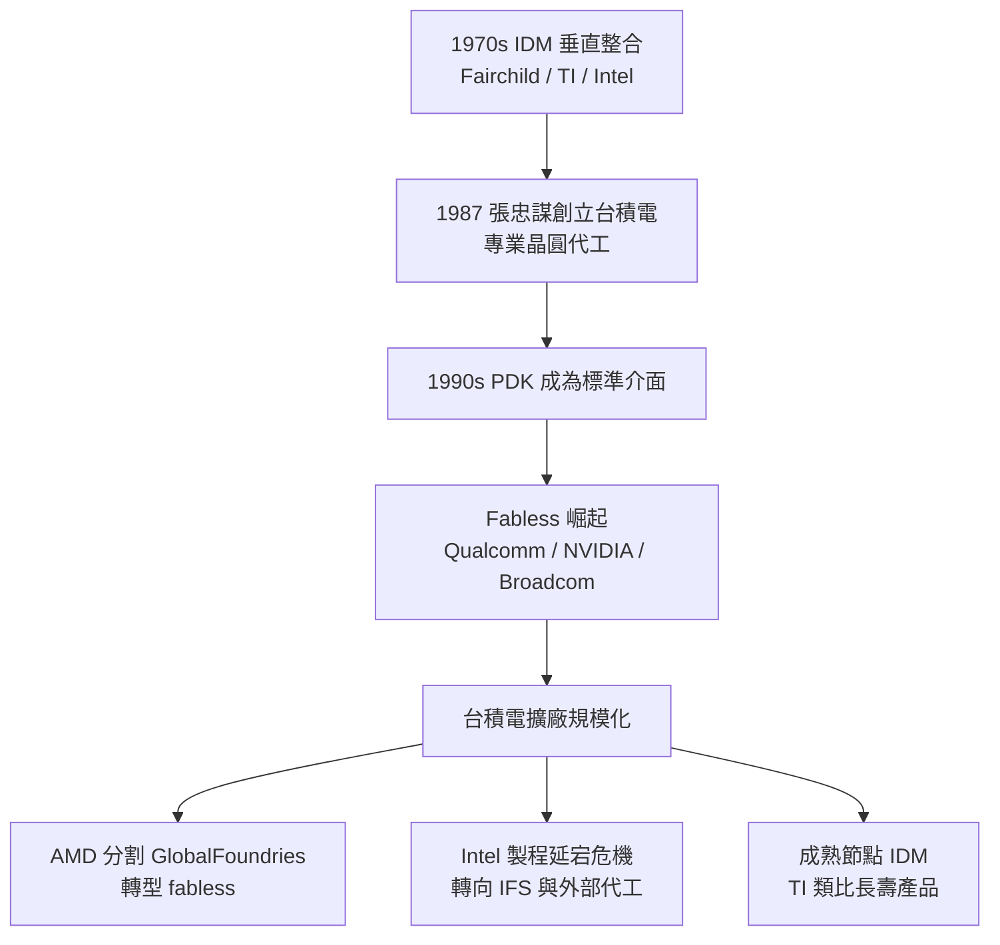

# 1.3 Fabless 與 Foundry 分工：晶圓廠模式的制度革命

半導體產業最初六十年，幾乎所有公司都遵循同一種商業模式：IDM（Integrated Device Manufacturer，整合元件製造廠）。從 Fairchild、TI、Motorola 到 Intel，這些公司一手設計晶片、一手擁有並經營自己的晶圓廠，設計與製造在組織內部垂直整合。這在 1970 年代是合理的：製程與設計的知識邊界還沒有那麼清楚，誰掌握晶圓廠誰就掌握產品節奏，Intel 靠著領先的製程在 DRAM 與微處理器市場長期稱霸。

但這種模式有一個內在矛盾：晶圓廠的產能是固定成本，而產品的生命週期與市場需求卻劇烈波動。當晶圓廠產能過剩，昂貴的機台就在折舊；當產能不足，訂單又被排擠。每一家 IDM 都在這個兩難裡掙扎，而整個產業的資源因此被大量重複投資在數十座彼此競爭的晶圓廠上。

## 張忠謀與 1987 年的賭注

張忠謀（Morris Chang）對這個矛盾有切身之痛。他出身 Texas Instruments，一路做到集團資深副總裁，主管全球半導體業務，親眼看過 IDM 模式的巅峰與其結構性弱點——他在 TI 任內就目睹過因產能決策失誤造成的損失。1985 年，他受中華民國政府之邀出任工業技術研究院院長，兩年後，1987 年，他在新竹科學園區創立台灣積體電路製造公司（TSMC）。

台積電的模式在當時聽起來近乎荒謬：這家公司不做自己的產品，只替別人製造晶片。它把晶圓廠當成「代工廠」（foundry），客戶帶著自己的設計來，台積電負責把它變成真的晶片，不問這顆晶片會賣給誰。當時 Intel、TI 等 IDM 龍頭普遍認為，客戶不會把寶貴的設計交給一家可能竊取機密、且製程技術落後的公司。

張忠謀賭的是三件事。第一，設計與製造的知識邊界已經足夠清楚，可以分開經營——這靠的是 PDK 的發明（詳見下一節），晶圓廠把製程規則打包成標準介面，設計者不需要知道製程細節也能設計。第二，市場上存在一群「有設計能力、沒有晶圓廠」的潛在客戶——當時的 ASIC 公司與新創，正被 IDM 不願接小單的現實卡住。第三，也是最少人相信的一件事：產能不該是設計者的瓶頸，而應該是像水電一樣可購買的公共財。

這個賭注最初靠政府資源與飛利浦（Philips）的技術轉移與持股撐過草創期，前幾年虧損連連。真正的轉折出現在 1990 年代個人電腦與後來手機的爆發：一批純設計公司（fabless）如雨後春筍，它們的訂單只能流向台積電，而台積電隨著客戶成長不斷擴廠，形成了今天被稱為「專業晶圓代工」（pure-play foundry）的產業生態。

## Fabless 的崛起：一種新的公司形態

專業代工的出現，直接催生了一種此前不可能存在的公司形態：fabless——設計與銷售晶片、但不擁有任何晶圓廠。1994 年成立的 Qualcomm（更早的無線部門自 1985 年起）、1993 年的 NVIDIA、1961 年成立但 1990 年代轉向 fabless 的 Broadcom，以及後來的 Marvell、MediaTek，都屬於這個陣營。它們的共同點是：把全部資源投入設計與市場，把製造外包，資本效率遠高於 IDM。

fabless 模式的經濟優勢極為明顯。一座 5nm 晶圓廠造價超過兩百億美元，且每年設備折舊吃掉龐大現金流；fabless 公司用同樣的資本可以養幾千名工程師、投資幾個產品線，錯誤的成本是一顆 mask，而不是一座工廠。這讓晶片創業的門檻從「數十億美元資本」降到「數千萬美元與一個好想法」，是矽谷 1990 年代之後半導體新創持續湧現的制度基礎。今天全球前二十大半導體公司中，fabless 與無廠設計的比重持續上升，NVIDIA 在 AI 世代的爆發性成長，正是這個模式四十年的總收割。

## IDM 的命運：分化與退場

並非所有 IDM 都走向同一結局，產業呈現出三種分化。第一種是徹底轉型：AMD 在 2009 年將晶圓廠分割成 GlobalFoundries，自己成為 fabless，這個「減重」決定被普遍視為它後來能在先進節點追上 Intel 的關鍵。第二種是雙軌並行：部分 IDM 在自有產品之餘也開放代工產能，但多數在「優先供貨給自家產品」與「服務外部客戶」之間難以取捨，代工事業往往做不大。第三種是繼續垂直整合：Intel 是最著名的例子，它長期相信「製程領先＝產品領先」的因果鏈，但 2010 年代後期其 10nm 製程延宕數年，而產品在無法即時取得自家先進製程時，卻缺乏像 fabless 那樣「隨時改用台積電」的彈性，導致 2020 年代初的市占與股價危機，最終 Intel 也被迫推出代工服務（IFS）並採用台積電的部分先進製程。TI 則走了另一條路：它集中在 28nm 以上的成熟節點，靠自有晶圓廠的長壽命產品與成本優勢在類比與電源市場穩定獲利——這說明 IDM 並非必然失敗，失敗的是「在先進節點硬扛」的 IDM。

這段歷史的制度教訓是：沒有一種商業模式永遠正確，正確的模式取決於你所處的技術曲線位置與資本結構。摩爾定律早期的「製程即王道」成就了 IDM，製程成本指數化之後的「設計即王道」成就了 fabless，兩者的消長是同一條成本曲線在不同階段的投影。

## 地緣政治與新的集中風險

分工模式解決了資本效率問題，卻製造了新的風險結構：當全球最先進的邏輯製程集中在台灣一地，晶片就從商品變成戰略物資。2010 年代末美中科技戰開打，2020 年起的全球晶片荒讓汽車業停產損失數千億美元，各國政府驚覺「設計與製造分工」的效率奇蹟，同時也是單點故障的奇蹟。於是美國通過 CHIPS and Science Act（2022 年，撥款五百二十七億美元補助半導體製造），歐盟推出 European Chips Act，日本、印度相繼以補貼吸引建廠，台積電被迫在亞利桑那、熊本、德勒斯登設廠。這波「再平衡」的代價極高——在美國建廠的成本比台灣高出三到五成——但它說明了一件事：當年張忠謀用市場邏輯拆解的垂直整合，三十年後正被政治邏輯部分重組。

有趣的是，這場再平衡並沒有回到 IDM 模式，而是出現了新的混合形態：各國爭取的是「代工的產能」，而不是「自家的 IDM」。這反過來印證了 1987 年那場制度革命的深度——純代工已經成為產業的預設座標系，連政治力量都只能在其框架內運作。

## 對設計者而言的意義

回到本書的視角：Fabless/Foundry 分工對個別工程師意味著什麼？意味著「做晶片」從一種需要擁有工廠的特權，變成一種可以像寫軟體一樣獨立完成的活動——只要你拿得到晶圓廠的 PDK、買得起 EDA 工具。過去這兩樣仍是高牆：PDK 簽保密合約才能取得，EDA 授權一席數十萬美元。但近年風向改變：台積電透過 Open Innovation Platform 降低生態進入門檻，開源 PDK（如 SkyWater sky130）與開源 EDA（如 OpenROAD）的興起，正在把 fabless 革命推向下一階段——「人人可設計晶片」。本書後半介紹的 veryl2chip 工具鏈，正是站在這條延伸線上。

制度的革命分兩次發生：第一次把製造從設計中拆出來，第二次正在把工具與製程知識從少數公司手中解放出來。下一節，我們來看這兩次革命共同的核心發明：PDK。
