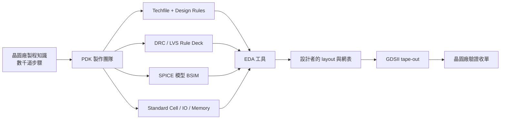

# 1.4 PDK：把一座晶圓廠裝進一個資料夾

上一節我們看到，1987 年台積電的專業代工模式，把「設計」與「製造」在制度上拆成兩家公司。但這個拆分在技術上要能成立，必須先回答一個問題：設計公司看不到晶圓廠的機台、不知道製程配方、沒有工程師進無塵室，那麼它怎麼可能設計出一顆「在這座工廠裡做得出來」的晶片？

答案是整個半導體產業最被低估的一項發明：PDK，Process Design Kit，製程設計套件。它名義上是一個「資料夾」，實際上是一座晶圓廠全部設計相關知識的總結與編譯產物。沒有 PDK，fabless 模式就只是空想；有了 PDK，遠在新竹或新店的設計團隊，可以放心地設計一顆將在台南十八廠以 5nm 製造的晶片，而不需要見過那座工廠的任何一台機器。

## PDK 裡面到底有什麼

一個完整的 PDK，是把晶圓廠數千道製程步驟的物理結果，翻譯成設計者可以使用的抽象層。它的核心組成包括以下幾類檔案，每一類都對應一座真實晶圓廠的某個面向。

第一是 process design rules（PDR）與 techfile。這是一份數萬條規則的清單：金屬最小線寬、線與線最小間距、via 的尺寸與包覆（enclosure）要求、閘極與活動區的最小重疊、天線效應限制、金屬密度上下限。這些數字不是憑空制定的，每一條背後都是光學解析度、蝕刻偏差、電致遷移或良率的實測統計。techfile 則把這些規則編譯成 EDA 工具（DRC、layout 編輯器、佈局繞線工具）可以直接讀取的格式，並定義每一層的幾何與電性參數。

第二是 DRC/LVS rule deck。DRC（Design Rule Check）逐條檢查 layout 幾何是否符合上述設計規則；LVS（Layout Versus Schematic）比對 layout 抽取出來的電路與原始電路圖是否一致。這兩套 rule deck 是設計與製造之間的契約執行者——違反任何一條，晶圓廠有權拒收 GDSII 檔。tape-out 前的 DRC clean，是所有晶片專案的必經儀式。

第三是 SPICE device models。設計者需要在不實際製造的情況下預測電晶體的電流行為，這靠的是 SPICE 模型：以 BSIM 系列模型（BSIM4、BSIM-CMG 等由 UC Berkeley 開發的業界標準）為骨架，晶圓廠用量測數據擬合出數百個參數，涵蓋不同尺寸、溫度、電壓、製程偏移（process corner：SS、TT、FF 等）下的元件行為。沒有這些模型，類比與時序設計都無從下手。

第四是 standard cell library（標準元件庫）。這是數位設計的核心：晶圓廠或 IP 供應商預先把 NAND、NOR、正反器、多工器等數百種基本邏輯單元，以該製程手工優化佈局並完成特徵化（characterization），提供每個 cell 在不同負載與 slew 下的延遲、功耗資料（.lib 檔）。合成與佈局繞線工具只操作這些 cell，設計者從不接觸電晶體層級。這個抽象層，正是 Lynn Conway 方法論「設計者不需要懂製程」理念的具體化。

第五是 IO library 與 memory compiler。IO 庫提供焊墊驅動器、ESD 保護電路，處理晶片與外部世界的介面；memory compiler 則能依使用者指定的容量與配置，自動生成 SRAM 巨集，因為記憶體佈局高度規則、適合程式化生成。這兩者加上標準元件庫，構成數位設計的全部「積木」。

此外通常還有 analog/RF 元件模型、寄生參數抽取（PEX）的 rule deck、以及文件與範例設計。

## 作為契約的 PDK

PDK 的深層意義不只是技術檔案，而是一份「契約」。設計者簽下它，等於承諾遵守晶圓廠的規則；晶圓廠發布它，等於擔保「遵守這些規則的設計，我保證做得出來」。這是一種法律與技術的雙重契約，因此 PDK 的取得從來不是單純的下載行為：設計公司必須與晶圓廠簽訂保密合約（NDA），有時還需通過稽核，確認其智慧財產管理能力足以防止製程機密外洩。PDK 內含的 SPICE 模型參數，本身就是晶圓廠最核心的商業機密之一——從這些參數可以反推製程能力，因此晶圓廠只把 PDK 交給簽約客戶，並用授權碼與版本控管追蹤每一份 PDK 的去向。

這種契約結構也解釋了為什麼 EDA、IP 與 PDK 必須三方事先整合。設計公司買了 IP，IP 必須在特定 PDK 上完成驗證；EDA 工具必須能讀特定版本的 PDK 格式。台積電在 2008 年成立的 Open Innovation Platform（OIP），把數百家 EDA 與 IP 夥伴納入統一的認證框架，本質上是把這種三方整合「制度化、目錄化」，讓設計公司可以像點菜一樣組合生態系中的零件。這是 1980 年代「每家 IDM 自帶工具鏈」時代的設計者難以想像的分工精細度。

## 版本、收斂與 tape-out 的儀式

PDK 是活的文件。晶圓廠會隨良率學習持續修訂設計規則與模型，推出 x.1、x.2 版本；設計專案進行中若 PDK 改版，可能需要重跑大半驗證流程，因此「PDK freeze」（凍結版本）是專案時程的關鍵里程碑。tape-out 時，設計者提交 GDSII，晶圓廠會用自己內部（通常更嚴格）的 rule deck 再驗證一次，通過才算正式收單。這個往返過程，正是「契約」在實務上的執行。

## 開源 PDK：把契約變成公共財

過去四十年，PDK 的高牆把晶片設計隔絕在簽約公司之外。這個牆在 2020 年前後出現了裂縫。SkyWater Technology 與 Google 合作，於 2020 年將其 130nm 製程以 sky130 為名開源，任何人都可以在 GitHub 上取得完整的 design rules、SPICE 模型與標準元件庫，並透過 efabless 平台（該平台後於 2025 年停止營運，但其生態影響已經擴散）把設計真正送上晶圓。同一時期，ARM 與美國國家實驗室體系推動的 ASAP7，提供了 7nm 節點的學術用開源 PDK，供教學與研究，雖不能實際流片，卻讓先進節點的佈局與 EDA 演算法研究不再需要簽 NDA。

開源 PDK 的意義遠超「免費」。它第一次讓晶片設計可以完整地走過「寫 RTL → 模擬 → 合成 → 佈局 → DRC/LVS → GDSII」的流程，而不需要任何商業授權。這正是大學 VLSI 教育與開源 EDA 運動（OpenROAD、OpenLane 等）能蓬勃發展的物質基礎——就像當年 Mead-Conway 教科書把 VLSI 知識帶進大學一樣，sky130 把「流片的權利」帶進了大學。本書介紹的 veryl2chip 工具鏈即是建立在此類開放生態之上：以開源 PDK 為目標製程，以輕量工具鏈完成從 Veryl 硬體描述語言到 GDSII 的完整路徑。

當然，開源 PDK 也有其限制：130nm 是二十多年前的製程，無法表現當代先進製程的物理效應；sky130 的設計規則與模型也不如商業 PDK 精細。但作為「教學契約」，它的價值不可取代——它讓學生與獨立開發者在簽下第一份商業 NDA 之前，就能完整理解 PDK 的結構與整個設計流程的物理意涵。

## 小結：資料夾裡的產業史

回顧這一章的路徑：從矽砂到晶圓（物理），從摩爾定律到設計成本危機（經濟），從 IDM 到 Fabless/Foundry（制度），最後落到 PDK——一個把製造知識壓縮成資料夾的介面發明（知識的封裝）。這條路徑呈現了半導體產業最迷人的特質：每一次抽象層的建立，都對應一次產業結構的重組。晶体管抽象出標準元件庫，催生了合成工具；製程抽象出 PDK，催生了 fabless 模式；下一次抽象正在發生——開源 PDK 與開源 EDA 正在把設計能力從公司層級下放到個人層級。歷史不會重複，但結構會押韻：當抽象層降低門檻，就會有新一波創作者湧入，而這正是本書其餘章節要帶你走進的世界。
