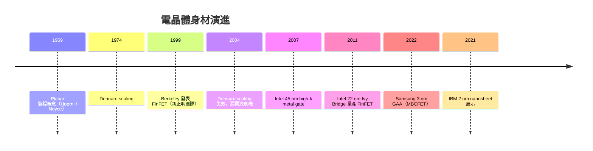

# 2.1 電晶體的三代身材：Planar、FinFET 與 GAA

要理解半導體產業過去六十年為什麼能以近乎宗教般的熱情追逐 Moore's Law，必須先理解一個看似單純的物理問題：MOSFET 的閘極（gate）如何有效地控制通道裡的電流。這個問題決定了電晶體的「身材」，而身材的每一次換代，都伴隨著一整個產業的震盪與重分配。

## Planar 時代：平面工藝的黃金六十年

1959 年，Fairchild 的 Jean Hoerni 提出平面製程（planar process）的想法：讓氧化層保護矽表面，再在其上形成電極。這個概念配合同年 Atalla 與 Kahng 在 Bell Labs 展示的 MOS 結構，奠定了此後所有積體電路的基礎。Robert Noyce 的積體電路專利正是建立在平面製程之上——元件做在同一片矽的表面，用金屬連起來，這在當年是革命性的簡化。

Planar MOSFET 的本質是：一個平板電容器。閘極壓在薄薄的閘氧化層上，底下是源極與汲極之間的通道。這個結構好製造、好理解、好建模——事實上整個 EDA 產業的第一代 SPICE 模型都是圍繞著它建立的。1960 年代末到 2010 年代初，業界靠著不斷縮小平面元件的尺寸，將特徵尺寸從十微米推進到二十奈米量級。

驅動這場縮小浪潮的理論基礎，是 1974 年 IBM 的 Robert Dennard 提出的 Dennard scaling。它的核心主張優雅而強大：當所有尺寸等比例縮小，電壓也跟著降低，於是功率密度保持不變——電晶體變小變快，晶片卻不會變得更熱。這是 Moore's Law 的「經濟學基礎」：每一代製程，同樣面積塞進兩倍電晶體，功耗卻不必增加。整個 1980 與 1990 年代，CPU 時脈從幾 MHz 衝上幾 GHz，靠的就是這張空頭支票。

## 支票跳票：短通道效應與漏電流危機

但 Dennard scaling 有個隱含前提：閘極必須能完全控制通道。當通道長度縮到數十奈米以下，這個前提開始崩壞。源極與汲極的電場開始「越區辦公」，直接穿透進通道區，削弱閘極的話語權——這就是短通道效應（short-channel effect）。具體症狀包括：臨界電壓下降、汲極引致能障降低（DIBL）、以及最致命的次臨界漏電流（subthreshold leakage）暴增。

漏電流不是學術上的小瑕疵，而是實打實的商業災難。2000 年代初，Intel 的 Prescott（90 nm，2004 年）因漏電過高而功耗失控，時脈衝刺計畫被迫放棄，轉向多核心路線——這個轉向重塑了此後二十年的電腦架構史。業界用盡各種手段延命：提高通道摻雜濃度抑制穿隧、加入 halo/pocket implant、縮薄閘氧化層到只剩幾個原子層——但摻雜越重，摻雜原子的統計漲落（random dopant fluctuation）越嚴重，元件對電晶體的變異性反而惡化。平面結構已經被逼到物理的牆角。

## FinFET：把通道立起來

解法的思路其實在 1990 年代就成形：既然閘極從上面控制平面通道控制得不好，那就讓通道「被閘極三面包夾」。1999 年，UC Berkeley 的胡正明（Chenming Hu）團隊——包括 T-J King Liu 與 Jeffrey Bokor 等人——發表了 FinFET（同時期的版本稱 DeltaFET、UTB-SOI 等）。把通道做成一片直立的「鰭」（fin），閘極像手掌包住鰭的兩側與頂部，閘極對通道的電容性控制大幅增強，短通道效應被有效壓制，漏電流下降一到兩個數量級。

 FinFET 真正的歷史時刻是 2011 年：Intel 在 22 nm 節點的 Ivy Bridge 量產 FinFET，這是第一個量產的三維電晶體。之後 TSMC 於 16 nm（2015 年量產）、Samsung 於 14 nm 相繼跟進。這次的轉換代價空前：晶圓代工廠要重新開發整個蝕刻與應力工程，EDA 公司要重寫所有模型與設計規則，IC 設計公司要學會處理 fin pitch 量化（通道寬度只能以鰭的整數倍調整）帶來的布局限制。FinFET 造成的 quantization 問題，也催生了後續 EDA 工具中大量針對 fin-based layout 的 DRC 與色彩化（coloring）演算法。

## GAA：最後一面閘極

鰭越做越窄，三面包夾終究還是有死角。下一步自然是四面全包：gate-all-around（GAA）。GAA 的通道是一片（或多層堆疊的）極薄的矽板，被閘極完全環繞，靜電控制達到單閘結構的理論極限。Samsung 在 3 nm 節點率先量產 GAA，採用其 MBCFET（multi-bridge channel FET）結構；TSMC 則在 3 nm 仍用 FinFET，將 nanosheet GAA 留給 2 nm。IBM 在 2021 年發表的 2 nm 展示性製程也採用 nanosheet，宣稱可堆疊多層通道以提高電流密度。

## 製程與 EDA 的共舞

這三次身材換代，每一次都是製程先動、EDA 跟著重寫的歷史。平面時代，SPICE 模型（後文的 BSIM 系列）的核心方程式描述的是表面反轉層的電荷分布；FinFET 時代，通道變成薄矽體，載子限域（quantum confinement）效應不可忽略，Berkeley 為此開發了 BSIM-CMG 模型——這不是小事，模型變了，全世界的設計流程都要跟著換。GAA 時代，堆疊 nanosheet 的電容耦合更加複雜，寄生參數萃取與 device-aware 設計工具又得一輪改版。

另一個常被忽略的面向是教育與人才：胡正明在 Berkeley 培養的學生散布於台積電、Samsung、Intel 與各大 EDA 公司，FinFET 能在十年內從論文變成量產技術，這個人才網絡是隱形推手。科技、產業與學術的這種循環，正是半導體業最獨特的生態。

從 planar 到 FinFET 到 GAA，電晶體的身材越來越立體，閘極的「掌控力」也越來越完整。但這只是元件的故事；下一節，我們回到晶圓廠，看看這些結構實際上是怎麼被「畫」出來的。
