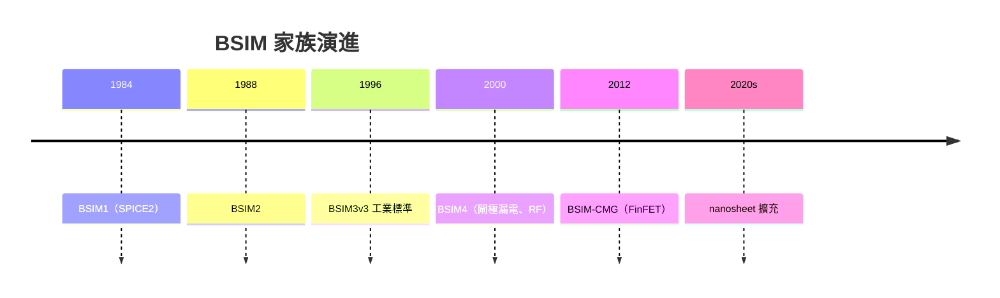

# 2.3 BSIM 模型：把幾百道製程濃縮成幾百個參數

晶圓廠裡有上千道工序、幾十億美元的機台，但 IC 設計工程師每天面對的，通常只是一個幾百 KB 的文字檔：模型卡（model card）。檔案裡數百個參數，就是幾百道製程的「濃縮萃取液」。這份檔案背後的學術基礎，來自 UC Berkeley 的 BSIM（Berkeley Short-channel IGFET Model）系列——一個橫跨四十年、深刻定義了整個產業標準的工程史。

## 為什麼需要模型

SPICE 模擬器需要知道：給定端點電壓，MOSFET 的電流是多少？對長通道平面元件，教科書的平方律公式就夠了。但真實元件有短通道效應、速度飽和、次臨界擺幅、閘極穿隧漏電、摻雜誘發的 $`V_t`$ roll-off、溫度效應、雜訊……沒有任何封閉公式能涵蓋一切。工業級的做法是折衷：用一套帶有物理意義的經驗方程式，配上大量可調參數，去擬合實測的 $`I`$ - $`V`$ 與 $`C`$ - $`V`$ 曲線。這就是 compact model 的本質：物理為骨架、實測為血肉。

## 從 BSIM1 到 BSIM4：平面時代的三十年長跑

1984 年，Berkeley 的 Ping Ko（葛守仁門下）與 C. Hu 等人推出 BSIM1，作為 SPICE2 的新 MOS 模型。它首度以大量經驗參數擬合短通道行為，但也因參數太多、彼此不獨立而飽受批評。BSIM2（1988）改善了亞臨界與輸出電阻的建模。真正的轉折是 BSIM3v3（1996 前後）：它回歸物理，以單一連續方程式描述從弱反轉到強反轉的全區域操作，參數具備可萃取性（extraction 友善），迅速成為工業標準，並獲選為 IEEE 標準。BSIM4（2000）加入閘極穿隧漏電、金屬寄生電阻、RF 效應等，服務了 0.25 μm 到 28 nm 的一整個世代。

這段歷史有一個常被忽略的面向：模型的普及不只是技術問題，更是制度問題。Berkeley 把 BSIM 以開放原始碼的形式免費釋出，任何模擬器廠商、任何晶圓廠都能採用；加上 Berkeley 在 SPICE 上的既有壟斷地位，「Berkeley 模型 + SPICE」形成了自我強化的生態系。各大晶圓廠的 PDK 全部以 BSIM 為基底，EDA 公司（HSPICE、Spectre、Eldo）都內建 BSIM 求解器。一個大學實驗室的模型，變成了全球晶片產業的共同語言。

## 參數萃取：從 wafer 到 model card

模型卡是怎麼來的？晶圓廠在每個製程開發階段與量產階段，都會在特殊測試鍵（test structures / PCM，process control monitor）上量測大量電晶體：不同 $`W/L`$ 、不同 $`V_{sb}`$ 、不同溫度下的 $`I_d`$ - $`V_{gs}`$ 、 $`I_d`$ - $`V_{ds}`$ 、電容、雜訊。然後是參數萃取（parameter extraction）流程：先用理論估計給參數初值，再逐段擬合——例如用長通道元件萃出 $`u0`$ （遷移率）、 $`vth0`$ （臨界電壓），用短通道元件萃出決定 $`V_t`$ roll-off 的參數，用寬窄元件萃出 $`W/L`$ 依賴項，最後做全域最佳化，讓整個模型在所有尺寸、所有偏壓下都誤差最小。這是一門半科學半藝術的功夫，業界稱為 model'ing（既是 modeling，也是 model 加 ing 的雙關），一流 model engineer 在晶圓廠的地位不亞於製程工程師。

萃取完的模型，會針對不同製程變異情況各給一份參數組——這就是 corner model（見 2.4 節）。

## BSIM-CMG：FinFET 時代的模型重寫

FinFET 一出現，BSIM4 的平面假設崩壞了。薄體矽的通道裡，載子受限於量子限域（quantum confinement），能階離散化，遷移率與電荷分布都和平面元件不同。Berkeley 的 BSIM 團隊為此開發了 BSIM-CMG（common multi-gate model），於 2012 年前後成為 FinFET 的事實標準。它建模的對象是以鰭數（number of fins）為單位的元件：通道寬度不再是連續變數，而是鰭數乘以每鰭有效寬度；串聯電阻、鰭間耦合、自熱效應（self-heating）都成了獨立的建模重點。到了 GAA/nanosheet 時代，BSIM-CMG 持續擴充，加入 sheet 數量、堆疊耦合等參數。同系列還有 BSIM-SOI（絕緣層上矽）與 BSIM-IMG（獨立雙閘）等分支。

## 模型卡在 PDK 與 EDA 流程中的位置

晶圓廠交付的 PDK（process design kit）中，模型卡通常按 corner 分檔（TT/SS/FF 等），並附上溫度、電壓範圍的說明。設計流程中，每個模擬環節都依賴它：前模擬（pre-layout simulation）用 schematic + model card；後模擬（post-layout simulation）再加上寄生抽取的 SPEF（見 3.3 節）；時序簽核的 STA 雖然不直接跑 SPICE，但其 NLDM/CCS 資料庫是用模型卡模擬標準 cell 而來。換句話說，模型卡是所有 EDA 數位與類比流程的共同源頭——模型的每一次改版，都會讓整條設計流程重新校準。

回頭看，BSIM 的故事是典型的學術—產業共構：Berkeley 供應模型與人才，晶圓廠供應數據與需求，EDA 公司供應模擬器，制度上則靠開放授權與業界委員會（如 CMX/CMI 標準化組織）維持一致性。下節我們看設計工程師如何用這些模型，在 TT、SS、FF 之間與未來對賭。
