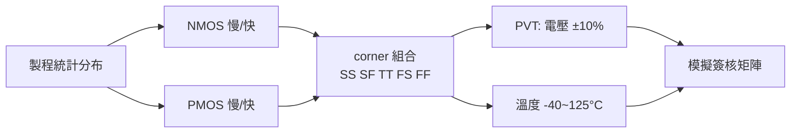

# 2.4 SPICE 與 Corner：在 TT、SS、FF 之間賭未來

晶片從設計到量產要一年以上，設計時工程師看不到未來那批晶圓會長成什麼樣。製程會漂移、電壓會波動、溫度會變化，元件比模型預測的快或慢。整個 EDA 簽核體系，本質上是一套「在不確定之下做出決策」的制度，而它的起點是 1970 年代 Berkeley 的一個課堂專案：SPICE。

## SPICE：模擬器的始祖

1960 年代末，Berkeley 的 Donald Pederson 教授主張：電路設計應該用電腦模擬，而不是靠麵包板試錯——這在當時是相當前衛的想法。他的學生 Larry Nagel 在 Ronald Rohrer 指導下完成 CANCER 模擬器（1970 年代初），之後發展為 SPICE（Simulation Program with Integrated Circuit Emphasis），1975 年釋出 SPICE2。SPICE 的核心是非線性電路的數值求解：用 Newton-Raphson 迭代解聯立非線性方程，用梯形法或 Gear 法做時間積分，用稀疏矩陣解 $`I = YV`$ 。它以開放授權免費散布，隨著 Berkeley 的學生四散到業界，SPICE 成為事實標準。1980 年代的商業化浪潮中，Meta-Software 的 HSPICE 加入收斂技巧、corner 分析、Monte Carlo 與工業級模型支援，成為簽核工具；Cadence 的 Spectre 則在 1990 年代以更好的數值演算法與射頻能力切入。今天所有晶片上電前，幾乎都經過 SPICE 家族模擬器的檢驗。

SPICE 的力量來自模型（前節的 BSIM），它的宿命也來自模型：模型是標稱的，晶圓不是。

## Process corner：給不確定性畫邊界

製程統計的結果，是每顆電晶體的參數都在標稱值附近漲落，而且 NMOS 與 PMOS 的漲落部分獨立。業界的做法是把這個二元分布的極端組合取名字：NMOS 與 PMOS 都偏慢是 SS（slow-slow，或稱 slow corner），都偏快是 FF（fast-fast），都在中心是 TT（typical-typical），一快一慢則是 SF、FS。這些是 process corner——設計者無法保證每顆晶片都落在中心，但可以要求它在所有 corner 下都正常工作。

Corner 之上還要疊加 PVT：電壓（供應電壓的容差，如 ±10%）、溫度（商用規格 0–70 °C、工業 −40–85 °C、車規 −40–125 °C）。三者相乘，模擬矩陣瞬間爆炸：5 個 corner × 3 個電壓 × 5 個溫度 = 75 種組合，每種都要跑全套模擬。設計工程師的日常，就是用 corner sweep 找出最壞情況（worst-case）的路徑——例如數位時序的最壞 setup 檢查通常在 SS + 低壓 + 高溫，hold 檢查卻在 FF + 高壓 + 低溫。耐人尋味的是，先進製程的溫度反轉效應（temperature inversion）讓「高溫更慢」的直覺失效，近臨界電壓下低溫反而更慢——這再次說明：直覺靠不住，corner 矩陣才是真理。

## Monte Carlo 與 local variation：corner 之外的世界

Corner 模型處理的是晶圓對晶圓（die-to-die）的系統性偏移，但晶片內部電晶體之間的隨機失配（local variation / random mismatch）是另一回事。對類比電路（如電流鏡、比較器）與低電壓數位電路，mismatch 是致命的。Pelgrom 定律（1989 年，Philips 的 Marcel Pelgrom）給出經典關係：失配標準差與 $`\sqrt{WL}`$ 成反比——面積越大越匹配。這條定律至今是類比設計的基石，也解釋了為什麼先進製程縮小尺寸反而讓變異問題惡化。

對付 local variation 的工具是 Monte Carlo 模擬：模型卡附帶統計參數（各 corner 的 mean 與 sigma），模擬器隨機抽樣數百到數千次，跑出性能的分布直方圖，然後看良率（yield）落在幾個 sigma。High-sigma 驗證（要求 6σ 以上，即抽樣要數百萬次）催生了重要性抽樣（importance sampling）等加速演算法，是 EDA 研究的活躍領域。SRAM 是最痛的應用：一顆晶片有上億個 bit cell，任何一個 cell 因 mismatch 讀寫失敗都是灾难，所以 SRAM 的 Vmin 驗證是 high-sigma 工具最大的戰場。

## 賭局的本質

把 corner、PVT、Monte Carlo 放在一起看，會發現這套制度的哲學：不是消除不確定性，而是為不確定性定價。設計者付出面積、功耗與時間的代價（例如更高的電壓 margin、更大的電晶體），換取良率與可靠性的保證；晶圓廠則以 corner 模型為契約，承諾落在規格內的晶圓會符合模型的行為。這是一份由模型卡充當合約的商業關係——HSPICE 開始收費的 1980 年代到今天，這份合約的格式變了，邏輯沒變。

這套對賭不只存在於元件層。下一章我們轉向互連（interconnect）：當導線的延遲超過電晶體，製程與 EDA 的戰場就從通道轉移到了金屬層。
