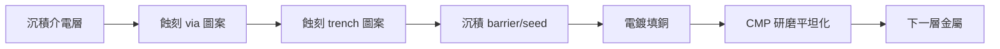

# 3.1 鋁到銅：Dual Damascene 與低介電材質的冒險

晶片上真正決定速度的，往往不是電晶體，而是把電晶體連起來的金屬線。1990 年代末，互連延遲（interconnect delay）超過電晶體延遲，成為新的瓶頸，晶圓廠被迫做兩件前所未有的事：把鋁換成銅，把二氧化矽換成低介電常數材料。這場「金屬與介電層的雙重冒險」，改寫了製程技術、材料科學，以及 EDA 的寄生模擬世界。

## 鋁的極限

從 1960 年代積體電路誕生到 1990 年代，互連金屬幾乎一直是鋁（以及鋁銅合金）。鋁便宜、易沉積、與矽和氧化層附著良好，用濺鍍（sputtering）沉積後以反應離子蝕刻（RIE）刻出線條——一種「先沉積、再蝕刻成形」的 subtractive 製程。但鋁有兩個致命傷：電阻率高（約 $`2.7\ \mu\Omega\cdot cm`$ ），以及在大電流密度下的電遷移（electromigration）問題——電子流會把鋁原子推著走，日積月累在導線裡造成空洞（void，斷路）或小丘（hillock，短路）。為了對抗電遷移，鋁線之下還要墊一層鎢插銷（tungsten plug）連接上下層，製程步驟多、電阻也高。

隨著特徵尺寸縮小，線寬變細、電流密度暴增，鋁的電阻與電遷移問題在 0.25 μm 以下變得不可承受。銅的電阻率只有 $`1.7\ \mu\Omega\cdot cm`$ （低約四成），電遷移抵抗力也強得多——但它被擱置了三十年，因為有兩個難題：銅會快速擴散進矽與介電層，毒化元件；以及銅難以用電漿蝕刻（銅的蝕刻副產物揮發性極差），傳統 subtractive 製程行不通。

## Damascene：用古老工藝解新問題

解法來自一個古老的工藝名稱：大馬士革（damascene）。中東的大馬士革鋼工匠把金銀鑲嵌進金屬表面的凹槽；半導體版的 damascene 則是：先在介電層刻出溝槽（trench），填入金屬，再把超出表面的金屬磨掉（CMP，chemical mechanical polishing），金屬只留在溝槽裡——完全不需要蝕刻銅。

IBM 的研究團隊（以 Edelstein 等人為代表）在 1990 年代完成關鍵工程化：在銅與介電層之間加入阻障層（barrier，如 Ta/TaN）防止銅擴散，加入晶種層（seed layer）讓電鍍（electroplating）得以開始，用電鍍填滿深寬比極高的溝槽與通孔。1997 年，IBM 推出全球第一個銅互連量產製程（CMOS 7S，0.22 μm 級），TSMC 等業界在 0.18 μm 世代全面跟進。這是十多年來第一次由「非微影」的製程創新主導一代技術。

dual damascene 則更進一步：把通孔（via）與溝槽的圖案用兩次微影刻在同一個介電層的階梯結構裡，一次電鍍同時填滿 via 與 trench。這把每層金屬的製程步驟大幅縮減，是銅製程能實用化的經濟關鍵。dual damascene 的「先刻 via 還是先刻 trench」（via-first / trench-first）成了製程整合的重要抉擇，也衍生出一整套 EDA 必須遵守的設計規則：via 的允許形狀、trench 與 via 的重疊（overlap）規則等。

## 低介電材質：另一場更危險的賭注

銅解決了電阻 R，但電容 C 同樣要降。導線與相鄰線之間的耦合電容由介電層的介電常數 $`k`$ 決定，SiO₂ 的 $`k \approx 4`$ 。降低 $`k`$ 的辦法是把材料「弄稀」：摻氟（FSG， $`k\approx3.5`$ ）、有機材料（SiLK、BLACK DIAMOND 等， $`k\approx2.7`$ ）、多孔材料（porous low-k， $`k<2.5`$ ，在材料裡故意造出奈米孔洞）。業界在 90 nm 到 45 nm 間逐代下探。

但多孔低介電材質是一場物性上的冒險：機械強度差（CMP 會磨壞）、熱導差（自熱散不出去）、對電漿與濕氣敏感（蝕刻與清洗會破壞表面，造成 k 值劣化）。業界又發展出 ultralow-k 與 air gap（在關鍵層以空氣為介電質）等極端手段。每一次 low-k 演進，都要求製程、材料、設備三方同時突破，失敗的代價是整個製程節點延期——這種系統性風險，正是先進製程競賽成本爆炸的核心原因之一。

## EDA 如何被這場冒險重塑

銅/低介電轉換對 EDA 的影響深遠。第一，寄生抽取模型全面改版：barrier 層的電阻不可忽略（它讓有效導體截面縮小）、銅的阻值隨線寬變窄而急升（尺寸效應，如表面散射與晶界散射），傳統的方塊電阻概念在奈米線寬下需要修正，這些都被寫進製程檔案（techfile / ITF）裡，成為 RC 萃取的輸入（詳見 3.3 節）。第二，dual damascene 的幾何規則催生了新的 DRC 與 via 結構（如 via 標註、redundant via 檢查）；EDA 工具甚至發展出 redundancy insertion（自動加備援 via 提升良率與可靠度）的功能。第三，CMP 的平坦化限制（金屬密度過高或過低都會研磨不均）帶來了 fill 與 density check 需求——工具自動在空曠區域塞入 dummy 金屬，這又反過來影響寄生電容。第四，銅製程的自熱與電遷移讓電流密度限制（EM/IR 規則）成為簽核項目（見 3.4 節）。

從鋁到銅，再到 nanosheet 時代的埋入式電源軌（backside power delivery），互連的每一次革命都在提醒我們：晶片是三維的系統，電晶體只是主角之一。下一節，我們看導線本身如何成為比電晶體更難伺候的對象。
