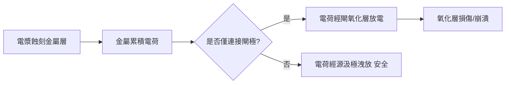

# 3.2 寄生 RC 與天線效應：導線比電晶體更難搞

在 0.25 μm 之前，晶片設計的常識是：電晶體慢，導線快。此後常識顛倒了。當特徵尺寸縮小，金屬線的電阻上升、耦合電容暴增，導線的 RC 延遲與串擾（crosstalk）成為決定晶片速度、功耗與良率的主角。與此同時，製造過程中的一個隱形殺手——天線效應——讓「畫一根線」這件事也變得危機四伏。本節談這兩個讓數位設計徹底改道的物理現象。

## 寄生 R 與 C 的物理

一根導線不是理想導體。它的電阻 $`R = \rho L / (W \cdot t)`$ ：線越長越細，電阻越大。殘酷的是縮小的數學：當線寬與厚度等比例縮小（寬度 $`W`$ 減半），單位長度電阻變成四倍；再考慮銅的尺寸效應——電子的平均自由程與線寬相當時，表面散射與晶界散射讓有效電阻率進一步上升——奈米級銅線的實際電阻率遠高於塊材的 $`1.7\ \mu\Omega\cdot cm`$ 。這也是為什麼先進製程的頂層金屬（供電網路）總是做得特別厚特別寬。

電容方面，導線對地的電容來自線底與基板、線側與相鄰層；更麻煩的是同層相鄰線之間的耦合電容（coupling capacitance）。隨線距縮小，側壁耦合在總電容中的占比超過一半——你的訊號線與隔壁線之間，實質上隔著一個大電容器。

兩者的綜合效應是 RC 延遲。對串聯電阻驅動負載電容的簡單模型，Elmore delay 給出近似： $`t_d = \sum_i R_i \sum_{j\ge i} C_j`$ 。對一根長導線，延遲隨長度的平方成長——這條平方律解釋了為什麼高層金屬（電阻低）要負責長距離走線，以及為什麼長導線必須插入中繼器（repeater/buffer）分段。佈局工具中的 repeater insertion 與 wire sizing 演算法，就是在跟這條平方律搏鬥。

## Crosstalk：耦合電容的黑暗面

耦合電容的另一面是串擾：相鄰線上的訊號切換會透過 $`C_c`$ 干擾你的線。干擾方向不同，效果截然不同：如果攻擊線（aggressor）與受害者（victim）同向切換，耦合電容等效充放電減少，延遲變短；反向切換則延遲拉長——這就是為什麼 STA 必須做 crosstalk-aware 的延遲計算（delta delay）。更糟的是攻擊線大幅擺動而受害者靜止時，電容分壓會在受害者上打出毛刺（glitch），可能穿透下游邏輯造成功能錯誤。對付串擾的手段——加大線距、插屏蔽線（shielding，用電源或地線夾住關鍵訊號）、翻面走線（alternating routing layers）——全部都成了佈線器（router）的內建演算法。現代佈線器本質上是一台「寄生電容最佳化機器」。

## 天線效應：製造過程的電荷陷阱

天線效應（antenna effect，或 plasma-induced gate oxide damage）是製造與設計互動最直接的例子。在蝕刻與 CMP 等電漿製程中，暴露在電漿裡的金屬會累積電荷。如果這段金屬直接連到閘極，累積的電荷會透過閘極放電——薄薄的閘氧化層承受電流衝擊，可能造成穿隧損傷（TID）、可靠度退化甚至直接崩潰。導線面積與閘極面積之比越大（線越長、閘越小），風險越高；而最諷刺的是：這段線在製造時只是一截金屬，還沒連到晶體管的源汲極可以洩流——「天線」之名由此而來。

業界以 antenna rule 應對：規定「單一金屬層上連到閘極的面積 ÷ 閘極面積」不得超過比值（CAR，charge-to-area ratio）。DRC 工具逐層檢查這個比值，違規即為 antenna violation。修法有兩大類：一是 jumper——把違規的線跳到上一層金屬再跳回來，讓每一層暴露於電漿的連續金屬段不超標（製造順序上，跳到上層的時點在閘極已被源汲極保護之後，電荷可以洩掉）；二是加 antenna diode——在閘極附近接一個反向二極體，提供洩流路徑。jumper 免費但改變繞線，diode 花面積但繞線不變，佈線器通常先試 jumper、不行再插 diode。這整套機制的存在，就是「EDA 必須理解製程順序」最好的證明：工具檢查的對象不是最終的電路，而是晶圓在每一道工序當下暫時的模樣。

## 導線思維的誕生

寄生 RC 與天線效應共同催生了一種新的設計哲學：導線是一等公民。1990 年代末，Synopsys、Cadence 相繼推出 physically-aware 的綜合與佈局（先估寄生、再最佳化），DAC 與 ICCAD 的論文列表被 interconnect 主導了十年。這場思維革命的前提，是設計工具能「算得出」導線的 RC——而這正是下一節的主題：RC 萃取與 SPEF。
