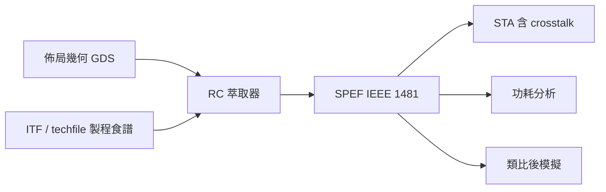

# 3.3 RC 萃取與 SPEF：EDA 如何替製程算帳

上一節說明導線的 RC 決定了晶片的命運，但設計工具怎麼「知道」一根繞出來的線究竟有多少電阻、多少電容？答案是 RC 萃取（RC extraction）：根據製程的幾何與材料參數，把佈局圖上每一根線、每一個通孔換算成等效電路。萃取的輸出——SPEF 檔案——是連接晶圓廠物理世界與設計簽核世界的帳本。本節講這本帳怎麼算。

## 製程參數的「食譜」：ITF 與 techfile

萃取的第一個輸入是製程資訊。晶圓廠在 PDK 中提供描述金屬層堆疊的檔案（如 Cadence 的 techfile、Synopsys 的 ITF）：每一層金屬的厚度、高度、方塊電阻、介電層的 k 值、通孔電阻、以及隨線寬線距變化的修正模型（如寬度相關的方塊電阻、考慮 barrier 層的有效導體截面）。這份食譜是晶圓廠用實際 wafer 的量測（實測 ringback 結構、s-parameter 量測）回推校準出來的——換句話說，萃取模型的精確度，最終取決於晶圓廠願意花多少錢量測與建模。先進製程的互連模型校準是 PDK 品質的核心指標。

## 從幾何到電路：兩條技術路線

有了幾何（佈局上的每一段線）與食譜，萃取有兩條路線。

一是 rule-based（經驗法則）萃取：晶圓廠預先用場域求解器（field solver）對典型幾何組合算出電容表格，萃取時依線寬、線距、相鄰狀況查表加權。速度極快，適合整顆晶片的全面抽取，精度取決於表格密度與幾何假設。這是簽核標準流程的主力，如 Synopsys StarRC、Cadence Quantus。

二是 field solver（場域求解）萃取：直接對幾何結構解 Maxwell 方程（或簡化後的拉普拉斯方程），算出電容矩陣與電阻。精度最高，但慢，只能用於關鍵網路（如時脈樹、高速匯流排、類比敏感節點）。業界常見的混合策略是：全面 rule-based，關鍵 net 用 field solver 精抽。早期還有所謂 star model（把每根線的電容掛到地，忽略耦合）與 coupling model（保留 net 對 net 的耦合電容）之別——crosstalk 簽核出現後，耦合電容成為必須保留的項目。

萃取出來的模型也有階層：最簡單的是 lumped 電容（Pi model：兩端各一個電容、中間一段電阻）；進一步是 lumped RC（電阻鏈加電容）；最精細的是 distributed RC（把線切成許多小段 R+C，形成 RC 樹）。模型階層的選擇決定了後續模擬的精度與速度，Elmore delay 之類的封閉公式只在 RC 樹上成立。

## SPEF：IEEE 1481 帳本

萃取的結果以 SPEF（Standard Parasitic Exchange Format，IEEE 1481 標準）輸出。一個 SPEF 檔案以文字形式描述每個 net 的等效電路：節點、電阻、對地電容、net 對 net 的耦合電容（以標號引用），並附上設計層次資訊與單位定義。它的價值在於「交換」二字：晶圓廠與 EDA 工具之間、前端與後端之間、簽核工具之間，都以 SPEF 為共同格式。實務上，SPEF 是整個簽核鏈的接口：STA 工具讀 SPEF 做 crosstalk-aware 時序分析；功耗工具讀它算互連功耗；類比後模擬則將其轉為 SPICE 子電路。一顆大型 SoC 的完整 SPEF 可能達數十 GB，因此業界又發展出簡化格式（如 reduced SPEF、DSPF）與分層抽取策略。

## 為什麼「算帳」這麼難

這本帳難算，有三個原因。第一是規模：大型晶片有數十億個幾何元素，rule-based 萃取本質上是巨量的幾何比對與查表，工具的平行化與分層處理是工程核心。第二是精度與速度的取捨：簽核要精、迭代要快，所以流程中往往同時存在估計級（佈局前的 wireload model 或虛擬繞線）、優化級與簽核級三種抽取精度，設計者要管理這三級之間的不一致——前後模擬結果落差，往往就來自抽取模型的差異。第三是變異：製程漂移會改變線寬與介電層厚度，先進節點的簽核需要抽取多個 corner（如金属厚度偏厚/偏薄的 CX corner），SPEF 也成套供應。RC corner 與前一章的 device corner 相乘，簽核矩陣進一步膨脹——這是先進製程簽核成本爆炸的又一例證。

回頭看，RC 萃取是 EDA 與製程互動最深的環節之一：晶圓廠供應食譜與校準數據，EDA 供應演算法與格式，設計者消費的是一本「帳目正確」的保證。帳算對了，時序與功耗的簽核才有意義；但有一種帳不是 RC 能涵蓋的——電流本身的帳。下一節，我們看電源網路上的 IR drop 與電遷移，如何成為先進製程的最終簽核戰場。
