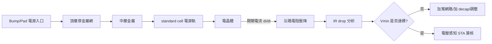

# 3.4 IR-Drop 與電遷移：電源網路的簽核戰場

晶片上有一張看不見的網，比任何訊號線都重要：電源網路（power grid）。數十億個電晶體同時從這張網上取電，網路本身的電阻會讓電壓沿途下降，電流會推著金屬原子緩慢遷移。當這張網出問題，晶片不是慢一點，而是直接算錯或死掉。IR drop 與電遷移（EM）的分析與簽核，因此成為先進製程實體設計的最後一道關卡。

## IR drop：電壓的沿路消耗

歐姆定律說：電流通過電阻會產生壓降。電源網路每一段金屬都有電阻，電流流過後，抵達電晶體的電壓已低於標稱值——這就是 IR drop。它有兩種形態：static（static IR）由平均電流造成，決定了穩態電壓的地板；dynamic IR 由瞬時開關電流造成，特別是時脈同步觸發的大量同時切換（di/dt 大），會在電源網路上打出瞬時電壓凹陷（voltage droop）。

IR drop 的後果是雙重的。第一，速度：電壓降低，電晶體變慢，時序餘裕被吃掉——這就是為什麼先進簽核要求時序分析輸入 IR drop 圖（voltage-aware STA），把每一處的實際電壓餵給 STA。第二，功能：供應電壓低於資料保存所需，flip-flop 可能丟失狀態；電源網路的地端如果浮動（ground bounce），雜訊裕度崩潰。進入近臨界電壓操作（低功耗設計的常態）後，几十毫伏的 droop 都可能致命，IR 分析從「健診」變成「簽核」。

## 電遷移：Black 方程的時間炸彈

電遷移（electromigration）是電流的電子風把金屬原子推走的現象。1950 至 60 年代，積體電路小型化後金屬線電流密度暴增，這個現象從學術好奇變成量產災難；1969 年，TI 的 James Black 發表了著名的 Black's equation：

$$MTTF = A \cdot J^{-n} \cdot e^{E_a / kT}$$

平均失效時間（MTTF）與電流密度 $J$ 的 $n$ 次方成反比（$n$ 約為 2），與溫度呈 Arrhenius 指數關係（$E_a$ 是活化能）。這條方程給了設計者兩個槓桿：限流與降溫。晶圓廠據此為每一層金屬、每一種線寬規定最大電流密度（DC 與 AC/avg/peak 分開規範），成為 PDK 中的 EM rule。

電遷移的失效模式有兩種：電子流上游的線被掏空（void，斷路）、下游堆積成小丘（hillock，可能頂穿介電層造成短路）。有趣的是電流方向決定生死：bidirectional（交流性質的）電流有自我修復效應，EM 耐受度高；unidirectional（如電源網路）最危險——這也是為什麼 EM 簽核對 power/ground 網路特別嚴格。銅製程（1997 年 IBM 導入）大幅緩解了 EM，但隨線寬縮小、電流密度再升，加上 barrier 層吃掉有效截面，EM 問題在 7 nm 以下捲土重來；先進製程甚至以合金（如 Co 或 Cu 合金內襯）與 top metal 加厚來對抗。

## 簽核工具鏈與設計對策

EM/IR 簽核的資料流與 RC 萃取（上節）共享基礎建設：先抽取電源網路的電阻（必要時含電感），讀入電流消耗模型（由功耗分析按時域、按區域分配的電流源），解大規模電路或做靜態近似，得出每節點的電壓與每段金屬的電流密度，再對照 PDK 的 EM/IR rule 逐條檢查。業界工具如 Cadence Voltus、Synopsys PrimePower/Angus 系列的 power grid 分析，本質上是在解一張「數十億節點的電路」。為了可行，工具採用向量無關（vectorless，用統計電流）與向量感知（vector-aware，用真實 testbench 波形）兩種模式，前者快、用於迭代，後者準、用於簽核。

設計端的對策是一部縮微的工程史：電源網路要加寬（但佔用繞線資源）、增加 via 陣列降低通孔電阻、在關鍵區域加去耦電容（decap，用 MOS 電容就近供應瞬時電流）、限制同時切換（clock gating、staggering）、頂層金屬加厚加寬承載大電流。每種對策都要花面積、功耗或時序的代價——電源完整性（power integrity）的工程本質，就是在這些代價之間找平衡。

## 簽核戰場的哲學

EM 與 IR drop 的簽核，代表著 EDA 與製程互動的另一個層次：這裡簽核的不只是「現在對不對」，而是「十年後還對不對」。Black's equation 是壽命的統計預測，晶圓廠以加速實測（高溫高電流下燒機，burn-in）回推常溫壽命，再把結論變成電流密度規則交給 EDA 執行。設計者在工具裡修掉的最後一個 EM violation，代表的是一份跨越時間的承諾：這顆晶片在車上跑十五年在規格內不會壞。

從電晶體的三代身材、微影的奈米雕刻，到銅互連、SPEF 帳本與電源網路的簽核，這兩章勾勒出製程與 EDA 共舞的主旋律：製程每一次向物理極限推進，EDA 就要把新的物理翻譯成設計者能用的規則、模型與工具。這場共舞還沒有終曲——新的節點、新的結構、新的失效模式，仍在持續譜寫下一樂章。
