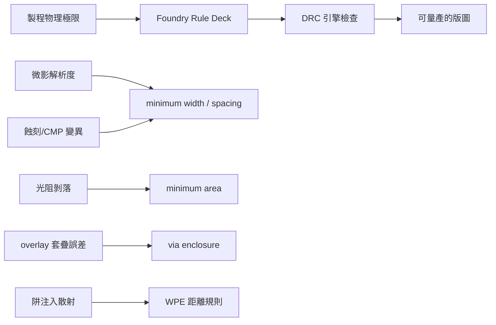

# 4.1 最小線寬、Enclosure 與 WPE：DRC 規則的物理出處

初學者在拿到一份 foundry 的 Design Rule Manual 時，往往會覺得那是一份任意頒布的法典：metal 最小寬度 0.14 μm、minimum spacing 0.15 μm、via enclosure 0.04 μm、minimum area 0.02 μm²——數字琳瑯滿目，卻看不出道理。事實上，每一條 DRC（Design Rule Check）規則的背後，都對應著某一個物理製程步驟的極限或變異。DRC 不是立法者的任性，而是製程工程師把物理世界的失敗經驗，壓縮成幾何上的禁令。

## 最小線寬與間距：微影與蝕刻的極限

最基本的一組規則是 minimum width 與 minimum spacing。它們的物理出處主要在微影（lithography）與蝕刻（etch）。

線寬的下限，來自光學系統的解析度。Rayleigh 繞射極限告訴我們，最小可解析的特徵尺寸與波長成正比、與鏡頭數值孔徑 NA 成反比（詳見第五章）。當製程無法把光刻膠上的圖案印得比某個尺寸更小時，版圖上畫得再細的線也不會存在——或者印出來是一段斷斷續續的殘影。因此 minimum width 實際上是「我能可靠印出的最小東西」。

Spacing 則多了一層來源：蝕刻與製程變異。兩條金屬線如果靠得太近，蝕刻時可能發生 bridging，殘留的薄膜讓兩條本應獨立的導線短路；即使印得出來，CD（critical dimension）在晶圓上各處的變異也可能讓設計值 0.10 μm 的間隙實際上縮到 0.06 μm，漏電與耦合電容跟著失控。此外，後段 CMP（化學機械研磨）造成的 dishing 與 erosion，也會讓密集區與疏稀區的線厚不同，這催生了所謂的 density rules——金屬層的密度必須落在上下限之間，否則 CMP 後的平坦度無法保證。

## Min area：光阻剝落的教訓

minimum area 是一條經常被初學者忽略、卻極有物理味道的規則：任何圖案的總面積不得小於某個值。它的出處是 photoresist 的附著力與製程化學。一個又窄又短的方形線段，在顯影、蝕刻、清洗的過程中，四周被溶液包裹，表面張力與液體流動產生的應力可能直接把這一小塊光阻或金屬「剝落」（peeling）或沖走，造成 defect。經驗法則是：圖案越小、長寬比越極端，越容易在製程中消失。foundry 於是規定，線段的長乘寬必須超過一個門檻，或窄線必須有最短長度。這條規則曾是早期 P&R 工具最常違反的一條——router 在末端插一個 via stub，畫出一個面積不足的小方塊，DRC 就報錯。EDA 工具對 min area 的支援，某種程度上是被 foundry 的量產失敗教出來的。

## Enclosure：對位誤差的保險

Via 與 contact 的 enclosure 規則，處理的是另一個問題：overlay（套疊誤差）。VIA1 層的圖案由 VIA1 的曝光機印製，而下方的 metal1 與上方的 metal2 由另外兩層光罩印製，三層之間的對位不可能完美——機台之間的 overlay 誤差可能在數十奈米的量級。如果 via 剛好和 metal 邊緣切齊，只要對位偏一點，via 就有一部分落在 metal 之外，與底下不存在金屬的區域接觸，接觸電阻暴增甚至完全開路。

因此規則要求金屬必須「包住」via 一圈，留下 enclosure margin，讓 via 在最壞的對位偏移下仍然完整落在金屬內部。這個 margin 的大小，等於製程 overlay 的統計分佈加上一定的工程餘裕。同一個物理問題也衍生出另一組規則：via 不能太大（會有 current crowding 與蝕刻均勻性問題）、不能兩顆 via 靠太近（會合併）、金屬上的 via 數量有其上限。凡此種種，都是在為對位誤差與製程變異買保險——保險費就是版圖面積。

## WPE：當版圖影響電晶體特性

前述規則影響的是「這個圖案能不能被做出來」，而 WPE（Well Proximity Effect）影響的是「做出來的電晶體特性是什麼」。當阱（well）的邊界由 well implant 遮罩定義時，離子注入是斜向散射的：靠近阱邊緣的區域會收到比中央更多的摻雜散射劑量，造成阱邊界附近數微米範圍內的電晶體，其 threshold voltage、驅動電流與崩潰特性都與遠離邊界的同型電晶體不同。

這對數位電路影響不大，卻是類比設計的噩夢：電流鏡的兩顆電晶體如果一顆靠近 well edge、一顆在中央，鏡像比例就會失準。WPE 因此催生了兩類 DRC：一是 foundry 在先進製程中提供的 WPE check，用腳本計算電晶體到 well 邊界的距離並比對允許值；二是 EDA 工具內建的 well proximity 距離計算，讓模擬用的 device model 可以依位置選取參數（corner distance model）。換句話說，WPE 讓 DRC 從「幾何合法性」跨入了「幾何決定電性」的領域——版圖不再只是電路的化身，版圖本身就是電路參數的一部分。

## 從 micron rules 到 lambda rules 到複雜規則

DRC 規則的呈現方式本身也有歷史。最早的 rule deck 是以絕對尺寸寫成的 micron rules，每個製程一套。Mead–Conway 在 1980 年推廣的 lambda-based rules（MOSIS 採用）把所有尺寸表達為 λ 的倍數，讓同一套規則可以隨著製程微縮等比例縮放——這是 VLSI 教育得以普及的關鍵制度發明：學生用同一份版圖規則，就能在不同大學的 MPW run 裡投片。但 lambda rules 犧牲了最佳化，先進製程中每層的微影條件、材料與蝕刻方式都不同，規則再也無法共用一個縮放因子，於是回到 per-layer、per-pitch 的複雜規則集，而且從「同一規則全場適用」進化為「依圖案周邊情境而變」的 context-dependent rules——1D 規則、不同 pitch 下的不同 spacing、cut mask、slotting 等。這種複雜度爆炸正是驅動 DRC 引擎從簡單布林運算走向分布式計算的動力，也是 4.3 節物理簽核工具權力結構的起點。

理解了每一條規則的物理出處，設計者才能真正掌握「哪些規則可以談、哪些不能動」；而 EDA 工具的每一次升級，本質上都是把更多物理知識編碼進自動化檢查與修復的流程裡。這正是製程與 EDA 共舞的第一支舞曲。
