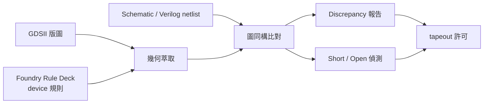

# 4.2 LVS：版圖與電路的幾何拓撲對質

如果說 DRC 檢查的是「圖案能不能被做出來」，LVS（Layout Versus Schematic）檢查的則是「做出來的圖案，是不是你想要的那個電路」。它回答的是晶片設計中最令人不安的問題：你畫的版圖，和你寫的電路圖（schematic）、或綜合出來的 netlist，真的是同一個東西嗎？

## 為什麼需要對質

在手工版圖的年代，錯接一根線、畫反一個電晶體，是家常便飯。即使到了自動化時代，綜合與 P&R 之間的資料傳遞、供應商 IP 的整合、手修 ECO 的介入，都可能讓最終 GDS 與預期電路出現分歧。流片一次數百萬美元，晶片回來若發現短路或開路，一切都不可逆。LVS 因此成為 tapeout 前的法定程序：把版圖重新「翻譯」成一份 netlist，與黃金標準的 schematic netlist 比對，任何電氣拓撲上的差異都必須清到零。

## 三個步驟：萃取、辨識、比對

LVS 的第一個步驟是 extraction（萃取）。版圖只是一層層幾何圖形的堆疊，萃取引擎必須依據 foundry 提供的 layer 定義，從圖形之間的交疊與接觸關係，重建出電氣事實：哪些圖形是同一片導體（合併為一個 net）、哪些交疊代表 via 連接（跨層連線）、哪些圖案的組合構成一個電阻、電容或電晶體。這一步在數學上是幾何布林運算與圖形連通性的計算，輸入是 GDS，輸出是一張連通圖。

第二個步驟是 device recognition（元件辨識）。foundry 的 rule deck 中有一段 device extraction 規則，描述「什麼樣的圖形組合是一顆電晶體」。例如：active 區被 poly 跨過，且兩側有 S/D implant 覆蓋，就是一顆 MOS；poly 在 well 上的一段，加上特定的標記層，就是一顆電容。辨識出來的元件會被標上類型、尺寸（W/L）、以及編號。辨識規則的正確性至關重要——規則寫錯，萃取出的元件就會多一顆或少一顆，整個 LVS 全軍覆沒。這也是為什麼 rule deck 從來不只是「DRC 數字表」，而是一套完整的製程知識編碼。

第三個步驟是比對。萃取出的 netlist 與 schematic netlist（來自 Cadence Virtuoso 的 schematic capture，或數位流程中 P&R 輸出的 Verilog netlist）送入 graph matcher，比對兩張圖是否同構（isomorphic）：net 對 net、device 對 device，連接關係完全一致。困難在於，電晶體在電路上是可對稱交換的——差動對的兩顆管、並聯的 finger、串並聯等效的電阻網路，都允許多種合法對應。先進的 matcher 會利用元件尺寸、對稱性與連通度做啟發式匹配，並在無法唯一決定時保留多組可能解。比對完成後，工具輸出兩類報告：discrepancy（元件或 net 數目不對、尺寸錯誤）與 short/open 偵測——兩個不該相連的 net 在版圖上連在一起是 short，一個 net 被切斷成兩半是 open。

## 規模的挑戰與階層式策略

百萬乃至百億電晶體的版圖，讓 LVS 成為計算量最恐怖的簽核任務之一。現代工具幾乎都採階層式比對：利用版圖與 netlist 共有的 hierarchy，先比對重複使用的 cell，相同者只比一次，再以「黑箱」方式往上層推進。當 hierarchy 被最佳化流程打散（例如 layout 上的 abstract view 與 gate-level netlist 結構不一致），工具還必須做 hierarchy re-structuring，自動尋找兩邊可對齊的分組。此外，供應鏈上的分工也反映在 LVS 流程：數位區塊用 gate-level netlist 比對，類比區塊用 schematic 比對，最後在 top level 合流；Filler cell、decap、antenna diode 等沒有電路對應物的圖形，則需在 rule deck 中標記為 ignored 或補進 netlist。

## 與 DRC、ERC 的分工

LVS 常與 DRC 並列為物理簽核的兩大支柱，但有時還加上 ERC（electrical rule check）：檢查浮接閘、電源短路、well tap 缺失這些「幾何合法但電氣錯誤」的問題。三者共用同一套萃取基礎，事實上現代簽核工具都是「一次萃取、多種檢查」：萃取出的資料庫同時餵給 DRC、LVS、電阻電容寄生參數抽取（RCX）。這也解釋了為什麼簽核工具的技術門檻如此之高——它不是單一演算法，而是幾何運算、圖論匹配、製程知識與資料管理的總和。

## 開源世界的 LVS

在開源生態中，Magic（John Ousterhout 於 1980 年代在 Berkeley 開發）早已內建 extraction 與 netlist 比對能力，是學術界數十年的標準配備；netgen 則是專為 LVS 比對而生的開源工具，擅長處理元件匹配與 short 報告。當 Google 與 SkyWater 在 2020 年開源 SKY130 PDK 時，KLayout（Matthias Koefferlein 開發）的 Ruby/Python 巨集環境配合 netgen，構成了開源 LVS 簽核流程的骨幹，使個人與小型團隊首次能在沒有商業簽核工具的情況下完成可流片的設計。開源 LVS 的崛起，不只是工具供給的問題，更是「簽核權」的民主化：過去只有買得起 Calibre license 的公司才能對自己的設計做最終裁判，如今任何人都可以。這個制度性的變化，正是下一節的主題。

LVS 的本質，是讓兩種截然不同的表示——幾何與電路——在同一個數學層次上互相對質。這種「對質」的精神貫穿了整個 EDA 史：模擬是行為對質、DRC 是物理對質、LVS 是拓撲對質。EDA 的每一次進步，都是把下一種對質自動化。
