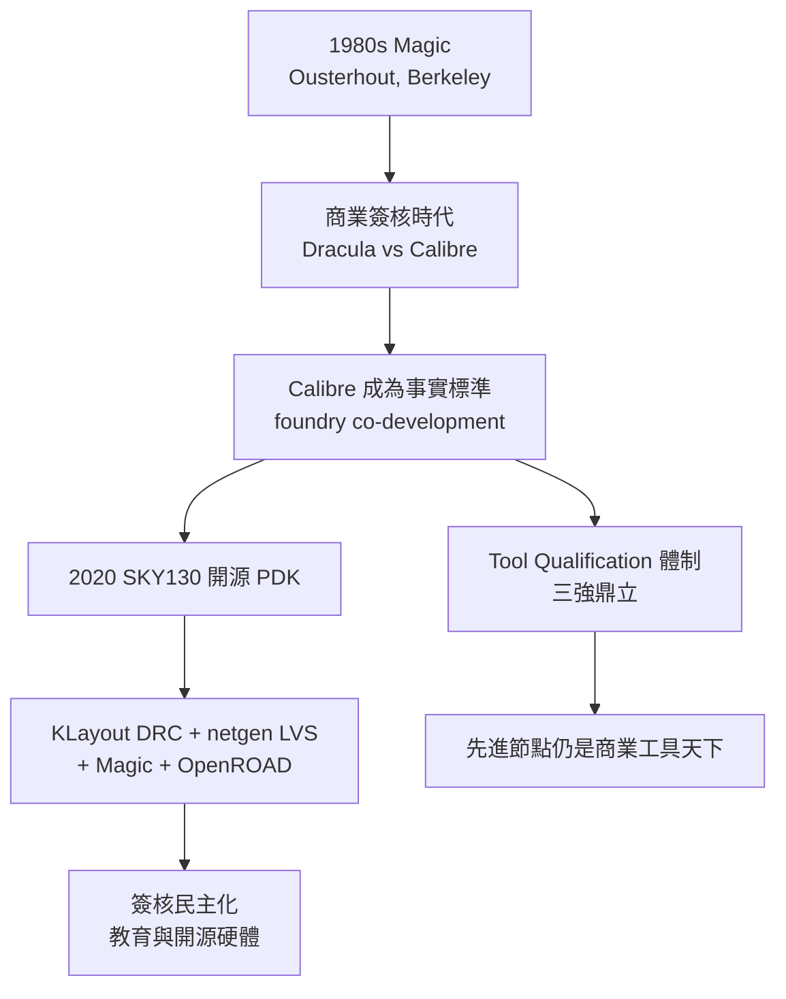

# 4.3 從 Calibre 到開源驗證：物理簽核工具的權力結構

在半導體產業，有一種權力不寫在合約裡，卻主宰著每一次 tapeout：誰的簽核工具被 foundry 認可，誰就掌握了設計進入量產的鑰匙。物理驗證工具的歷史，與其說是技術史，不如說是一部產業權力結構的演化史。

## Calibre 的崛起：DRC/LVS 的事實標準

Mentor Graphics（2021 年被 Siemens 收購後更名 Siemens EDA）的 Calibre 誕生於 1980 年代末。當時物理驗證市場上有 Dracula（Cadence 前身之一的 ECAD 產品，後併入 Cadence）等競爭者，但 Calibre 以幾個關鍵設計取勝：階層式 DRC 演算法在維持結果正確性的前提下大幅加速；互動式 debug 環境讓設計者能快速定位違規並修正；以及——最關鍵的——與 foundry 的深度合作。Mentor 早期就投入資源與台積電、聯電等 foundry 共同開發 rule deck，讓客戶拿到製程的同時就拿到一份 Calibre 格式、且經過矽片驗證的規則檔。

到了 2000 年代，Calibre 已成為 DRC/LVS 的事實標準：foundry 的 golden sign-off deck 以 Calibre SVRF（Standard Verification Rule Format）語言撰寫，IP 供應商交付的 design rule checklist 預設以 Calibre 結果為準。這形成了強大的網絡效應——不是技術絕對領先，而是整條供應鏈都默認了這種格式與流程。簽核工具因此成為 EDA 業中黏著度最高的生意之一：即使 license 昂貴、以設計規模計價，客戶也難以出走，因為換工具意味著重寫所有 runset、重驗所有結果，風險遠大於節省的費用。

## 三強鼎立與 tool qualification

Calibre 之外，Cadence 以 Pegasus（新一代分散式簽核引擎）與歷史悠久的 Virtuoso 生態對抗，並收購了 Numeca、OpenLane 相關技術補強；Synopsys 則以 IC Validator（原 Hercules 血統）與 PrimeSim 生態應戰。三者與 foundry 之間存在一套 tool qualification 體制：任何簽核引擎要成為某製程的 official sign-off tool，必須通過 foundry 的認證測試——在標準測試版圖上，結果必須與 golden tool 完全一致（bit-for-bit match），包括違規的位置與數量。這看似客觀，實則由於 golden deck 本身以特定工具語言撰寫，標準的制定權始終在既有霸主與 foundry 的聯盟手中。

這種結構的經濟後果是明顯的：簽核市場長期高度集中，工具價格隨先進節點節節攀升，新創 EDA 公司幾乎不可能從 DRC/LVS 切入。而 design house 的議價能力也受限——你可以換 synthesis、換 P&R，但不能換 sign-off。權力集中在「最後一關」。

## 開源的先聲：Magic 與 Ousterhout

開源驗證的理想其實非常古老。1980 年代，John Ousterhout 在 UC Berkeley 開發了 Magic，這不只是一個版圖編輯器，更內建了即時 DRC 與 circuit extraction——設計者畫下每一筆，工具當場告訴你有沒有違反規則。Magic 採用 corner-stitching 資料結構，在當年是了不起的演算法成就。透過 MOSIS 的 lambda-based rules，Magic 成為全球大學 VLSI 課程的標準工具，培養了整整一代設計者。但 Magic 世代的工具始終無法進入商業量產流程：沒有 foundry 願意為開源工具出 golden deck，商業 IP 也不以開源格式交付。開源與量產之間，隔著的不是技術，而是制度。

## SKY130 之後：簽核的民主化實驗

轉折發生在 2020 年。Google 與 SkyWater Technology 將 SKY130（SkyWater 的 130 nm CMOS 製程，技術源自 ON Semiconductor，更早可追溯至 AMI）以開源 PDK 形式釋出，並與 efabless 平台合作推出 open MPW 與 ChipIgnite 服務。這件事的制度意義在於：foundry 第一次正式接受以開源工具完成的簽核流程。

配套的開源工具鏈逐漸成形：KLayout（德國工程師 Matthias Koefferlein 自 2006 年起開發的版圖檢視與編輯工具，具有強大的 Ruby/Python 巨集介面）承擔 DRC 檢查——SKY130 的 DRC 規則被改寫為 KLayout 的 DRC script；netgen 負責 LVS 比對；Magic 提供萃取與 DRC 補充；再配合 OpenROAD 做自動化佈局繞線，形成了完整從 RTL 到 GDS 的開源流程。許多 SKY130 的 DRC 規則甚至簡化了先進節點才需要的複雜性（如複雜的 model-based OPC 檢查），使得 rule-based 工具就能應付。

這場實驗的深遠影響在於示範了一件事：簽核權可以被重新分配。當 rule deck 以開放格式存在、當任何人都能在本地跑完整的 DRC/LVS，設計的「合法性裁判」就不再專屬於少數工具與其授權客戶。教育端因此受惠——大學課程、學生、獨立開發者都能完成真正的流片；開源硬體社群（如 Tiny Tapeout）甚至把流片成本壓到數百美元。當然，先進節點的簽核仍離不開商業工具：calibre 級別的階層式引擎性能、與 foundry 的 co-development 關係、以及先進微影規則的複雜度，短期內開源工具難以企及。但權力結構的邊緣已經鬆動。

物理簽核工具的歷史告訴我們：EDA 的競爭不只是演算法的競爭，更是格式、認證與供應鏈關係的競爭。誰掌握了「什麼是正確」的定義權，誰就掌握了產業的咽喉。而每一次權力的重新分配，幾乎都伴隨著一次製程或商業模式的根本變化——這也正是本書反覆出現的主題。
