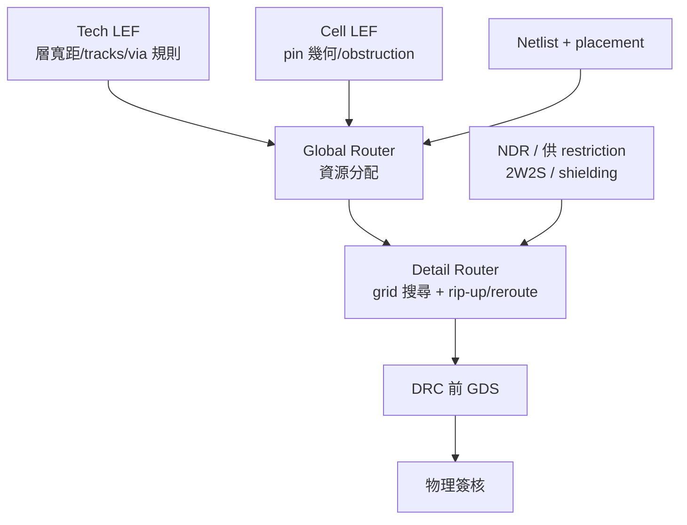

# 4.4 Rule-Driven 的 P&R：繞線器如何在規則縫隙中生存

自動佈局繞線（place and route, P&R，或稱 APR）工具本質上是一個巨大的幾何求解器，但它的每一個動作都受到成千上萬條規則的約束。與其說 P&R 工具在「設計」，不如說它在規則允許的縫隙中尋找一條可行路徑。理解 P&R 的架構，就是理解製程知識如何被編碼成機器可讀的格式，以及繞線器如何在這些約束下掙扎求生。

## LEF/DEF：製程知識的標準化載體

P&R 工具不看 GDSII。它看的是 LEF（Library Exchange Format）與 DEF（Design Exchange Format）——Cadence 在 1990 年代推廣、至今仍是數位後端通用語言的兩種格式。Tech LEF 描述製程層面的知識：每一層金屬的名稱、方向（horizontal/vertical）、最小寬度、最小間距、最小面積；每一種 via 的圖形與電阻電容參數；以及 routing tracks——繞線的格子系統，規定金屬線中心可以落在哪些座標上。Cell LEF 則描述每個 standard cell 的 abstract view：cell 的邊界、pin 的位置與金屬形狀（稱為 pin geometry）、obstruction（cell 內不可繞線的區域）。DEF 則描述設計本身：netlist、placement 結果、繞線路徑。

LEF/DEF 的存在，是製程與 EDA 之間一次重要的解耦：foundry 不需要揭露完整的 GDS 層級資訊（那是商業機密），EDA 工具也不需要理解所有製程細節，雙方只交換「繞線所需的最小知識集」。這種簡化有代價——LEF 中的 abstract view 丟掉了真實版圖的許多細節，因此先進節點的簽核永遠要回到 GDS 與完整 rule deck 重新驗證一次，P&R 的結果只是「很可能正確」，不是「已經正確」。

## Detail Router 如何吃規則

Detail router（詳細繞線器）是 P&R 中規則密度最高的模組。它的輸入是：tech LEF 的層資訊與 track 系統、每個 pin 的位置、以及一張 net 的拓撲。它的任務是在三維的格點圖上，為每條 net 找到一條滿足所有規則的路徑：線寬不低於 minimum width、與鄰線距離不低於 minimum spacing、每一段線的長乘寬超過 minimum area、via 的 enclosure 足夠、同一層的 via 之間保持最小間距。

這些規則以多種形式存在於 tech LEF 中：spacing table（依平行線長度或相鄰寬度而變的間距）、spacing pitch、min step（線端與轉角的最小階梯）、以及 via rule stack（允許的 via 疊層組合）。先進製程還有 unidirectional layer（單向走線）與 preferred direction 約束，讓相鄰金屬層分別走水平與垂直以降低耦合。Router 的核心演算法是網格圖上的迷宮搜尋（A* 或相似變形）加上 rip-up and reroute：當兩條 net 搶同一資源或違反 spacing 時，拆掉其中一條重繞，反覆迭代直到收斂。規則越複雜，每次搜尋的成本越高——這是先進節點 P&R 運行時間爆炸的重要原因之一。

## 供 restriction：NDR 與設計者的干預

製程規則是死的，但設計者可以施加更嚴的「自我設限」，稱為供 restriction 或 NDR（non-default routing rule）。典型例子是時脈網路：為了降低 jitter，時脈線要求雙倍寬度、雙倍間距（2W2S）、或指定屏蔽（shielding）——在兩側鋪地線隔離耦合。這些 NDR 會在 net 層級指定，router 必須為這些 net 選用不同的繞線風格，並確保寬線的 spacing 要求也作用於其鄰居。電源網路則使用更寬的金屬與特殊的 via 陣列規則，以承載大電流並控制 IR drop。P&R 工具的 rule-driven 架構，正是要讓這些「default 之上」的規則能以資料描述而非硬編碼的方式注入流程。

## 從規則縫隙到全局最佳

Detail router 只處理局部，全局資源分配由 global router 先行：把晶片切成分區（gcells），為每條 net 規劃粗略的跨區路徑，避免某些區域被過度塞滿（congestion）。Global routing 的品質決定了 detail routing 能否收斂——如果 global 階段已經把資源用盡，detail 階段再聰明也無路可走。近年學界與工業界有一股把 routing 完全交給機器學習或連續優化的潮流（如以神經網路預測 congestion，Google 2021 年發表於 Nature 的 placement 工作即是代表），但 rule 的存在使這條路特別艱難：ML 模型可以學「大概怎麼繞」，卻很難保證「每一微米都合法」。最終仍需 rule-driven 的 detail router 收尾。這說明了一個結構性事實：只要製程規則以離散、情境相依的形式存在，rule-driven 架構就難以被完全取代。

P&R 的歷史是一部規則複雜化的歷史。從早期 micron rules 時代幾乎可以直接把 wire 拉直，到如今每一條線的寬度、間距、轉角、via 都有情境相依的規則，繞線器的自由度被壓縮到只剩「在縫隙中選擇」。而下一章將看到，規則縫隙的物理來源——微影——本身也在進化，並且反過來把更多規則塞進版圖與遮罩之間的空隙裡。
