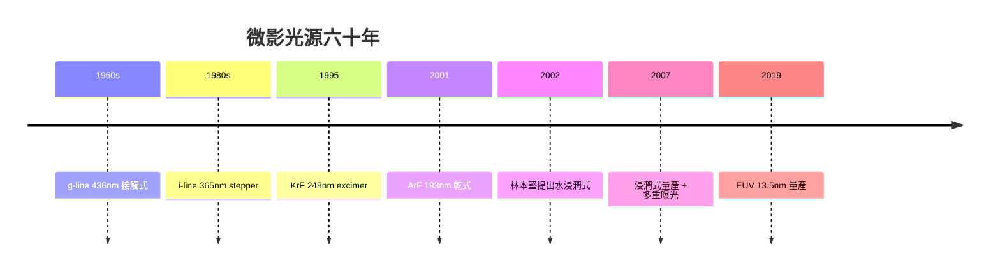

# 5.1 從 g-line 到 EUV：一台微影機的六十年進化

微影（lithography）是 IC 製程的心臟：它決定了一顆晶片上最小的圖案能有多小，因此也決定了摩爾定律能否延續。回顧微影光源的六十年進化，我們看到的不只是波長的縮短，而是一場物理、工程、經濟與產業組織的長期共舞。

## 接觸式與 g-line：手工時代

1960 年代初期，IC 剛從 Fairchild 與 TI 的實驗室走出來，微影使用的是接觸式曝光：光罩直接貼在塗有光阻的晶圓上，用高壓汞燈曝光。汞燈的光譜是線狀的，其中 436 nm 的紫色譜線被選為主光源，稱為 g-line。接觸式曝光解析度不錯，但光罩與光阻直接接觸，每次曝光都會磨損光罩、污染晶圓，良率與壽命都受限。 proximity printing（近接式）稍微改善了壽命，但解析度隨間距變大而下降。這個時代的光罩是手工畫在紅膠片上再縮小照相的，一台微影機的「程式」就是技師的手藝。

## 步進投影機與 i-line：PGI 的革命

兩個發明終結了接觸時代。一是 1970 年代 Perkin-Elmer 推出的掃描投影對準機（micralign），用鏡面反射光學把光罩影像投影到晶圓上，光罩與晶圓不再接觸；二是 1980 年代 GCA 推出的步進重複曝光機（stepper）——一次只曝光一顆 die 大小的區域，然後晶圓步進移動重複曝光。Stepper 搭配更短的 i-line（365 nm）與更好的鏡頭，把最小線寬推向 1 μm 以下，並引入了放大倍率縮小的概念：光罩可以畫成 5 倍大，降低光罩製作誤差。從此，微影機的解析度公式被明確寫下：

$$
R = k_1 \cdot \frac{\lambda}{\text{NA}}
$$

其中 λ 是波長，NA 是鏡頭的數值孔徑，k₁ 是製程因子（理論下限約 0.25，實務上 0.3–0.8）。這條公式成為此後四十年所有微影策略的座標系：要縮小 R，就縮小 λ、加大 NA、或壓低 k₁——三條路徑分別對應了後來的三波技術革命。

## KrF 與 ArF：excimer 雷射時代

汞燈的光譜在 365 nm 以下已經太弱，繼續縮短波長需要新光源。1980 年代，excimer 雷射被引入：KrF 雷射提供 248 nm（深紫外，DUV），隨後 ArF 雷射提供 193 nm。這不只是換一個燈泡——excimer 雷射每發脈衝能量高、頻寬極窄、需要複雜的譜線純化與光學鍍膜，整條供應鏈（Lam、Cymer、Lambda Physik 等光源廠，以及 Nikon、ASML、Canon 等機台廠）因此重組。1990 年代後半，KrF stepper 搭配離軸照明與相移遮罩，把量產節點推進到 130 nm；ArF 則接力到 90 nm 以下。

但 193 nm 之後，物理似乎斷了路：波長更短的 F₂ 雷射（157 nm）遭遇材料災難——沒有透光的光學材料與光阻能在 157 nm 下穩定工作，氟化鈣透鏡的製造也遇到巨大困難。業界在 157 nm 上投入數年後集體承認此路不通。

## 浸潤式：林本堅的 2002 破局

2002 年，當業界還在 157 nm 的死巷裡掙扎時，台積電的林本堅（Burn J. Lin）提出了水浸潤式微影（immersion lithography）：在鏡頭最後一片鏡片與晶圓之間填入一層超純水。水的折射率約 1.44，使得 NA 的有效值突破乾式系統的 1.0 上限（可達 1.35），等效上等於把波長縮短到 193/1.44 ≈ 134 nm。這個想法原理上早有人提過，但工程疑慮極大：水流過晶圓會不會污染？光阻泡水會不會失效？掃描時水層如何穩定？林本堅以詳盡的理論與實驗說服了機台廠——起初 ASML 與 Nikon 都有疑慮，Nikon 甚至押注 157 nm。最終浸潤式在 2004–2005 年量產，直接把 ArF 的壽命延長了十年以上，65 nm、45 nm、32 nm、28 nm 以至 20 nm 以下的多重曝光（double/double-double patterning）都建立在浸潤式機台上。這是製程技術史上由台灣工程師主導的關鍵突破，也奠定台積電在先進微影上的話語權。

## EUV：十年磨一劍

要再縮短波長，可見光與紫外光的光學徹底失效——所有材料都吸收。唯一出路是極紫外光（EUV，13.5 nm），而且必須完全離開透射光學：用多層膜反射鏡（Mo/Si 交替鍍膜，每層反射率約 70%）在真空中反射成像。EUV 從 1980 年代的構想走到 2019 年 ASML 的量產機 NXE:3400 系列，走了三十年，其艱難程度超乎想像：

- 光源：需要把 25–50 kW 的 CO₂ 雷射打到每秒 5 萬次飛行的錫液滴上，使其電漿化發出 13.5 nm 光，功率與穩定性都是極限工程。
- 反射鏡：需要原子級平整的 Mo/Si 多層膜，且因反射率不到 100%，光在機台內反射十餘次後剩不到 2%，曝光效率極低。
- 真空與無塵：EUV 被所有物質吸收，整條光路必須在真空，且任何有機污染都會讓反射鏡變質。
- 奈米級工件台：在真空中以每秒數百毫米的速度移動晶圓，定位精度需達次奈米。

經濟結構也徹底改變：EUV 機台單價從 1.2 億美元漲到 3 億美元以上（High-NA 機台更貴），全球只有 ASML 一家能造，其供應鏈（Zeiss 的鏡頭、Cymer 的光源）構成史無前例的技術壟斷。台積電、三星、英特爾三巨頭成為僅有的客戶。微影從「買一台機器」變成「參與一個地緣政治級的產業聯盟」。

從 g-line 到 EUV，每一次波長跳躍都伴隨著 EDA 的被迫進化：解析度越高，製程變異與光學效應對版圖的影響越細膩，也逼出了 OPC、ILT、多重曝光等一整套計算微影技術。下一節，我們從繞射極限說起。
