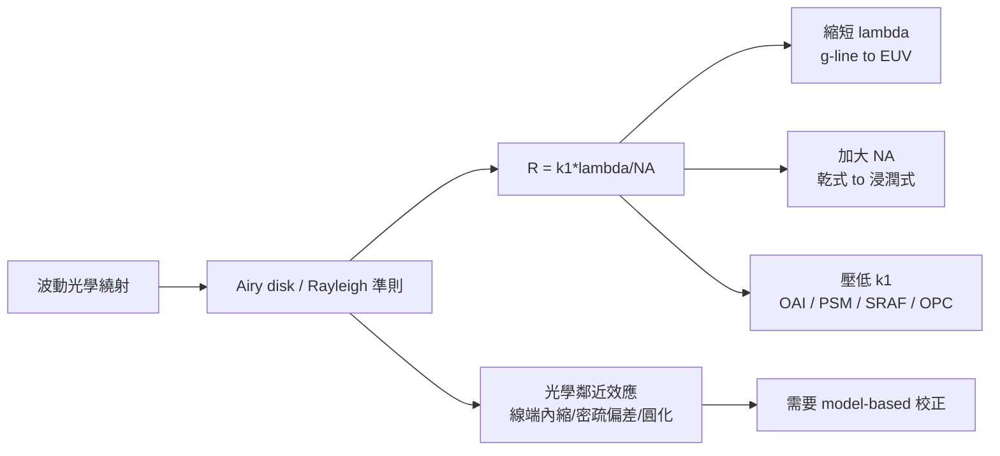

# 5.2 繞射極限與光學鄰近效應：艾利盤的統治

微影的本質是用光「複印」圖案，但光的波動性設下了一道根本性的牆。理解這道牆，才能理解為什麼現代晶片的每一條金屬線、每一個接觸孔，背後都站著一整支計算微影團隊。

## Rayleigh 準則與艾利盤

任何光學系統的解析度，最終受繞射限制。當一個點光源經過有限孔徑的鏡頭成像時，它不會是一個點，而是一個由繞射造成的同心環圖案——艾利盤（Airy disk），中央亮斑被一圈圈暗環與次亮環包圍。這個現象由 George Airy 在 19 世紀描述，而 Rayleigh 準則給出了「兩個點能否被分辨」的判據：當一點的中央亮峰落在另一點的第一暗環上，兩者勉強可分辨。

把這個準則套到微影上，就得到那條支配產業四十年的公式：

$$R = k_1 \cdot \frac{\lambda}{\text{NA}}$$

這裡的 R 是最小可解析的半間距（half-pitch）。λ 是曝光波長，NA 是鏡頭的數值孔徑，定義為 $\text{NA} = n \sin\theta$，n 是晶圓側介質的折射率，θ 是最大集光半角。乾式系統中 n = 1，所以 NA 永遠小於 1；浸潤式微影用 n ≈ 1.44 的水，把 NA 推到 1.35。k₁ 是製程因子，綜合了光阻能力、照明的形式（coherent/partially coherent）、以及一切後處理的功勞，理論極限約 0.25，而現代多重曝光與計算微影硬是把 k₁ 壓到 0.27 以下——接近物理極限的技術孤注一擲。

另一個關鍵量是景深（depth of focus）：

$$\text{DOF} = k_2 \cdot \frac{\lambda}{\text{NA}^2}$$

DOF 隨 NA 的平方而縮小，這解釋了為什麼加大 NA 是一場危險的交易：解析度變好，但對晶圓表面的平坦度、聚焦誤差、光阻厚度的容錯都急遽惡化。浸潤式微影的隱藏代價之一，就是極薄的 DOF 迫使 CMP 平坦度與光阻厚度控制進入前所未有的嚴苛境界。

## 從繞射到影像：光學鄰近效應

艾利盤的統治不只限制最小尺寸，還扭曲了所有圖案的形狀。原因是：晶圓上的每一個圖案點，其實是整個光罩上所有點繞射波的疊加。兩個圖案靠得近時，彼此的繞射波互相干涉，成像結果不等於圖案的獨立成像之和。這就是光學鄰近效應（optical proximity effect, OPE）。

OPE 的具體表現多樣而狡猾：

- 線端內縮（line-end pullback）：線的末端因沒有鄰居補償，成像後縮短，可能短到無法蓋住下方的 via。
- 密疏偏差（iso-dense bias）：獨立（isolated）的線比密集（dense）的同寬線印得更寬，因為密集線的鄰居搶走了曝光能量。
- 轉角圓化（corner rounding）：直角在成像後變圓，因為高頻空間成分被有限孔徑濾掉了。
- 影子效應與 pattern loading：在蝕刻與 CMP 中，密集區與疏稀區的反應速率不同，造成又一層「鄰近效應」。

OPE 對 EDA 的意義重大：它意味著版圖上「畫的形狀」和「做出來的形狀」不是同一回事。設計者畫的是矩形，晶圓上是圓角、內縮、粗細不均的形狀。當節點粗到 500 nm 時這些偏差可忽略；當節點進入 90 nm 以下，OPE 直接威脅功能正確性——via 蓋不住、通道寬度錯誤、線與線之間意外橋接。

## k₁ 的戰爭：把極限推到邊界

面對繞射極限，工程師有幾張牌可打。縮短 λ（第五章第一節的進化史）與加大 NA（浸潤式）是硬體路線；壓低 k₁ 則是計算與製程的混合路線，其手段包括：

- 離軸照明（off-axis illumination, OAI）：讓光以斜角入射，改變繞射階的分佈，對密集週期圖案提升對比。
- 相移遮罩（phase-shifting mask, PSM）：利用相位差 180° 的光互相抵消，把暗區的邊緣變銳利。Levenson 型 PSM 在 1990 年代救了 248 nm 世代的命。
- 次解析輔助圖形（sub-resolution assist features, SRAF）：在主要圖案旁放上小於解析度、不會成像的小線，用其繞射波校正主要圖案的成像。
- 光學鄰近校正（OPC）：直接修改光罩圖形，補償 OPE。

這些技術共同把 k₁ 從 0.8 壓到 0.27 附近，代價是微影從「光學工程」變成「光學 + 計算科學」。每一張光罩的圖形不再等於設計者的意圖，而是經過模型計算的最佳化解——這催生了完整的計算微影（computational lithography）產業，也是 5.3 與 5.4 節的主角。

艾利盤的統治沒有被推翻，只是被巧妙地繞過。EUV 雖然把波長縮到 13.5 nm，但同樣面對繞射與 OPE（只是尺度更小、鏡頭遮蔽與 source-mask optimization 更複雜）。繞射極限是物理，而如何逼近它，是工程、經濟與運算能力的戰場——這正是下一節的主題。
