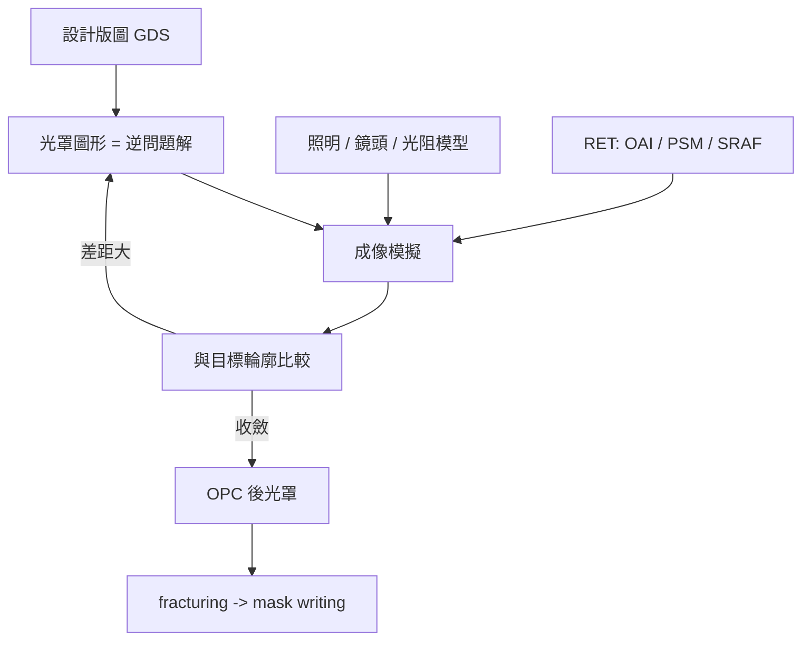

# 5.3 OPC 與 RET：把版圖改到光看得懂為止

當繞射極限成為常態，微影工程師學會了一件違反直覺的事：不要讓光罩忠實於設計。相反地，要讓光罩成為「成像結果的逆問題解」。OPC（optical proximity correction）與 RET（resolution enhancement technology）就是這套思維的具體化，也把微影從光學工程推向了計算科學。

## Rule-based OPC：用查表法起步

最早的 OPC 是 rule-based 的：工具掃描版圖，對每種已知的圖案情境套用預先定義的修正。線端加錘頭（hammerhead）補償內縮；線側加亞解析輔助線（SRAF）校正密疏偏差；轉角加小方塊補償圓化。修正量來自工程師的實驗與經驗，編成 if-then 規則表。rule-based OPC 的優點是快、可預測、易 debug；缺點是規則是離散的情境分類，遇到規則未涵蓋的情境就無能為力，而且規則表隨製程複雜度指數成長，最終難以維護。

## Model-based OPC：把繞射算出來

真正的轉變是 model-based OPC。其原理是建立一個光學影像模型：給定光罩圖形、照明條件（光源形狀）、鏡頭的傳遞函數、光阻的響應，計算出晶圓上實際的影像輪廓（aerial image 經光阻模型轉換為 resist profile）。工具接著迭代地修改光罩圖形，使模擬出的輪廓盡量貼近目標——這在數學上是一個優化問題，目標函數是「模擬輪廓與目標輪廓的差距」，變數是光罩上每一小塊邊緣的位置。

Model-based OPC 的核心想法可以概括為：光罩上多畫一小塊，會讓附近影像變胖一點；少畫一塊，變瘦一點。工具把這種局部線性關係組合起來，反覆修正，直到收斂。這需要的不只是光學模型，還有光阻模型（描述曝光能量如何轉為溶解速率）與蝕刻模型（描述蝕刻的圖案負載效應），合稱 litho-etch-litho 模擬鏈。模型的精確度直接決定 OPC 的品質，因此 foundry 會為每個製程提供校準過的模型（calibrated model），設計公司用 model 校正自己的版圖，再用模型驗證（litho check / contour check）。

## RET 家族：在光源與光罩上下手

OPC 修改的是光罩圖形，RET 則是更廣的一類技術，還包括在照明與光罩相位上下手：

- 離軸照明（OAI）：把光源從中央移到環形、四極（quadrupole）或二極（dipole）形狀，改變繞射階的分佈。對密集週期結構（如記憶體）效果極佳，但照明形狀與圖案方向高度相關，對邏輯電路的多方向圖案需要妥協。
- 相移遮罩（PSM）：在光罩上製造 180° 相位差。Levenson 型 PSM 讓相鄰透明區互相抵消，把暗線銳化；attenuated PSM 則讓「不透明」區微微透光，改善孤立線的成像。PSM 在 KrF/ArF 時代是救命的技術，但相位的設計本身又是一個圖論問題（衝突圖的著色），需要工具自動分配相位並處理無法著色的衝突區（需插入截止條 chromeless phase feature）。
- SRAF：亞解析輔助圖形，幫孤立線「假裝」自己有鄰居。

這些技術共同作用時，問題就變得高度耦合：OAI 的形狀影響 PSM 的可行性，PSM 的相位影響 OPC 的修正量。因此先進製程的光罩最佳化從「各工具獨立跑」進化為「source-mask optimization（SMO）」——同時優化光源形狀與光罩圖形，在多維參數空間中找最佳組合。

## 運算需求的爆炸

Model-based OPC 的運算量驚人。一張先進節點的邏輯光罩有數百億至兆級的邊緣片段，每個片段的修正都要做數十次光學模型計算；一個完整 OPC run 在 2000 年代要數天 CPU time，到了 28 nm 之後更是叢集運算的常客。EDA 公司因此發展出 GPU 加速的計算微影（NVIDIA 與 ASML 合作、Cadence 与 Synopsys 的 GPU 版引擎），而多核心叢集與雲端運算成為 tapeout 前的例行開支。業界甚至有一句半開玩笑的話：「摩爾定律的後半段，是靠摩爾定律養出的運算能力來實現的。」——製程的微縮依賴計算，計算的成長依賴晶片，兩者互為因果，這正是製程與 EDA 共舞最深的結構。

OPC 與 RET 的故事說明了一個深刻的轉變：光罩不再是設計的「複印件」，而是一份為了讓光「看懂」設計而精心編造的密碼。編碼的代價是資料量與運算量的雙重爆炸，而解碼的戰場則轉移到了遮罩製作與遮罩資料準備——這是下一節的主題。
