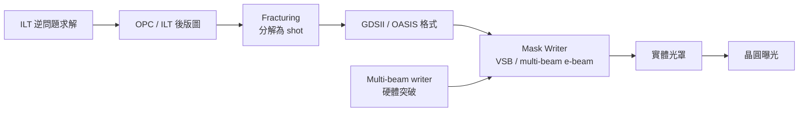

# 5.4 ILT 與 Mask Data Preparation：當遮罩檔案比作業系統還大

OPC 把光罩變成了「逆問題的解」，這個解的代價最終落在了兩個地方：遮罩寫作機（mask writer）的時間，與遮罩資料準備（mask data preparation, MDP）的資料量。當 inverse lithography technology（ILT）把逆問題推到極致，遮罩圖形從簡單的方塊與多邊形變成了像素級的灰階調變，整個遮罩供應鏈被迫重新發明。

## ILT：讓每個像素都成為設計變數

ILT 的思路與 model-based OPC 同源，但更激進：不再只是「移動邊緣」，而是把光罩上每一個像素的透光率都當作優化變數，直接求解「什麼樣的光罩能讓晶圓成像最接近目標」。這在數學上是一個非線性逆問題，用梯度法或壓縮感知類技術迭代求解。ILT 的結果是令人驚豔的：在同等微影條件下，可以獲得比傳統 OPC 更大的製程視窗（process window）、更忠實的輪廓、對線端與轉角的更好控制。它甚至能把某些多重曝光的問題轉化為單次曝光的複雜光罩。

ILT 的商業化歷史曲折。這項技術由 Luminescent Technologies 開發並推廣，2013 年 Mentor Graphics 收購了 Luminescent 的 ILT 技術，把它整合進 Calibre 平台成為 Calibre ILT。業界起初觀望——ILT 產生的光罩圖形極其複雜，曲線輪廓加上無數的小輔助塊，遠超 mask writer 的處理能力。真正讓 ILT 從理論走向生產線的，是兩個外部變化：一是 EUV 時代解析度需求仍舊嚴苛（EUV 的 k₁ 同樣被壓到極限），二是 multi-beam mask writer 的出現。

## Mask writing：從單束到多束電子

遮罩是用電子束寫出來的：電子槍把電子聚焦成極細的束，掃過塗有電子阻的遮罩基板，逐塊曝光。傳統的 variable-shaped-beam（VSB）writer 一次只寫一個矩形（最大約 1–2 μm 的可變矩形），要把整張遮罩的圖形分解成數以千億計的矩形逐一曝光。一張 28 nm 邏輯層的遮罩，VSB 寫作時間約 10–20 小時；7 nm 以下、經過 ILT 的遮罩，寫作時間可能超過 60 小時甚至寫不完——這就是 mask write time 的危機，直接反映在遮罩價格上：一組 7 nm 的光罩價值數百萬美元，先進節點一次 tapeout 的光罩總費用可達上千萬美元。

解法是 multi-beam writer：如 NuFlare 與 JEOL 的多束機台，用數萬甚至數十萬束電子並行曝光，把寫作時間壓回 10 小時量級。這個硬體突破是 ILT 得以量產的前提——沒有 multi-beam，ILT 產生的圖形只是理論玩具。

## Fracturing 與資料量爆炸

從 EDA 的角度，遮罩資料準備面對的是一場資料工程危機。流程是：OPC/ILT 後的版圖先做 fracturing——把所有圖形分解成 mask writer 能接受的 primitive（矩形或梯形）序列，然後壓縮、格式轉換、輸出到遮罩廠。傳統 GDSII 格式（1980 年代 Calma 公司定義）在此暴露嚴重不足：GDSII 只有矩形與多邊形，無法表達曲線，且檔案結構冗長。一張先進節點的 GDSII 檔案可達 TB 級，fracturing 後更膨脹數倍。

業界的回應是 OASIS（Open Artwork System Interchange Standard），SEMI 標準，2000 年代中期由 Cadence 等推動，以更緊湊的編碼、更豐富的 primitive（含梯形、圓、重複結構引用）取代 GDSII，典型可省 50–90% 檔案體積。此外還有 Mask-Write 相關的新格式如 MEBES 的後繼者（e-beam 專用的格式族）與用於 multi-beam 的 format（如 NuFlare 的 EBEAM format 與 SET 的規範）。即便如此，MDP 仍然是「越先進節點，越接近超級電腦叢集」的工作：一個 full-chip 的 mask data volume 破 TB、fracturing 運行數天，需要分散式計算基礎設施——這是 EDA 與遮罩供應鏈交會的前線。

## 經濟與制度的後果

遮罩成本與資料量的爆炸改變了產業的經濟結構。tapeout 不再是「送出檔案、付錢、等晶片」，而是一場與遮罩廠的工程協作：mask 資料品質（如 fracturing 後的 shot 數、寫作時間）直接影響成本與時程，因此 EDA 工具開始把「mask writer friendly」納入優化目標——ILT 演算法會在解析度與 shot 數之間取捨，甚至有專門的「ILT-lite」或「MB-OPC」折衷模式。MPW（multi-project wafer）與開源晶片運動（如 efabless、Tiny Tapeout）之所以能壓低門檻，正是因為它們鎖定在 130 nm 等遮罩便宜、且 OPC 需求簡單的節點上。遮罩經濟學，成為新興設計社群與先進製程之間的一道分界線。

當一張遮罩的資料量超過一個作業系統的核心映像、當一次 tapeout 的遮罩費用超過一座小型晶圓廠的年度預算，我們就明白：計算微影不只改變了「怎麼印」，更重新分配了整個產業的資源與權力。微影與 EDA 的共舞，在遮罩這一層達到最密集的交織——物理極限逼出了演算法，演算法又逼出了新的硬體與新的產業分工。
