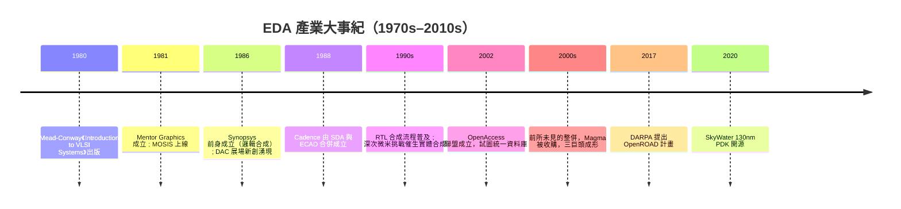

# 1.2 EDA 產業的四十年簡史

要理解 OpenROAD 為何在 2017 年出現，必須先理解它所挑戰的對象：一個累積了四十年的產業。EDA 的歷史，幾乎就是積體電路設計方法論的歷史，兩者互為因果地螺旋上升。

故事的起點在 1970 年代。當時的晶片設計靠人工繪製版圖，工程師用紅寶石刀在透明膠片上刻出電晶體圖形，再縮影製版。Xerox PARC 與 Calma 等單位開始開發電腦輔助版圖編輯與檢查工具，這是 EDA 的史前時代。真正的理論突破來自 1979 至 1980 年：Carver Mead（Caltech）與 Lynn Conway（Xerox PARC）出版了《Introduction to VLSI Systems》，提出一套以 λ 為單位的可縮放設計規則，把版圖設計從「工匠對每一層光罩的直覺」提升為「任何人都可以遵循的系統性方法」。這本書配合 MIT 與 Xerox 開辦的密集課程，在 1980 年代的美国大學培養出整整一代 VLSI 設計者。同一時期，MOSIS 服務於 1981 年上線，把多位使用者的設計併在同一片晶圓上流片，大幅降低學術界的製造成本。方法論、教材、製造通路三者齊備，晶片設計第一次具備了「可教、可學、可量產」的現代學科形態。

有了方法論，工具需求隨之而來。1980 年代的 DAC 展場見證了產業的誕生：1981 年 Mentor Graphics 在奧勒岡成立，率先喊出要為電子設計做「電腦輔助工程」；1986 年，Aart de Geus 與幾位同事離開奇異（GE）的微電子中心，創立了後來的 Synopsys，押注在當時最激進的想法上——邏輯合成（logic synthesis）。在那之前，工程師用硬體描述語言（HDL）寫出電路行為描述，再手工轉成邏輯閘；Synopsys 的 Design Compiler 證明了機器可以自動完成這個轉換，而且品質可接受。這是一場方法論革命：設計焦點從「畫出每個邏輯閘」轉移到「描述電路該做什麼」，RTL（Register Transfer Level）設計流程自此成為業界標準。1988 年，SDA Systems 與 ECAD 合併成 Cadence，版圖編輯（Virtuoso）與之後收購而來的模擬技術，讓它成為類比與客製設計領域的霸主。

1990 年代是 EDA 技術的黃金十年，也是商業格局定型的十年。半導體製程跨入次微米（sub-micron）後，連線延遲（interconnect delay）開始超越邏輯閘延遲，設計不再是「合成完再畫版圖」的線性流程，而必須在實體佈局與邏輯合成之間反覆收斂。這催生了實體合成、時序驅動佈局、信號完整性（signal integrity）分析等一批新工具，也讓 Synopsys 從前端合成跨入實體設計、Cadence 反向進攻前端，兩家產品線全面重疊，競爭白熱化。Verilog 與 VHDL 先後成為 IEEE 標準、UNIX 工作站普及，讓 EDA 成為規模化市場。

然而也正是從 1990 年代末開始，產業走向整併。技術上，先進製程的設計規則越來越複雜，點工具（point tool）無法單獨存活，客戶要求的是「完整流程」；商業上，投資人要求規模，於是收購成為常態。2000 年代的 Cadence 與 Synopsys 各自吞併了數十家公司，曾經以「最好用的點工具」聞名的 Avalon、Simplex、Monterey、Get2Chip 等名字，逐一消失在收購公告裡。唯一在 2000 年代成功上市的新玩家 Magma Design Automation——以「統一資料模型」架構聞名——最終也在 2012 年被 Synopsys 以 5 億美元收購。此後十年，先進數位流程市場上再沒有出現過新的上市公司。三巨頭的格局，就此凝固。

在這四十年裡，也有過幾次「開放」的嘗試，但都沒有觸動根本。2002 年 OpenAccess 聯盟成立，試圖統一業界的設計資料庫格式——這是工具互通的進步，但授權條款並非真正的開源，開放的是資料格式而非演算法。大學方面，伯克利的 ABC（邏輯最佳化）、TimberWolf 佈局器、Magic 版圖編輯器等學術工具，長年是學術界的救命稻草，但多為研究原型，缺乏產業級完善度，難以串成完整流程。換句話說，到 2010 年代中期為止，「從 RTL 走到 GDSII 的完整開源流程」仍然不存在。

商業模式的固化同樣值得細看。三巨頭的主流授權模式是「前期授權費加年度維護費」，維護費通常為授權費的 15% 到 20%，一旦停止繳納，重新啟用往往要補足中斷期間的費用。完整的先進流程一年成本以百萬美元計，學術授權雖有折扣或捐贈，但通常禁止散布工具、限制用途。對新創公司而言，這意味著在賺到第一分錢之前，先要燒掉數百萬美元在工具上——這是晶片新創遠比軟體新創稀少的直接原因之一。

政治與地緣因素則在最後十年加入變數。2010 年代，美中科技競爭升溫，美國政府對華為等公司實施出口管制，EDA 工具明確列於管制清單；歐盟推動《晶片法案》，日本扶植 Rapidus——各國突然意識到，設計工具與光刻機、晶圓廠一樣，都是戰略物資。當一個由三家美國公司壟斷的產業，變成大國博弈的籌碼，「是否有不受單一國家、單一公司控制的替代方案」這個問題，就從學術理想主義變成了政策議題。

回頭看，這四十年呈現出一個清晰的弔詭：EDA 產業在技術上極度開放——發表論文、贊助學術會議、捐贈大學授權——但在知識產權與商業結構上極度封閉。演算法的思想在 DAC、ICCAD 的論文裡人人可讀，把思想變成可用軟體的能力卻被鎖在三家公司手中。這種「思想開放、實作封閉」的結構，正是下一代人要打破的東西。

---

*裂痕已現。下一節，我們回到 2017 年，看 DARPA 如何以一紙合約，賭上「無人值守設計晶片」的瘋狂目標。*
