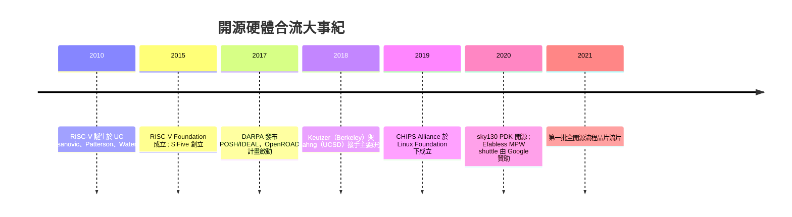

# 1.4 RISC-V 與開源硬體運動的合流

2010 年春天，UC Berkeley 的實驗室裡，Krste Asanovic 與 David Patterson 面對一個看似平凡的問題：他們需要一個指令集架構（ISA）來做研究專案，但無論是 ARM、MIPS 還是 x86，每一個都因為授權與規格的封閉而不合用。ARM 的核心授權費以百萬美元計；MIPS 當時在 Imagination 手中，同樣昂貴；x86 更是完全不對外授權。Patterson——RISC 一詞的發明人之一，1980 年代 Berkeley RISC 計畫的主持人——與 Asanovic 做出了一個影響深遠的決定：與其再跟授權方糾纏，不如自己定義一個全新的、乾淨的、以 BSD 授權完全開放的指令集。RISC-V 就此誕生，學生 Andrew Waterman 與 Yunsup Lee 首先實作了第一版核心。

要理解這個決定的重量，得回顧指令集架構四十年的政治經濟史。從 1980 年代起，ISA 就不只是技術規格，而是一種帝國：Intel 靠 x86 的向下相容累積了數十年軟體資產，ARM 靠 IP 授權模式建立了行動時代的壟斷，每一家都有強烈動機用法律手段（專利、授權條款、保密協定）把 ISA 變成護城河。在這種環境下，「ISA 的開放」本身成為一個激進的政治主張。RISC-V 的技術設計刻意配合這個主張：ISA 本身極簡、模組化（基本指令集 RV32I 加上可選擴充 M/A/F/D/C 等）、無歷史包袱、且刻意避開已知的專利地雷。Asanovic 反覆強調一個關鍵區分：開放的是指令集規格，任何人都可以自由實作自己的處理器——這與「開放一顆特定的處理器原始碼」不同，前者解決的是整個生態系的入口問題。

2015 年，RISC-V Foundation 成立（後於 2020 年遷至瑞士，改名 RISC-V International，以避開地緣政治對單一國家管轄的疑慮），會員迅速擴展到 NVIDIA、Google、Western Digital 等巨頭。同年，伯克利團隊的核心成員成立 SiFive，這是第一家以 RISC-V 為主業的商業公司。SiFive 的存在有其微妙意義：它讓保守的企業客戶相信「開源 ISA 背後有商業支援」，大幅降低了產業採用的心理門檻。到 2020 年代，RISC-V 已滲透到嵌入式控制器、SSD 主控、AI 加速器乃至各大晶片公司的內部專案，出貨量以數十億顆計。

但指令集只是入口，不是終點。要真正「做出一顆晶片」，還需要處理器實作、驗證環境、以及——回到本章主題——設計工具與製造通路。有趣的是，這幾塊拼圖在 2010 年代以近似平行的節奏逐一到位，形成一場未曾事先規劃的合流。

處理器實作方面，伯克利內部發展出的 Rocket、BOOM 等開源核心，配合 Chisel 這個 Scala-based 硬體建構語言，示範了「參數化的開源處理器產生器」的可能；而在伯克利之外，義大利工程師 Claire Wolf 的 PicoRV32 等社群自發貢獻，證明開源社群同樣能產出可用的核心。CHIPS Alliance——一個隸屬 Linux Foundation 的開放專案聯盟，成員包括 Google、SiFive、Esperanto 等——則為這些專案提供了中立的治理傘與資金管道：把開源硬體放在 Linux Foundation 之下，等於宣告「開源硬體要用開源軟體三十年來被驗證過的治理模式」。

工具與製造這兩塊，就是前面兩節的主角的登場。2020 年 7 月，Google 與 SkyWater Technology 宣布將 SkyWater 130nm（sky130）製程的 PDK——標準單元庫、製程設計規則、SPICE 模型——以 Apache 2.0 授權完全開源。這是一個歷史性時刻：PDK 過去是晶圓廠最核心的機密，簽 NDA 才拿得到；開源 PDK 意味著任何工具（包括 OpenROAD）都可以針對一個真實可流片的製程做設計，而不需要簽任何合約。同一時間，Google 也贊助了 Efabless 平台上的 MPW（Multi-Project Wafer）shuttle——例如 MPW-1 到 MPW-4 等多個 run——讓設計者只需支付極低費用（早期甚至免費），就能把自己的設計與數百個其他專案併上同一片晶圓；Efabless 的 Caravel 軟板（harness）則代勞了 I/O、電源、管理核心等周邊。

把這些事件排成一條線，會看到一個完整的閉環就此成形：RISC-V 提供了免費的架構與開源核心，OpenROAD 提供了從 RTL 到 GDSII 的工具鏈，sky130 提供了真實的製程資料，Efabless 與 Google 贊助的 MPW 提供了低成本流片通路，CHIPS Alliance 與 Linux Foundation 提供了治理基礎設施。任何一個大學生，用一台筆記型電腦、零授權費，可以在數個月內走完「寫 RTL → OpenROAD 實體設計 → sky130 PDK → MPW 流片 → 拿到真晶片測試」的全流程。這在 2010 年不可想像，在 2021 年成為現實——它終於與軟體產業「一人一機即可創業」的門檻站在同一條起跑線上。

這場合流背後的思想底蘊，可以追溯到 Richard Stallman 的自由軟體運動（1983）、Linux 的誕生（1991）與開源軟體的商業化這條主線。開源軟體用三十年證明了：品質可以透過透明與眾人審視提升；商業與開源可以共榮；知識的公共財化會產生外部性紅利——Python 教育出一整代資料科學家，Linux 教育出一整代系統工程師。開源硬體運動做的，就是把這套思想移植到半導體領域，而它面對的敵人——更高的資本門檻、更深的專業分工、更強的商業鎖定——也更頑固。正因如此，這場革命需要的不只是理想主義者，還需要 DARPA 這樣願意承擔早期風險的國家機構、Google 這樣有戰略眼光的企業、以及 Keutzer、Kahng、Asanovic 這樣既有學術聲望又願意投入工程的領袖。

回望第 1 章的起點：1980 年 Mead-Conway 曾經許諾的「人人都能設計晶片」的理想，在商業工具與封閉授權的高牆下沉睡了近四十年，最終由一個政府機構的賭注、一所大學的指令集、一家搜尋引擎公司的 PDK 開源，加上數百名社群工程師的程式碼，重新接了起來。這就是 OpenROAD 誕生的完整前史。接下來，我們從歷史走進實作：安裝 OpenROAD、理解它的架構、並親手把一顆設計送上矽。
