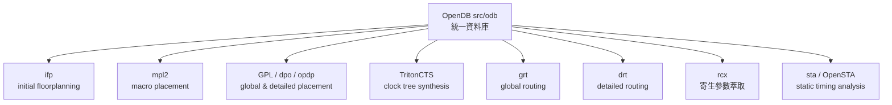

# 2.1 單一應用程式與模組化資料庫 OpenDB

EDA 工具的歷史，很大程度上是一部「資料格式戰爭」的歷史。1980 年代，Cadence、Mentor Graphics、Synopsys 等公司各自打造自己的內部資料庫，工具之間靠 LEF/DEF、Verilog、SDF 這類交換格式傳遞設計。交換格式解決了互通問題，卻也付出了代價：每一次格式轉換都是一次資訊損耗與時間浪費，實體設計工程師的日常，就是在不同工具之間來回 export/import，等待檔案讀寫，然後處理轉換過程中「消失」或「被改壞」的資訊。

這種碎片化的架構背後有其商業邏輯。封閉的內部資料庫是護城河，工具之間的摩擦是綁定客戶的手段。但當 DARPA（美國國防高等研究計畫署）在 2017 年左右意識到美國晶片設計人才與工具生態的瓶頸時，碎片化正是他們鎖定的核心病灶之一。DARPA 的 EDA 計畫（後來稱為 IDEA 與 POSH 計畫）資助了 OpenROAD 專案，由 UC San Diego 的 Andrew Kahng 教授領銜，目標寫得非常直接：「24 小時內、自動化完成、從 RTL 到 GDSII」——24-hour, No-human-in-the-loop (NoHL) 的晶片設計。要達成這個目標，第一件事不是寫新的演算法，而是把整條流程建立在同一個資料庫之上。

## Unified Application 的哲學

OpenROAD 的答案是「單一 unified application」：一個可執行檔 `openroad`，內部整合了從 floorplanning、placement、CTS、routing 到 signoff 的所有引擎。這不是把多個獨立工具用腳本串起來的「工具鏈」，而是真正共享記憶體中的設計資料。前一個引擎寫入的結果，後一個引擎立刻可見，不需要任何檔案交換。

支撐這個架構的核心，就是 OpenDB——一個以 C++ 撰寫的模組化資料庫，存放在原始碼樹的 `src/odb` 目錄。OpenDB 儲存的是晶片實體設計的完整描述：tech LEF 定義的製程層與設計規則、cell LEF 定義的單元外觀與 pin 位置、DEF 描述的 netlist 與擺放結果，以及 wire、via、blockage、region 等所有實體物件。它自己就是 LEF/DEF 的完整 parser 與 writer，因此 OpenROAD 讀入 LEF/DEF 之後，資料就活在 OpenDB 裡，所有引擎直接操作這些 C++ 物件。

OpenDB 的 API 設計遵循一個簡單原則：資料庫的每個概念物件都有對應的 C++ class，並且提供綁定。OpenROAD 同時支援 Tcl 與 Python 兩種介面（下一節會詳談），代表你可以用腳本語言直接增刪改查晶片上的任何物件——查一個 instance 的位置、改一條 net 的 routing、列出一個 master cell 的所有 pin。這種「資料庫即 API」的設計，讓研究者與工程師不必碰 C++ 也能寫出操作設計的工具，這正是開放生態能長出枝葉的土壤。

## 模組化的引擎群

OpenDB 之上，各個引擎以模組形式存在，每個目錄對應一個功能域：



這些名字背後多是學術界的明星演算法：ifp 處理 die area、core area 與 IO pin 擺放；mpl2 做巨塊（macro）擺放；gpl 是基於 ePlace/RePlAce 思想的 global placement；TritonCTS 長時脈樹；grt 與 drt 分別做 global 與 detailed routing（後者即 TritonRoute）；rcx（OpenRCX）做寄生參數萃取；而 OpenSTA 則來自工程師 James Cherry 獨立開發的時序分析器，後來捐給 OpenROAD 計畫，成為整個開源世界事實上的 STA 標準。

模組化不代表各自為政。所有引擎共享同一份 OpenDB 資料與同一套技術檔案（Lef/Def、 Liberty、SDC 約束），這讓整條流程可以被一段連續的腳本驅動。實際使用時，你啟動 OpenROAD 的方式就是：

```tcl
openroad
openroad> read_lef platform/lef/sky130_fd_sc_hd.tlef
openroad> read_def design.def
openroad> initialize_floorplan -die_area {0 0 200 200} \
    -core_area {10 10 190 190} -site unithd
openroad> global_placement
openroad> write_def placed.def
```

每個命令背後就是對應引擎的一次執行，而中間沒有任何檔案落地——資料始終在 OpenDB 記憶體中流動。

## 為什麼這件事難

有人可能會問：統一資料庫聽起來不難，為什麼三十年來業界沒人這樣做？難點在於「完整」與「效率」的張力。實體設計資料橫跨多個抽象層次：邏輯網表、時序約束、物理幾何、寄生參數、製程規則，彼此互相引用、隨時更新。 routing 改一條線，寄生電容變了，時序就跟著變，placement 可能要重做。在交換檔案的世界裡，這個循環以「天」為單位；在 OpenDB 的世界裡，以「分鐘」為單位。把這些資料放進一個一致、可增量更新、支援百萬級物件的資料結構，是真正的工程挑戰。

OpenDB 的另一個歷史角色是向後相容。它不要求使用者拋棄既有工具，而是完整讀寫業界標準格式——LEF/DEF 由 Cadence 於 1990 年代開放規格（OpenDB 內建的 lexer 就源自 Cadence 釋出的開源版本），Liberty 格式則是 Synopsys 的時序庫標準。OpenROAD 的策略是「吃標準格式，住統一資料庫」，這讓它能嵌進任何以 LEF/DEF 為界的流程裡，包括我們在上一章討論過的 veryl2chip 這類小型開源工具鏈——它們產出的 DEF，理論上可以直接交給 OpenROAD 接手後段實體設計。

## 給學習者的話

理解 OpenDB，等於理解 OpenROAD 的骨架。如果你打開 OpenROAD 原始碼，會發現 `src/odb` 的程式碼風格樸素、註解完整，甚至附有 Python/Tcl 的 SWIG 綁定產生器。對想入門 EDA 開發的人來說，從 OpenDB 的 API 開始讀，遠比從 routing 演算法開始讀更友善——因為資料模型是所有演算法的共同語言。三十年來 EDA 的封閉把人才擋在門外，而 OpenDB 把門打開了：晶片設計的知識，第一次可以被完整地閱讀、修改與傳授。這不只是技術架構的選擇，也是一種教育與文化的宣言。
