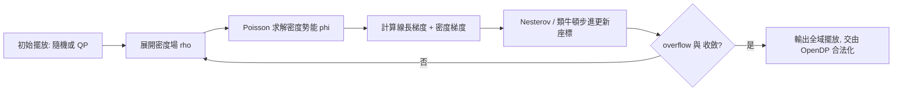

# 4.1 Global Placement 與 RePlAce 演算法

在晶片實作（Physical Implementation）的流程裡，合成（Synthesis）把 RTL 變成了成千上萬個 standard cell，但這些 cell 此刻還只是一堆「散落的零件」，沒有任何位置資訊。接下來的第一個實體化步驟，就是擺放（Placement）。業界慣例把這件事切成兩段：先做 Global Placement（全域擺放），再由 Detailed Placement（細部擺放，OpenROAD 中的 OpenDP）完成合法化。為什麼要切兩段？因為「把十萬個 cell 放到最佳位置」是一個極大規模的連續優化問題，若直接在離散的 row/site 格點上求解，組合爆炸會讓問題完全不可解。Global Placement 的思路是先放寬（relax）問題：允許 cell 重疊、允許不對齊格點，在連續座標空間中求得一個「大致正確」的分布，最後再由合法化步驟收尾。這種「先連續、後離散」的分層哲學，是 EDA 演算法數十年來最核心的設計思想之一。

Global Placement 的目標函數主要是三項：總繞線長度（HPWL 或更精確的半週長線長）、密度均勻性（每個區域的 cell 面積密度不能超過目標），以及時序與功耗的間接考量。早期學術界的作法是 Quadratic Placement——把線長近似成二次函數，用線性系統求解器一口氣解出所有 cell 座標。這招快，但無法處理密度約束：二次優化總是傾向把相連的 cell 擠成一團。於是 2000 年代出現了 Force-Directed Placement 的復興，以及更有系統的「先放到處都是、再慢慢疏散」的 Simulated Annealing 路線（IBM 的 Timberwolf 是經典），但 annealing 在現代規模下太慢，終究退出主流。

真正的轉折發生在 UCSD。Andrew Kahng 實驗室（也就是後來打造 OpenROAD App、Iris 團隊的同一批人）在 2018 年前後發表了 RePlAce：一套以靜電學（electrostatics）為基礎的非線性優化框架。RePlAce 的洞見非常優雅：把每個 cell 想成一個帶正電的粒子，cell 之間由「線長力」互相吸引（這部分沿用線長對座標的梯度）；同時把 cell 密度場視為電荷密度，用 Poisson 方程求解出密度勢能場，這個勢能場對 cell 產生一股「排斥力」，把過度擁擠的區域推開。於是整個 Global Placement 變成一個物理系統：粒子在「吸引」與「排斥」兩種力場下，經由類牛頓法（nonlinear preconditioned conjugate gradient，實作上採用 Liu and Nocedal 的 limited-memory BFGS 思路）反覆迭代，最終收斂到一個既線長短、又密度均勻的分布。

$$
\nabla^2 \phi(\mathbf{x}) = -\rho(\mathbf{x}), \qquad \mathbf{D}(\mathbf{x}) = -\nabla \phi(\mathbf{x})
$$

其中 $`\rho`$ 是由 cell 面積展開（通常用高斯核 spread）得到的密度函數， $`\phi`$ 是密度勢能， $`\mathbf{D}`$ 是密度梯度。吸引力來自半週長線長對 wire 權重的平滑近似（rewrite 成誤差函數 erf 的加權，使不可微的 max 變成可微的平滑函數），排斥力來自上面的 $`\mathbf{D}`$ 。每輪迭代以動態調整的 density penalty 權重 $`\lambda`$ 控制兩者平衡：一開始幾乎只顧線長，cell 自由聚類成大團；隨著 $`\lambda`$ 漸增（實作上是全域收縮 density penalty target），粒子團被逐輪「撐開」，最終攤平到合法密度。這個「先聚類、後疏散」的過程在 GDS 之前的佈局圖上看起來就像細胞分裂，OpenROAD 的 gpl 模組（Global Placement，fork 自 RePlAce 的 C++ 版本）在每輪迭代後都可以輸出中間擺放結果，教學上非常直觀。

mermaid 圖描述 RePlAce 的迭代迴圈：

值得說明的是，OpenROAD 對 RePlAce 的整合不只是把論文程式碼搬進來。2018 年 Kahng 團隊在 DARPA CRAFT 與 IDEA 計畫的資助下，把 RePlAce 以 C++ 重寫並整合進 OpenROAD，成為今日的 `gpl` 模組（指令 `global_placement`）。這段歷史也是開源 EDA 制度化的一個縮影：過去大學研究原型發完論文就束之高閣，OpenROAD 提供了一個「研究演算法可以直接被產業測試、回饋、迭代」的載體，RePlAce 因此從學術 demo 變成可以跑在 SKY130、Nangate45 等 open PDK 上、支援數十萬 cell 的實用工具。同一時期 Google 與 Columbia 大學的論文（例如 2021 年 Nature 上關於 RL 擺放的討論）也引發了「ML 能否取代演算法擺放」的論戰，但直到今天，靜電學方法仍是唯一在開源工具中穩定落地的 Global Placement 主力，RL 與 GNN 更常扮演參數調優、flow 建議等輔助角色。

實務層面，呼叫 OpenROAD 的 global placement 時，幾個關鍵參數值得理解。`-density` 設定目標擁塞密度（例如 0.6 表示每個 bin 最多塞 60% 面積的 cell），設太低會把 cell 推得太散、線長暴增；設太高則後續 Legalization 與繞線會塞車。`-timing_driven` 與 `-routability_driven` 開關分別啟用時序驅動與可繞性驅動模式：前者在迭代中對 critical net 增加權重（並用虚拟 net/virtual path 修正延遲），後者以 GCell 層級的繞線需求估計動態插入 padding，避免擺放結果造成繞線器無解。密度與擁塞的細節正是下一節的主題。

回頭看思想史，RePlAce 的成功還有一層教育意義：它把一個「演算法問題」重新表述成一個「物理問題」，讓任何學過電磁學的電機系學生都能直觀理解 Placement 在做什麼——帶電粒子在勢能場中找能量最低點。這種跨領域類比正是 EDA 演算法最迷人的地方，也是 OpenROAD 作為教學與研究平台最珍貴的資產：程式碼完全開源、論文與實作一一對應，你可以在 `gpl` 的原始碼裡親眼看著 Poisson 方程變成 C++ 迴圈。理解了 Global Placement 之後，下一步就是面對它遺留的兩個敵人——擁塞與密度，這正是 4.2 要談的內容。
