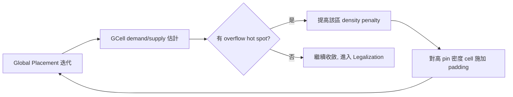

# 4.2 擁塞與密度：繞線塞車的預防醫學

如果說 Global Placement 是把十萬個 cell 放到「大致正確」的位置，那麼這個大致正確裡藏著一個致命的陷阱：它可能放出了一個線長極短、時序極好、但根本繞不過線的佈局。繞線器（Router）的資源是有限的——每個 GCell、每一層金屬上的 track 數量是固定的，如果某一小塊區域擠了太多 cell、太多 pin，繞線需求就會超過供給，這就是擁塞（Congestion）。擁塞一旦發生在 Detailed Placement 之後才被發現，回頭重跑 Placement 的代價是數小時甚至數天的 flow 時間。因此現代 Physical Design 把擁塞管理當成一種「預防醫學」：與其病發後治療，不如在 Placement 階段就注射疫苗。

先建立量化的直覺。把 die 劃分成 $G_x \times G_y$ 個 GCell，對每個 GCell 與其四邊，繞線需求（demand）是「需要穿過這條邊界的 net 數」，供給（supply）是「這條邊界上所有金屬層可用的 track 總數」。擁塞度就是：

$$\text{Congestion} = \frac{\text{Demand}}{\text{Supply}}$$

超過 1 的地方就是塞車點。經驗法則上，Routing 階段的 demand/supply 比建議保持在 0.9 以下、區域最大值不超過 1.1 到 1.2，留給 clock net 與 ECO 的餘裕。這個供需模型正是學術界「可繞性驅動擺放（Routability-Driven Placement）」二十多年研究的基礎：從 ISPD 2011、2012 的 Routability-Driven Placement Contest 開始，如何預測並消除 hot spot 成為獨立的競賽題目，也催生了商業與學術工具共同的標準手段——padding（在 cell 周圍虛擬地佔用額外空間，降低 pin 密度）與 congestion-aware weighting（對穿越 hot spot 的 net 加重線長懲罰）。

OpenROAD 的 gpl 實作了完整的 routability-driven 流程。當 `-routability_driven` 開啟後，工具會在 RePlAce 的迭代過程中定期（以 iteration 數與 overflow 收斂情況觸發）做一次快速的 GCell 層級繞線估計：用 FAxRy 之類的簡化模型或呼叫 fast route（OpenROAD 的 `grt` 模組，基於 FastRoute 演算法的整合版）估算每個 GCell 邊界的 demand/supply。凡是 overflow 的區域，工具會做兩件事：一是提高該區域的 density penalty，把 cell 推走；二是對 pin 密度過高的 macro 或 cell 施加 padding，相當於在擺放階段就替繞線器預留走線空間。整個回饋迴圈會重複數輪，直到 overflow 收斂或達到迭代上限。這正是「預防醫學」的具體形態——在細節繞線前，先用便宜的估計手段把塞車點消滅。

密度（Density）與擁塞（Congestion）是相關但不相同的兩件事。密度是面積的概念——某個 bin 裡 cell 面積佔了多少百分比；擁塞是繞線資源的概念——某個通道需要多少 track。一個區域可以密度 60% 卻嚴重擁塞（例如硬 macro 的 pin 全擠在一側，或一排小 cell 的 pin 全部朝向同一條通道），也可能密度 85% 卻不擁塞（cell 大而 pin 稀疏）。這就是為什麼 RePlAce 的密度目標 `-density` 不能設得「越低越好」：密度設太低，cell 被過度推散，線長暴增、時序變差、功耗上升；密度設太高，擺放結果緊湊漂亮，但 Legalization 階段找不到足夠的合法位置可挪，繞線階段更是寸步難行。實務上，對 SKY130 這類 standard cell 高度固定的製程，典型目標密度落在 0.55 到 0.75 之間，並視 macro 佔比與 power strap 佔用的空間調整。

另一個經常被忽略的事實是：Placement 看到的「可用面積」必須先扣除 blockage 與 special wiring。Floorplan 階段擺好的 macro、power ring、power strap、I/O pin 的 keep-out，都會透過 placement blockage 傳給 gpl；這些區域既不能放 cell，也會切斷上方的繞線通道。老練的設計者會在 Floorplan 階段就對 macro 周圍加上 halo（環形 keep-out），這不是潔癖，而是因為 macro pin 通常從特定邊伸出，緊貼 macro 的 cell 會把 pin 通道堵死。類似地，在低層金屬資源緊張的製程（例如僅 5 到 6 層金屬的 SKY130），凡是會用 M1/M2 做電源布線的設計，都要預先在 density 目標裡留出餘裕，否則 detail route 會發現標準 cell pin 層的通道已被 power strap 吃掉大半。

擁塞的度量與回饋在 OpenROAD 中有三個層次。第一層是 gpl 自身的 overflow 指標（bin 層級密度超標的百分比），這是收斂的內部訊號；第二層是 grt 在 global route 後給出的 per-layer、per-GCell 擁塞報告，這是判斷「擺放能不能繞」的準則，通常在 CTS 前的 post-placement optimization 時檢查；第三層是 detailed route（OpenROAD 的 `drt`，基於 TritonRoute）之後的最終 DRC/short 報告，這時才發現擁塞就太晚了。實務上的檢查點設計是：placement 收斂後先跑一次 global route，看 overflow 與 worst congestion hotspot；若有 hot spot，回到 placement 調降 density 或手動加 blockage，而不是硬著頭皮往下走。這種「每個階段都向前驗證下一階段可解性」的思想，是 Physical Signoff 品質的基礎，也解釋了為什麼 OpenROAD 要把 gpl、grt、drt 這些模組緊密整合在同一個記憶體空間裡——階段間的回饋代價越低，「預防醫學」才越可行。

從更大的視野看，擁塞問題的興起本身就是製程演進的產物。1990 年代只有 3 層金屬時，繞線資源極度稀缺，擺放幾乎總是 channel-based；0.13μm 之後金屬層增加到 7 層以上，通道被 cell 之間的直接 over-the-cell routing 取代，表面上看資源變多了，但 cell 也越做越密、pin 越來越多，供需依然是緊的。到了 FinFET 世代，pin 全部集中在中層金屬（M2/M3 pin access 問題），且 double patterning 進一步限制同一層的 track 選擇，擁塞預測從「估計」升級為「必要籤核（signoff）」。OpenROAD 選擇把一個還算輕量的 FastRoute 常駐在 flow 裡反覆呼叫，正是為了讓小團隊也能負擔得起這種預防性的反覆驗證。下一節我們回到擺放本身：Global Placement 放出了一個理想但非法的解，如何把它變成 legal 的、一格一格對齊的擺放？這是 OpenDP 的工作。
