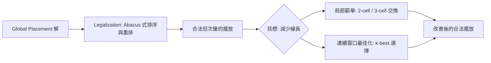

# 4.3 Detailed Placement：合法化與 OpenDP

Global Placement 給出的解是連續空間上的：cell 可以落在 die 的任何實數座標，甚至彼此重疊。但真實的晶片不是連續的——standard cell 必須一個個排在 row 裡，每個 cell 的左下角要對齊 site 的格點，同一個 row 內的 cell 不能有任何一絲重疊，還要滿足電源軌（power rail）的方向要求。把連續解轉成這種合法解（legal solution）的過程叫 Legalization（合法化），而合法化之後再進一步微調 cell 位置以改善線長與時序，就是 Detailed Placement（細部擺放）。在 OpenROAD 裡，這整件事由 `dpl` 模組承擔，也就是 OpenDP（Detailed Placement 的官方名稱），背後同樣是 Andrew Kahng 的 UCSD 團隊（Iris 小組）為 OpenROAD 開發的成果。可以說，第 4 章的這三部曲——RePlAce 負責「理想解」、OpenDP 負責「現實化」——正好對應了 EDA 的永恆主題：數學之美必須落回工程之約束。

Legalization 本身是個經典的組合優化問題：給定一組有寬度的矩形與一組固定的 row/site 網格，要求把每個矩形放到不重疊的格點上，並最小化總位移（或 HPWL 增量）。這問題是 NP-hard 的，但三十年來累積了許多優雅的多項式時間近似。最著名的是 Frank M. Johannes（慕尼黑工大）1996 年提出的 Tetris 演算法：把 cell 依座標排序，一個個像俄羅斯方塊一樣「丟」到最近的合法空位。Tetris 快得驚人，但容易在局部堆出險峻的密度。後續的研究把它系統化：Abacus 演算法（Spindler 與 Johannes，2008）在 Tetris 之後再對每個 cluster 做精確的重排優化，把線長增量壓得更低；HKNU 與 NTU 團隊也在 ISPD Legalization Contest（2013 前後）中發展了以區域流為核心的方法。OpenDP 的 legalizer 採用的正是 Abacus 這一脈絡的方法，這也是為什麼它的 legalization 品質在開源工具中名列前茅。

Legalization 之後，Detailed Placement 接手做「局部微調」。此時每個 cell 都已合法，但 global placement 的連續最優解被合法化「打斷」後，總有若干 cell 被迫離開理想位置。Detailed Placement 用更精細的局部變換來找回這些損失：

具體手段包括：同一 window 內兩個 cell 的 swap（交換位置）、三個 cell 的 cyclic swap、以及把一小段連續 cell 拔起來重新窮舉排列的 window-based refinement。這些操作的共同特徵是：變換空間小到可以窮舉或近似窮舉，但合併起來對總線長的改善可觀。OpenDP 實作了上述的合法化與若干改善變換，並且提供 `detailed_placement` 指令；它還有一個獨立的子功能 DPO（Detailed Placement Optimization，以 `improve_placement` 指令呼叫），專門做這種事後的局部改善，對典型設計能把 HPWL 再壓低幾個百分點。別小看這幾個百分點——在時序緊的設計裡，關鍵 path 上 1μm 的線長差可能就是 setup 失敗與通過的差別。

實務上使用 OpenDP 有幾個必須理解的檢查項。第一是 site 與 row 的設定：合法化完全依賴 tech lef 與 floorplan 中定義的 site 尺寸與 row 結構，如果 floorplan 的 row 沒有對齊 site、或 macro 阻斷了 row 的連續性，legalizer 會無解或產生極差的結果。第二是 max displacement（`-max_displace` 之類的參數）：legalization 時允許 cell 移動的最大距離。放太寬，cell 會被丟到離 global placement 理想解很遠的地方，時序退化；放太窄，legalizer 在高密度區可能直接失敗。這正是 4.2 節擁塞管理的回聲——legalization 的成敗，一大半在 placement 的 density 目標裡就決定了。第三是 power rail 方向：standard cell 的電源 pin 依 row 交替方向（tap cell、well tap 的插入也必須考慮），OpenROAD 的 `tapcell` 指令通常在 placement 之前或之後插入這些 cell，OpenDP 需要與之協同。

時序驅動的細節擺放也是必要的。Global Placement 的 timing-driven 模式已經對 critical path 加權，但合法化的「一視同仁」可能把一個 setup slack 只剩幾 ps 的 cell 挪遠。OpenDP 的改善流程可以配合 OpenSTA 的報告，對 critical cell 的移動設限制或給較高的優先權；更完整的 post-placement timing recovery 則由 OpenROAD 的 `rsz`（resizer）負責——它會在 placement 之後做 gate sizing、buffer insertion，這些操作同樣必須經過 OpenDP 的合法化。這個「rsz 改一點、dpl 合法化一點」的緊密循環，是 OpenROAD 相較於傳統點工具鏈（工具間靠檔案交換、每輪迭代都要重新讀取資料庫）最大的效率優勢之一：所有模組共用同一個 ODB（OpenDB）資料庫，任何改動即時可見。

從歷史與制度的角度看，Detailed Placement 曾長期被視為「不性感」的問題——比起 global placement 的物理類比與 ML 故事，legalization 聽起來像會計工作。但開源 EDA 的發展恰好證明了反面：沒有高品質的 OpenDP，RePlAce 的數學再漂亮也無法變成可簽核的結果。DARPA 的 OpenROAD 計畫（2017 年啟動，目標是 24 小時內從 RTL 到 GDS，即所謂「24-hour rule」）的深層意義正在於此：它不是資助單一演算法，而是補齊整條 flow 中每一個看似平凡的環節，讓學術界三十年的 placement 研究積累（Tetris、Abacus、RePlAce、ePlace 系列的能量法）全部沉澱為可執行、可組合、可教學的開源實作。對學習者而言，OpenDP 的原始碼規模不大、結構清晰，是把「合法化」這個教科書章節讀成可執行程式的最佳素材。擺放至此完成，cell 已各就各位——接下來第 5 章轉向另一個維度：時間。我們先從所有時序判斷的裁判——OpenSTA 開始講起。
