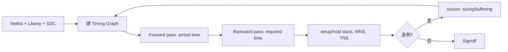

# 5.1 OpenSTA：靜態時序分析的核心

數位晶片的整個設計流程，最終都要回答一個問題：這顆晶片在想要的時脈頻率下，能不能正確工作？動態模擬（simulation）無法窮舉所有輸入組合與所有路徑，於是業界發展出 Static Timing Analysis（STA，靜態時序分析）：不施加任何特定的輸入向量，而是對電路中所有的 timing path 進行窮舉式的圖論分析。STA 在 1980 年代由 IBM、Bell Labs 等公司的內部工具開創（S. Even、S. Muroga 等學者早期對 combinational circuit delay analysis 的研究是理論基礎），到 1990 年代隨著 Synopsys 的 PrimeTime 成為簽核（signoff）標準，形成了延續至今的範式：以 SDC（Synopsys Design Constraints）描述時序約束，以 Liberty（.lib）格式描述 cell 的 delay/transition 查表，以圖的方式窮舉所有 startpoint 到 endpoint 的路徑，計算 setup 與 hold 的 slack。

OpenSTA 就是這個範式的開源實作，也是業界唯一成熟、被實際產品採用的開源 STA 引擎。它由 James Cherry 從 2010 年代中期開始開發維護，最初作為獨立專案（fork 自 Parallax 的 PVT 相關工作脈絡——James Cherry 曾在 Parallax Research 從事 STA 相關開發），後來整併進 OpenROAD，成為其中的 `sta` 模組。Cherry 本人是資深的 timing 簽核工程師，這個出身決定了 OpenSTA 的性格：它不追求演算法的花哨，而是忠實地實作 PrimeTime 語意的每一個角落——SDC 命令的行為、report_timing 的輸出格式、path group 的分類——使得任何熟悉 PrimeTime 的工程師可以幾乎無痛地把 OpenSTA 當成免費的簽核級工具使用。這種「語意相容」策略是開源 EDA 制度設計上的聰明之處：不是要使用者拋棄既有知識，而是讓既有知識直接遷移。

STA 的數學核心並不複雜。把 netlist 視為有向圖：節點是 pin，邊是 cell delay 與 net delay。對每個 pin 計算兩個值：arrival time（訊號實際到達時間）與 required time（依約束推出的最晚允許時間）。slack 定義為：

$$\text{slack}_{setup} = t_{required} - t_{arrival}$$

$$\text{slack}_{hold} = t_{arrival} - t_{required,hold}$$

全域搜尋時沿圖做 forward pass（計算 arrival）與 backward pass（計算 required），因為 delay 是 monotonic 的（輸入 transition 越慢、輸出 transition 越慢、delay 越大），只需要追蹤每個 pin 的 worst case 就能得到全域 worst path——這正是「static」的效率來源：不用考慮所有 transition 組合，只要沿著最壞的傳播。兩個全域指標隨之而來：WNS（Worst Negative Slack，最差路徑的 slack，若為正則全部通過）與 TNS（Total Negative Slack，所有違例路徑 slack 的總和），前者衡量最壞點，後者衡量違例的廣度。Physical Design 工程師的日常就是盯著這兩個數字：WNS 決定頻率上限，TNS 決定修復的工作量。

delay 的計算則完全來自 Liberty 查表。每個 cell 在 .lib 中以輸入 transition 與輸出 load 為軸的二維 table 描述 delay 與 output transition；net 的 delay 則由 RC 模型（早期用 Elmore delay，簽核級用 NLDM/CCS 的 driver model）計算。流程上，Placement 階段還沒有真的繞線，net 的 RC 用估計值（例如以 HPWL 估計的線長搭配 wire load 或虚拟 route 模型），因此此時的 STA 結果是「有系統性偏差的預測」；繞線之後以 parasitic extraction 的真實 RC 重算，才是最終簽核。理解這個「估計逐步逼近真實」的階層，是理解 Physical Design 節奏的關鍵：Placement optimization 時用便宜的估計做方向性決策，Route 後用昂貴的精確值做最終判決。

在 OpenROAD 中，OpenSTA 的角色遠不止「最後簽核」。它是整個 flow 的反饋迴路中樞：global placement 的 timing-driven 模式會呼叫它取得 critical net 權重；resizer 的 `repair_timing` 依賴它的 slack 報告決定在哪裡 insert buffer、對哪些 cell 做 sizing；CTS 前後用它檢查 clock latency 與 skew；routing 後的 signoff 用它出最終 report_timing。SDC 約束的品質因此成為整條 flow 成敗的源頭：`create_clock` 定義時脈的週期與波形、`set_input_delay`/`set_output_delay` 描述 I/O 預算、`set_false_path`/`set_multicycle_path` 處理特殊路徑。寫錯 SDC 是 Physical Design 最常見也最昂貴的錯誤之一——約束過鬆，晶片實際跑不到目標頻率；約束過緊，工具為不存在的問題犧牲面積與功耗。

值得一提的是時脈本身的建模：對於同步設計，setup 檢查考慮 clock 在 launch flop 與 capture flop 的到達時間差（clock skew），hold 檢查則確保 data 不會太快穿越同一時脈沿。這些計算在 CTS 之前使用「理想時脈」（ideal clock：所有 flop 的 clock 同時到達、zero skew）的 propagated 與 non-propagated 兩種模式；CTS 之後才用 propagated clock，把真實的 clock tree delay 與 skew 納入。OpenSTA 提供這兩種模式，OpenROAD 的 flow 也嚴格按此順序切換。下一節我們就來看：clock tree synthesis 如何把理想時脈變成真實的樹，以及這個轉換如何在 skew、latency 與功耗之間做取捨。
