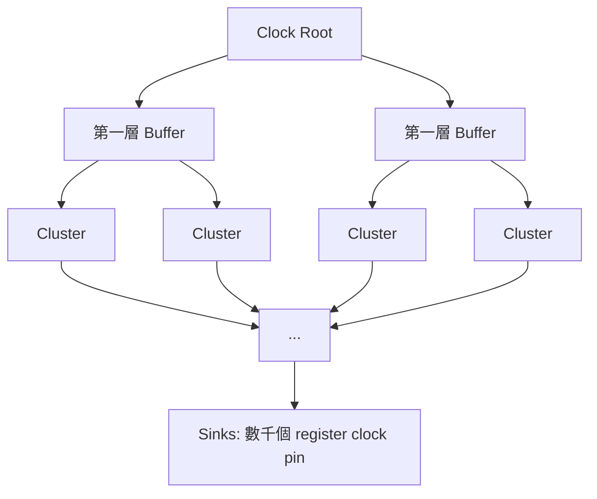

# 5.2 TritonCTS：時脈樹綜合

Placement 完成後，電路中每個 register 都已就位，但此時它們的 clock pin 還只是被一根「理想的」線圖示著——STA 用的還是 ideal clock 模型，假設所有 register 的時脈同時到達。真實晶片當然沒有這種好事：時脈訊號要從 clock source（PLL 或 port）經過金屬繞線與緩衝器，傳播到全 die 成千上萬個 clock pin。Clock Tree Synthesis（CTS，時脈樹綜合）的任務，就是把這根理想之線變成一棵真實的緩衝器樹，並且讓樹的每片葉子（每個 register 的 clock pin）盡量在同一時間收到訊號。這是 Physical Design 中最講究「公平」的一步：時脈是唯一同時驅動全晶片最多負載的訊號，任何不平衡都直接轉化為時序違例。

CTS 在 OpenROAD 中的實作是 TritonCTS，由 UCSD 與業界合作者（開發過商業 CTS 引擎的團隊成員，含曾在 Oracle/Synopsys 等公司負責 clocking 的工程師）開發並於 2019 年前後整合進 OpenROAD。TritonCTS 的演算法核心是分群（clustering）建樹：自頂向下把 clock sinks 依幾何位置與負載能力逐層分群，每一層分出的群組再繼續細分，直到每個葉群組的 sink 數量適合一個緩衝器驅動；然後自底向上在每個群組中心插入 buffer，形成樹狀結構。這種「由 sinks 反推樹形」的方法，與最經典的 H-tree 構造法一脈相承。

H-tree 的思想可以追溯到 VLSI 早期的脈衝分配網路研究：從中心出發，先分兩條等長的支路，每條支路再各分兩條等長支路，如此遞迴。若每層的繞線長度與 buffer 特性完全相同，則理論上所有葉子到達時間相同、skew 為零。但真實晶片上 sink 的分布極不均勻（某些區域 register 密度高、某些區域是 macro 荒地），嚴格的 H-tree 會浪費大量繞線資源，因此現代 CTS 演算法把 H-tree 的「等長配對」思想離散化：TritonCTS 在建樹時採用 pairing 與 clustering 的策略——先把相鄰的 sinks 兩兩配對，再逐層把配對合併成更大的 cluster，cluster 內部盡量平衡負載與線長，等效上是在不規則的 sink 分布上重建一棵「統計意義上的 H-tree」。

TritonCTS 的執行流程大致是：先從 ODB 讀取 clock net 的所有 sinks（register 的 clock pin 與下游的 macro clock pin），排除已由 placement 階段建立的 special wiring；然後進行 sink clustering——這裡有個常被忽略的實務細節，sink 總數太大時會先做「register bucketing」，把 sink 依位置粗分組以控制問題規模；接著逐層建樹並插入 buffer，buffer 的選擇來自 SDC 或 `set_cts_buffers` 指定（通常選高驅動力、低 delay 的 clock buffer，且這些 cell 必須在 .lib 中被標記為 clock buffer）；最後做 balancing——調整每個葉子路徑上的 buffer 數量與插入位置，使各 sink 的 arrival time 收斂到相近值。OpenROAD 的指令是 `clock_tree_synthesis`，之後通常接 `repair_clock_nets`（修補 clock net 的高 fanout 問題）與 `report_cts`（輸出 skew 與 latency 統計）。

CTS 完成後，整個 flow 有一個關鍵的轉折：STA 從 ideal clock 模式切換到 propagated clock 模式。之前所有時序報告裡的 clock arrival 都是「假設零延遲」，現在要重新用真實的 clock tree delay 計算——這幾乎總是讓時序報告變差，因為 clock delay 佔掉了週期預算的一部分。因此 Physical Design 的節奏是：CTS 之前做 setup-driven 的 placement/route optimization，CTS 之後立刻做一輪 post-CTS timing closure，包括修 setup（resizer 的 `repair_timing`）與修 hold（`repair_timing -hold`），此時 skew 已知、修復的方向才有意義。這個「CTS 是分水嶺」的流程制度，在 OpenROAD 與商業 flow 中完全一致。

CTS 之所以是一門獨立的學問，在於它的目標不只是 skew 小。過度追求零 skew 的代價是巨大的：buffer 數量暴增、clock net 的動態功耗（short-circuit 與 switching power）佔全晶片功耗的比重上升——在現代設計中 clock network 動輒消耗 20% 到 40% 的總功耗。更根本的問題是，clock network 的每一級 buffer 都在每個時脈週期切換一次，是全晶片 switching activity 最高的網路，沒有之一。因此 5.3 節要談的 skew、latency 與功耗三角取捨，本質上是在問：為了讓所有 register 同時收到時脈，我們願意付出多少面積與功耗？而這個問題的答案，隨著製程與設計類型（高效能 CPU 用 mesh，低功耗 SoC 用 tree）而截然不同。TritonCTS 作為開源實作，選擇的是 tree 路線——這對大多數設計是正確的起點，也讓學習者能以合理的演算法複雜度理解 CTS 的本質。
