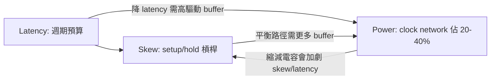

# 5.3 Skew、Latency 與功耗的三角習題

CTS 的輸出是一棵真實的 buffer 樹，接下來的問題是：這棵樹好不好？評價一個 clock network 有三個互相牽制的指標：skew（偏斜）、latency（延遲）與 power（功耗）。理解這三者的張力，等於理解了 Clock Network 設計三十年來的全部爭論。

先定義清楚。對每個 register，clock latency 是時脈訊號從 clock root 傳到該 register clock pin 的總延遲；skew 是同一個 clock domain 中任意兩個 register 之間的 latency 差。Setup 檢查關心的是 capture flop 與 launch flop 之間的 skew 方向：如果 capture flop 的時脈來得比 launch flop 晚（positive skew，沿資料流方向），等於時脈「幫你」多留了一點週期時間，setup 變容易；反之 negative skew 侵蝕 setup 預算。Hold 檢查正好相反：hold 只看同一時脈沿的資料穿越，若 launch 與 capture 之間 skew 為正（capture 晚收到時脈），資料可以在 clock tree 裡「搭便車」多傳播一段時間，造成 hold violation——因此CTS 之後的 hold fix 幾乎總是必須的，而且 skew 越大、hold 修復要插的 delay buffer 越多。這就是第一組張力：skew 不是越小越好的單純問題，而是 setup 與 hold 的槓桿，工程師真正想要的是「skew 可控、方向可預測」。

Latency 則是另一個維度的預算問題。Clock root 到 register 的平均 latency 越大，時脈訊號本身消耗的週期預算越多，且在多 clock domain 的設計中，不同 domain 的 latency 差會造成跨域路徑的 setup 額外負擔。降低 latency 的直覺做法是減少 buffer 級數、用高驅動力的 buffer——但這會增加每級的 dynamic power（輸出負載越大、transition 越快，短電流功耗越高），也可能惡化 clock pin 的 transition（slew），違反 .lib 中的 max_transition 限制。Latency 上的節省與功耗上的支出，是第二組張力。

Power 是壓軸的大魔王。Clock network 是全晶片 switching activity 最高的網路：每個時脈週期，樹上每一段繞線與每一級 buffer 都完整充放電一次。粗估 clock network 的功耗佔比，在現代設計中普遍落在 20% 到 40%，高效能處理器甚至更高。功耗與樹的「總電容」成正比，而 skew 的改善幾乎總是要增加總電容（更多的 buffer、更長的繞線以平衡路徑）。第三組張力因此現形：skew 的每一皮秒改善，都要用皮法級的電容去買。把三組張力疊起來，就是 CTS 工程師每天面對的三角習題：

業界對這道習題給出過兩種截然不同的答案。第一種是 clock mesh（網格）：用兩層以上的金屬織成一張覆蓋全 die 的網格，時脈先由一層預平衡的樹驅動到網格邊緣，網格內部則因金屬的低電阻而近似等電位。Mesh 的 skew 極小且對製程變異極不敏感（後期模擬中 skew 幾乎不受 OCV 影響），這是它被高效能 CPU（Intel、AMD 的處理器長期採用）青睞的原因；代價是電容巨大、功耗高，而且 mesh 的建立高度依賴客製化的 special route，流程自動化程度低。第二種是 clock tree：純樹狀結構，電容最小、功耗最低、與 EDA flow 的整合最好，這是多數 SoC 與低功耗設計的選擇；代價是 skew 對 PVT 變異敏感，簽核時必須用 OCV/AOCV 模型收斂。兩條路線的取捨本質上就是三角習題在不同應用下的解。TritonCTS 走的是 tree 路線，實作上採用 pairing/clustering 的分群建樹——但其設計思想中保留了 mesh 與 tree 混合的彈性思維（tree 為主、必要時可在上層用 mesh 補強），這也是現代商業工具的共同方向。

實務上，OpenROAD 在 CTS 之後提供完整的度量與修復手段。`report_cts` 輸出各 sink 的 insertion delay 與 skew 分布；OpenSTA 切到 propagated clock 模式後，可以對特定 clock 用 `report_clock_skew` 看到分組的 worst skew。修復流程通常依序是：先 `repair_clock_nets` 處理高 fanout 與長 net，再 `repair_timing -hold` 修 hold violation（插 delay cell），必要時回到 CTS 調整 `set_cts_buffers` 的 buffer 選擇或 sink clustering 的參數重跑。有一個值得養成的習慣：在 CTS 之後、route 之前，clock net 的 delay 仍是估計值，此時的 skew 是「方向正確但數值未定」的參考；真正的 skew 簽核必須等 detail route 與 parasitic extraction 之後。因此 Physical Design 的老手不會在 post-CTS 階段追求 skew 的絕對數值，而是檢查 skew 的分布形態——有沒有異常長的 branch、有沒有某個 cluster 的 latency 明顯突出——這些形態問題在 route 後只會更糟，不會自己好。

回到思想層面，這道三角習題其實是整個 EDA 學科的縮影：任何一個子問題的最優解，都依賴於你如何為「時間的正確性」、「面積的成本」與「功耗的代價」定價。Clock Network 因為 switching activity 最高，把這個定價問題推到極端，所以最值得初學者仔細體會。當你在 OpenROAD 裡跑完 CTS、看著 report_cts 的 skew 表格時，不妨想一想：這些數字背後，是三十多年來從 H-tree 的理想幾何，到 mesh 與 tree 的路線之爭，再到變異感知簽核的制度演化——而三角習題的答案，永遠取決於你這顆晶片要賣給誰、跑在什麼溫度、用什麼電池。
