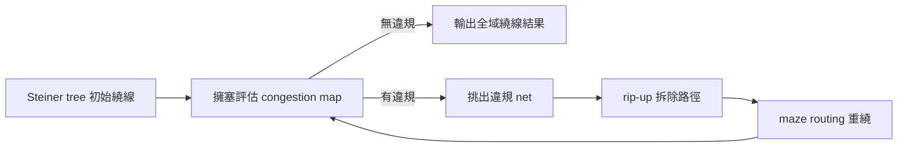

# 6.1 FastRoute：全域繞線的擁塞地圖

實體設計流程走到繞線這一步，問題的本質終於回到圖論：晶片上成千上萬條 net，要在一張被金屬層與繞線軌道（track）切分的巨大網格上，找到彼此不衝突、不超過容量的路徑。這是一個 NP-hard 的問題，而且規模大到任何暴力解法都會崩潰。所以業界三十多年來的標準做法，是把它拆成兩個階段：先做全域繞線（global routing），在粗粒度的網格上為每條 net 規劃「大概走哪些區域」；再做詳細繞線（detailed routing），在實際的幾何空間裡把線真正畫出來。OpenROAD 的繞線流程正是這個架構，第一棒就是 FastRoute，整合為 `grt` 模組。

FastRoute 的出身很清楚：它源自德州大學奧斯汀分校（UT Austin）Chris Chu 教授團隊的研究。2000 年代初期，Chris Chu 在 IBM 研究期間參與了方陣式的繞線演算法研究，隨後在學術界發展出的 FastRoute 系列工具，憑著簡潔而有效的演算法框架，成為學術界全域繞線的事實標準之一。後來這套技術由 Chris Chu（後轉至耶魯大學）及其合作者持續演進，並在 DARPA IDEA 計畫的資助下以開源授權整合進 OpenROAD，成為 `grt` 模組的演算法核心。這是「學術演算法 → 開源工具 → 工業流程」這條路徑的又一個實例，跟前面章節裡 OpenSTA、TritonCTS 的故事一脈相承。

## 演算法核心：maze routing 與 rip-up-and-reroute

全域繞線的困難不在於「找一條路」，而在於「同時為幾十萬條 net 找路，還要互相不衝突」。FastRoute 的解法框架可以概括為三個步驟的循環：

第一是初始繞線。對每條 net 先建立 Steiner tree——也就是把這條 net 的所有 pin 連起來、總長度儘量短的樹狀結構。FastRoute 用的是 Flute 這類近似演算法，能在幾毫秒內處理一條 net。有了 Steiner tree，再把樹上的邊映射到全局面板上，每個 panel 的每層金屬就累積出使用量。

第二是擁塞評估。把每個 panel、每層的使用量（demand）與容量（capacity）相比，就得到擁塞地圖（congestion map）。這張圖是全域繞線最重要的產出之一：它不只是一個「通不通」的檢查結果，而是整顆晶片的繞線資源分佈熱圖。實務上，工程師在詳細繞線之前就會看這張圖，判斷哪些區域過度擁塞、是不是該回頭調整擺置（placement）或增加金屬層資源。這也是為什麼 OpenROAD 把擁塞地圖做成 `grt` 的標準輸出，可以直接用 GUI 檢視。

第三是迭代修復，這裡的核心技術就是 maze routing 與 rip-up-and-reroute。Maze routing 就是經典的 Lee 演算法（迷宮尋路）：在網格圖上用 BFS 或 A* 找一條避開障礙的最短路徑，代價函數裡同時計入長度、via 數量與擁塞懲罰。當某個 panel 的使用量超過容量時，FastRoute 會把經過該區域的部分 net「rip-up」——把已繞的路徑拆除——再用 maze routing「reroute」到比較不擁塞的區域。整個系統就這樣反覆迭代：繞線、測擁塞、拆掉重繞，直到所有 panel 都不違規，或迭代次數達上限。這個「先放縱、再收斂」的策略，比任何一次到位的貪婪演算法都強韌，因為它允許整體解在早期犧牲局部最佳性，換取全域可行性。

## 長度估算與時序的橋樑

全域繞線還有一個容易被忽略但極其重要的副產品：估計的線長與寄生參數。在詳細繞線還沒做之前，時序分析（OpenSTA）需要知道每條 net 的延遲，而延遲取決於線長。全域繞線給出的路徑雖然是「大約的」，但已經比擺置階段的 HPWL（半週界線長）估算準確得多。OpenROAD 的流程在 `grt` 之後會用這些估計長度更新寄生參數，再跑一次時序分析，讓 resizer 模組做 gate sizing 與 buffer insertion 時有更可靠的依據。這是「繞線回饋給優化」的典型迭代迴路。

## 歷史脈絡：從工具壟斷到開源重構

全域繞線在商業工具裡早已是成熟模組——Cadence、Synopsys 的整套流程都有，但這些都是數百萬美元授權費背後的黑盒子。2000 年代學術界一度出現「EDA 演算法已經飽和、無從研究起」的悲觀氛圍，因為沒有真實資料，也沒有可對照的開源工具。DARPA 在 2017 年啟動 IDEA（Electronics Resurgence Initiative）計畫，正是針對這個問題：与其抱怨工具壟斷，不如直接補助把學術演算法整合成一條開源全流程。FastRoute 整合進 OpenROAD，就是這個計畫的直接產物之一。

從教育的角度看，這件事的意義比工業應用更深。過去一個研究生想研究繞線演算法，只能拿玩具規模的 benchmark 自娛；現在任何人都可以拿真實的 SKY130 或 ASAP7 設計，跑 `grt`、看擁塞地圖、改演算法、再對照結果。這種「演算法可觸及、資料可重現」的環境，是過去四十年 EDA 教育一直欠缺的。經濟上，開源全域繞線也降低了新創公司與小型設計團隊進入實體設計的門檻——不必再因為買不起整套工具而把實體設計外包。

## 實務觀察

實務上用 `grt` 有幾個值得注意的地方。首先，全域繞線的結果只是「規劃」，詳細繞線（TritonRoute）不保證完全照著走，所以 `grt` 的 DRC 估算（含估計的 short 與 spacing 違規）只是參考；但擁塞地圖的趨勢是可信的。其次，`grt` 允許使用者設定擁塞容忍度與迭代上限，對於特別擁塞的設計，放寬迭代次數通常能換到更好的收斂。最後，當 `grt` 反覆迭代仍無法收斂時，這通常是上游問題的訊號：擺置密度太高、金屬層資源不足、或 power grid 擋路太多。這時候正確的動作不是硬凹 `grt`，而是回頭調整上游——這也是實體設計「上游決定下游」這條鐵律在繞線階段的體現。

FastRoute 在 OpenROAD 裡也肩負一部分 pin access 的前期規劃，為詳細繞線的 pin 存取問題鋪路。詳細繞線最難的部分往往不是「把線畫出來」，而是「在標準單元的 pin 附近，怎麼在極度受限的空間裡合法地畫進去」——這個問題，我們留給下一章的 TritonRoute。
