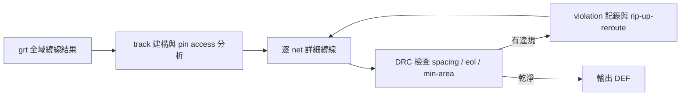
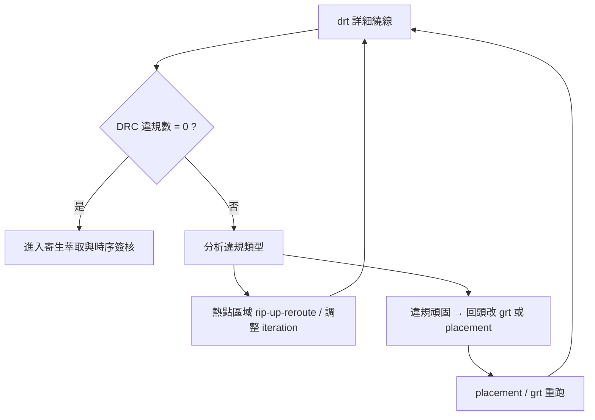

# 6.2 TritonRoute：詳細繞線與先進製程DRC

全域繞線給了每條 net 一張「路線規劃圖」，但圖上只有 panel 與層級的粗略指示，離真正可以在晶片上製造的金屬線，還差很遠。把它變成合法幾何的工作，就落在詳細繞線器（detailed router）身上。OpenROAD 的詳細繞線器叫 TritonRoute，模組代號 `drt`，它要把 `grt` 的結果轉成每一層金屬的精確座標、via 的放置、以及對先進製程所有設計規則（DRC）的遵守。

## 為什麼先進製程的 DRC 這麼難

在 0.5μm 或 0.35μm 的老製程裡，DRC 規則簡單得像教科書習題：線寬多少、間距多少、包圍（enclosure）多少。但製程一路縮到 28nm、16nm、7nm，規則的性質變了。這不是規則「變多」而已，而是規則開始「互相耦合」——一條線為了滿足 spacing 規則而挪動，可能觸發旁邊另一條線的 end-of-line 規則；為了滿足 min-area 規則而加寬的線端，又可能違反 neighbor 的方向性（preferred direction）要求。

典型的先進製程 DRC 規則包括：

- 間距規則（spacing rule）：同一層兩條金屬之間的最小距離，且在同向與異向、併排與對角等不同幾何情境下，數值可能不同。
- 線端規則（end-of-line rule）：金屬線的「端點」因蝕刻效應會變圓或內縮，所以端點到旁邊物件的距離要求比一般 spacing 更嚴格，或需要線端延伸（eol extension）補償。
- 最小面積（min-area rule）：極短的金屬片段因為蝕刻時會「飄」，必須達到某個最小面積，這對 via stub 和 short jumper 特別致命。
- 金屬層方向規則（preferred direction）：每一層金屬規定「橫走」或「直走」，繞線器必須在同一條 net 的路徑上不斷換層，而每次換層都要打 via，via 的 array 規則、cut layer 的 min area 又是另一套規則。
- Pin access 規則：標準單元的輸入輸出 pin 位於底層金屬，繞線要「碰到」pin，但不能侵犯 pin 周圍的間距，也不能佔用相鄰單元的 pin 資源。

這些規則的正式描述通常以 LEF/DEF 的 `SPACING`、`MINAREA`、`ENDOFLINE` 等敘述，或更複雜的 DRC language 寫在 tech file 裡。TritonRoute 的設計哲學，就是把這些規則直接讀進來，在繞線過程中就遵守，而不是繞完再修——「修」的成本在先進製程下會爆炸，因為一個違規修好了常會連鎖觸發新的違規。

## Pin access：詳細繞線最硬的一塊

如果只能挑一個詳細繞線的難點來講，多數實體設計工程師會選 pin access。標準單元的 pin 集中在 cell 的邊界、底層金屬（通常 M1），相鄰 cell 的 pin 彼此緊貼，中間能給繞線器下刀的空間極小。繞線器必須決定：這個 pin 從哪個方向「進來」？要不要在 pin 上直接打 via 換層？打 via 會不會侵犯隔壁 pin 的 spacing？這些決定彼此牽動——你為這個 pin 選的 access point，決定了隔壁 pin 還剩哪些選擇。

TritonRoute 在繞線之前會做一個 pin access 分析階段，為每個 pin 預先計算可行的 access pattern（從哪邊進、要不要 via、via 型態），並在後續繞線中當作約束。這個「先算 access、再繞線」的順序，是近十年學術界與工業界對先進製程詳細繞線的共識做法，因為「繞到 pin 附近才發現進不去」的代價太高。

## 演算法骨架

TritonRoute 的核心仍是網格式的 maze search，加上 rip-up-and-reroute 的迭代框架，但比全域繞線多了一層「幾何精確性」的要求：每一條候選路徑都要通過 DRC 檢查，所以搜尋的狀態空間不是「panel 上的格子」而是「帶有層別、方向、寬度、端點型態的精確幾何段」。這讓狀態空間比全域繞線大好幾個數量級，也讓記憶體與執行時間成為實際瓶頸。TritonRoute 在 OpenROAD 裡以 C++ 實作、支援多執行緒，是整條開源流程裡計算量最重的模組之一。

從歷史看，TritonRoute 是 DARPA IDEA 計畫下由 UCSD（Andrew Kahng 團隊）主導開發的成果，名字延續了 UCSD 過去 Triton 系列工具（如 TritonPlacer）的命名傳統。它的重要意義在於：這是第一個公開可取得、並且針對先進製程 DRC（含 ASAP7 這種 7nm 預測型 PDK）設計的完整詳細繞線器。在此之前，學術界研究詳細繞線的人幾乎拿不到可用的先進製程繞線器，只能發論文比理論；現在任何人都可以在 ASAP7 上跑 `drt`、看 DRC 結果、改演算法。這對 EDA 研究社群的衝擊，類似 RISC-V 對處理器研究社群的衝擊——把「只有大公司玩得起」的東西民主化了。

## 實務流程與 DRC 收斂

在 OpenROAD 流程裡，`drt` 跑完後輸出 DEF，並且自己會報 DRC 違規清單。實務上常見的迴路是：

幾個實務心得值得記下。第一，`drt` 的 DRC 違規數很少會一次歸零，容忍幾十到幾百個違規再迭代是正常節奏；但如果違規數不收斂、或集中在同一小塊區域，那幾乎一定是上游（placement 或 power grid）的結構性問題。第二，先進製程的 DRC 檢查器（如商業工具或開源的 Magic、KLayout）與 `drt` 內建的檢查偶爾會有出入，`drt` 說乾淨不代表 signoff DRC 工具說乾淨，所以最終仍要以獨立 DRC 工具為準——這個「繞線器內檢查 vs. 簽核工具檢查」的落差，在第七章談 Magic 與 KLayout 時會再展開。第三，繞線階段的時序還不是最終時序，因為真正的寄生參數要等線真的畫出來才量得到；所以 `drt` 之後還要跑 OpenRCX 萃取、再回 OpenSTA 做一次時序確認，必要時回到 resizer 做 hold fix。這一條「繞線 → 萃取 → 時序 → 修復」的最後衝刺，是下一章與 6.4 的主題。

對教育與研究社群而言，TritonRoute 打開了一扇過去關著的門：詳細繞線的演算法研究（pin access、DRC-aware routing、ML 輔助繞線）現在可以在真實製程上重現與比較。近年多篇頂會論文以 OpenROAD 的 `grt` + `drt` 為 baseline，就是這個開放生態的直接收穫。
