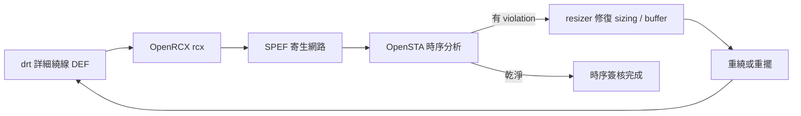

# 6.3 OpenRCX：寄生參數萃取與SPEF

繞線把金屬線真的畫出來之後，每一段線都不再是理想導線：它有電阻、有對地的電容、有相鄰線之間的耦合電容。這些寄生參數（parasitics）在先進製程下會徹底改寫時序——一條 7nm 製程下 100μm 的長線，其 RC 延遲可能比驅動它的邏輯閘本身還大，耦合電容造成的串擾（crosstalk）甚至能讓一個功能正確的電路在實際晶片上時好時壞。要預測這些效應，就必須做寄生參數萃取（parasitic extraction），OpenROAD 裡負責這件事的模組是 OpenRCX，代號 `rcx`。

## 為什麼萃取是時序簽核的樞鈕

整條實體設計流程的時序資訊，可信度是階梯式上升的：擺置階段用線長估計，全域繞線後用估計的 RC 模型，詳細繞線後才有真實的幾何可以萃取。而時序簽核（timing signoff）要求的是最後一級：用真實幾何萃取出來的寄生參數，餵給靜態時序分析（OpenSTA），才算數。業界的資料交換格式是 SPEF（Standard Parasitic Exchange Format），它把每條 net 表示為一個 RC 網路——節點是 net 上的分岔點，邊是電阻，對地與對鄰的電容掛在節點上。OpenSTA 讀入 SPEF，就能把每條 net 的延遲從「估計」升級為「萃取」。

SPEF 之所以重要，不只是格式本身，而是它把「萃取」與「時序分析」解耦了：萃取工具可以是 OpenRCX，也可以是商業工具；時序工具可以是 OpenSTA，也可以是 PrimeTime。只要 SPEF 是標準的，兩邊可以獨立替換。這種「標準格式作為介面」的設計，是 EDA 產業四十年演化出的關鍵制度——它讓工具之間的競爭與合作得以共存，也讓開源工具能無痛插入商業流程，或反之。

## OpenRCX 的技術路線

寄生萃取的學術光譜上，一端是純幾何的規則式方法：把繞線幾何套進一組由製程商提供的電容係數表（pattern-matching 式），快速但精準度有限。另一端是場求解器（field solver）：直接解馬克斯威方程，精準但慢到無法用在全晶片。實務工具都在這條光譜上找平衡。

OpenRCX 採用的是「rule-based、表驅動」的路線，配合製程提供的電阻電容係數檔，對繞線後的幾何做 pattern matching，算出電阻、對地電容與耦合電容，然後輸出 SPEF。它的強項是速度與可擴充性：全晶片規模的設計可以在合理時間內完成萃取，這使它可以被放進「繞線 → 萃取 → 時序 → 修復」的迭代迴路裡反覆執行，而不只在最後簽核時跑一次。這個「萃取可以反覆跑」的性質，是 OpenROAD 流程設計上很重要的一環。

另一個值得注意的細節是耦合電容的處理方式。SPEF 支援把耦合電容表示為明確的兩節點電容（coupling capacitance），或簡化為接地電容加 Miller 效應修正（對訊號切換方向做統計假設）。前者更精準但需要靜態時序工具支援 crosstalk 分析（含 delta delay、noise），後者是大多數簽核流程的實際做法。OpenRCX 兩種模式都支援，實務上在 OpenSTA 的分析能力範圍內，多以接地電容簡化模式輸出，必要時才用完整耦合模型。

從歷史脈絡看，寄生萃取在 EDA 產業裡一直是商業工具的天下——Cadence 的 Quantus、Synopsys 的 StarRC 都是這個領域的巨人，授權費不菲，而且它們的精準度模型（calibration 資料）來自與晶圓廠多年的合作，這是學術界難以複製的護城河。DARPA IDEA 計畫注意到這個環節的空缺，補助開發 OpenRCX，目標不是立刻超越 StarRC 的精準度，而是讓開源流程擁有一個「夠準、夠快、可驗證」的萃取工具，補上從繞線到時序簽核之間的最後一塊拼圖。對教育與新創公司而言，這意味著第一次可以「不用商業授權」走完整條實體設計與簽核流程。

## 實務操作與可信度

在 OpenROAD 流程裡，`rcx` 的典型用法是讀入詳細繞線後的 DEF，搭配 LEF 與製程電容表，輸出 SPEF。實務上幾個關鍵點：

第一，萃取的精準度取決於電容表的品質。對學術 PDK（如 ASAP7）與開源 PDK（如 SKY130），電容表來自學術量測或經驗公式，與實際晶圓的偏差比商業工具對正式製程的偏差大。這不是 OpenRCX 本身的問題，而是「開源 PDK 的寄生模型先天就沒有真正做過大量矽驗證」的現實。對研究用途這不是障礙，因為要比較的是演算法之間的相對好壞；但對真正要流片的設計，工程師會在時序上多留 margin 作為保險。

第二，萃取的範圍可以選擇。全晶片萃取很慢，實務上常見的策略是「籠統萃取 + 熱點精萃」：先對全晶片做一次粗萃取，找出時序最緊的幾條路徑，再對這些路徑用更高精度（例如考慮更遠鄰居、更細的幾何切分）重萃取一次。OpenRCX 支援這種分層式的用法。

第三，SPEF 檔案可能非常巨大——大型設計的 SPEF 以 GB 計，這也是為什麼簽核流程裡會有專門的 SPEF 壓縮與 reduction 技術（把 RC 網路簡化為 fewer-pole 模型）。OpenRCX 與 OpenSTA 的搭配已經能處理合理規模的設計，但對超大型 SoC，使用者要有心理準備管理這些資料量。

## 從延遲到串擾：先進製程的新挑戰

寄生參數對電路的影響不只延遲。耦合電容帶來的串擾在先進製程裡是時序簽核的核心難題之一：鄰近線同向切換時耦合電容的等效值減小（受害者受益，叫 speedup），反向切換時等效值加倍（受害者受害，叫 slowdown），所以真正的時序分析要對每條路徑考慮最壞與最好的切換情境（SI 分析，signal integrity）。商業工具早已有完整的 SI 簽核能力，開源工具這部分還在發展中，這也是 OpenRCX 與 OpenSTA 未來幾年最被期待的演進方向之一。

從制度面看，寄生萃取這個環節的開源化，補上了「開源晶片能否被認真對待」這個問題的最後一塊。過去開源流程做出來的結果，業界總有一句話可以打槍：「你的寄生模型哪來的？」現在 OpenRCX 給出一個可以引用、可以驗證、可以改進的答案。這樣的演進，正是開源 EDA 從玩具走向工具的必經之路，而下一章要談的時序修復與簽核衝刺，就是拿著這條開源流程的產出，走完最後一里路。
