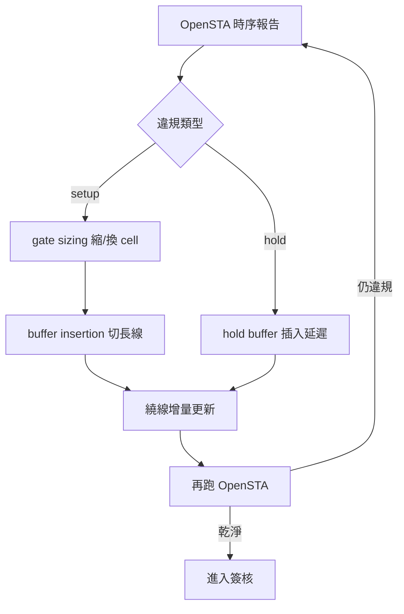
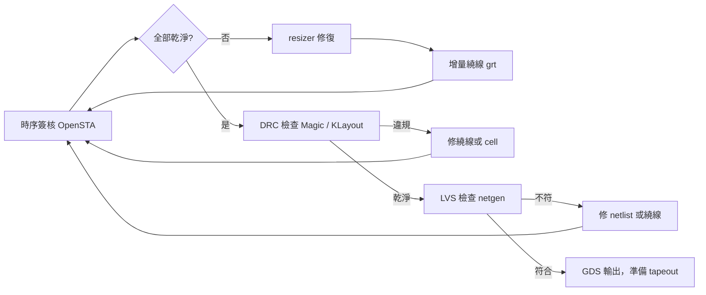

# 6.4 時序修復與Signoff的最後衝刺

實體設計流程走到這裡，該畫的線畫了、該萃取的寄生參數萃了，但時序很少第一次就過。真實的晶片設計在最後階段，幾乎總是在一個「時序違規 → 修復 → 再驗證」的循環裡打轉，這個循環占掉專案後期相當大的比例時間與人力。OpenROAD 把這個循環裡可自動化的部分交給 resizer 模組，把最終的驗證交給 OpenSTA，合起來構成簽核前的最後衝刺。

## 兩種違規，兩種修法

時序違規分兩大類，修法完全不同。setup 違規是指資料在時脈到來之前沒有穩定，通常是路徑太長、延遲累積太多；hold 違規是資料「太快」了，在下一級 flip-flop 的 hold time 還沒結束就翻轉，導致前一級的資料被誤抓。兩者的本質差異在於：setup 違規與時脈週期有關，可以靠加快邏輯、縮短路徑來救；hold 違規與週期無關，只與兩級 flip-flop 之間的延遲差有關，唯一的修法是「把路徑拉慢」——插入延遲。

Setup 修復的兩個主力是 gate sizing 與 buffer insertion。Gate sizing 是把路徑上的 cell 換成驅動力更強（或更弱）的版本：驅動力強的 cell 延遲低但面積與功耗大，反之亦然。這是一個經典的最佳化問題——Lechtner 與同事在 1980 年代就給出了用凸最佳化解 sizing 的理論基礎，而實際工具用的是啟發式迭代：對每條違規路徑，計算每一級 cell 改變 size 對整條路徑延遲的敏感度，選 CP 值最高的改動做下去，再重新評估。Buffer insertion 則是對付長線的武器：一段長 RC 線的延遲與長度平方成正比，把它切成幾段、中間插 buffer，總延遲可以從 $O(n^2)$ 降到 $O(n)$。這個「平方變線性」的性質，是所有實體設計工程師都該內化的一條數學直覺。

Hold 修復相對單純但更敏感：在 hold 違規的路徑上插入延遲 buffer（有時是連續幾顆小 buffer 串起來），直到違規消失。難處在於：插了 buffer 會影響繞線（多出的 cell 要找地方放、要重新繞線），而且過度插 buffer 會浪費面積與功耗，甚至影響 setup（因為多餘的延遲在某些 corner 下可能反向變成 setup 問題）。

## Resizer：把理論變成可執行的模組

OpenROAD 的 resizer 模組負責上述兩件事。它的設計哲學是「與流程其他模組緊密耦合」：resizer 做完 sizing 與 buffer insertion 之後，不輸出一個「等著被重繞」的中間結果，而是直接呼叫 `grt` 做增量全域繞線，再回 OpenSTA 重新分析時序。這個「修復 → 繞線 → 時序」的內部迭代迴路，正是近年學術界與工業界講的「物理感知的邏輯優化」（physical-aware logic optimization）——修復的決策要考慮繞線後的真實寄生，而不是修完才發現反而更糟。

Resizer 的能力包括：gate sizing、buffer insertion（含專門的 hold buffer）、cell 的 cloning（把一顆驅動多個負載的 cell 複製成兩顆分攤）、以及 cell 的 pin swapping（把輸入訊號接到延迟不同的 pin）。這些操作每一個都看似簡單，但組合起來的搜尋空間巨大，所以 resizer 採用的是基於 slacks 敏感度的貪婪迭代，配合多 corner（不同製程、電壓、溫度條件）的評估。

## 多 corner 與多模式：為什麼簽核這麼麻煩

時序簽核不是「一種時序分析」而是「好幾種」。一顆晶片要在不同的製程 corner（SS / TT / FF，代表晶圓製程偏差的慢、典型、快）、不同的電壓與溫度下都正確工作；而且要在不同的工作模式下（功能性模式、測試模式、低功耗模式）都正確。每一種組合就是一個 corner/mode，每一個都要跑一次時序分析。實際的簽核流程可能是十幾到幾十個 corner 的組合，setup 與 hold 各自有最壞 corner。

對開源流程而言，多 corner 是一個現實挑戰：OpenSTA 支援多 corner 分析，但每一個 corner 都需要對應的 liberty 檔與寄生參數（每個 corner 有一份 SPEF），資料量與執行時間都會倍增。實務上，開源社群常見的做法是挑代表性 corner 做（例如 ASAP7 提供的幾個標準 corner），對研究與教學而言夠用；真正要流片的專案則需要自己補齊 corner 矩陣，這是開源流程與商業流程之間仍存在的落差之一。

## DRC 與 LVS：時序之外的另一道關

時序乾淨了還不夠。簽核清單上至少還有：DRC（幾何設計規則檢查，由 Magic 或 KLayout 做，第七章詳述）、LVS（佈局與電路圖比對，確認畫出來的東西電氣上等於設計意圖，開源工具是 netgen）、antenna 檢查（製程中電荷累積可能打壞閘極，繞線階段就要預防）、以及 IR drop 與電遷移（EM）分析。這些檢查彼此獨立又互相關聯——修 hold 插了 buffer，繞線變了，可能引入新的 DRC 違規或 antenna 問題。所以「最後衝刺」的本質，是在多個檢查維度之間來回收斂，直到所有維度同時乾淨。

## 從歷史看最後一里

回顧 EDA 產業的演化，「簽核」這個概念本身就是制度與技術交織的產物。1980 年代晶片設計還沒有嚴格的簽核概念，工具自己檢查自己；隨著製程複雜化與代工（foundry）模式的興起，代工廠開始要求設計端提交通過特定工具驗證的資料，簽核工具清單成為合約的一部分。這個制度把商業 EDA 工具的位置進一步鞏固——因為「用哪個工具算數」是代工廠說了算，設計端沒有選擇權。

開源流程在簽核這一環的突破路徑，也因此與前面幾章不同：它不只是「做出一個一樣功能的工具」，還要說服代工廠接受這些工具的結果。SKY130 的開源化在這裡扮演關鍵角色：SkyWater 與 Google 不只開源了 PDK，還建立了接受開源工具流程（OpenLane、OpenROAD）產出的流片管道。這是制度層面的創新，與工具層面的演進互相驅動——下一章的 ASAP7、SKY130、與 Google MPW 計畫，就是把鏡頭轉到 PDK 與流片制度這一邊。

對使用者而言，最後衝刺階段的實務建議很簡單：相信工具，但驗證工具。OpenSTA 的時序報告要與商業工具（如果有的話）對照一次，OpenRCX 的寄生參數要用場求解器抽樣驗證，Magic 與 KLayout 的 DRC 結果要互相對照。開源工具的可貴在於「可驗證」——所有輸入輸出都是公開格式，你永遠可以自己寫個腳本去交叉檢查。這種可驗證性，是封閉工具時代工程師從來不曾擁有的權利。
