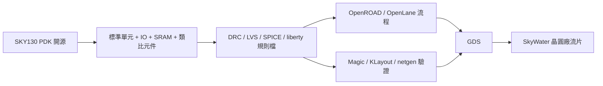

# 7.2 SkyWater130nm：真正可以流片的開源PDK

如果說 ASAP7 證明了「PDK 可以開源並推動研究」，那麼 SKY130 證明了更大的命題：「PDK 可以開源並真正流片」。2020 年，Google 與 SkyWater Technology 宣布將 SkyWater 的 130nm CMOS 製程 PDK 以 Apache 2.0 授權開源，這是第一個真正可流片的開源 PDK——不是預測、不是玩具，而是 SkyWater 明尼蘇達州晶圓廠實際量產、可以收錢下單的商業製程。

## 為什麼是 130nm

選 130nm 而不是 7nm，不是妥協而是深思熟慮。第一，130nm 是一個「甜蜜點」製程：它足夠先進，可以做出微控制器、類比電路、RF、功率元件、甚至小型加速器；又足夠成熟，晶圓價格低、製程穩定、對設計規則的容忍度高。第二，130nm 的混合訊號能力很強——開源晶片社群早期的許多專案（包括 RISC-V SoC、類比前端、感測器介面）都在這個節點上有實際價值，而不是純粹的教學練習。第三，SkyWater 作為一家美國本土的 foundry，在美國政府的國防與太空供應鏈裡有特殊地位（他們是可信鑄造 accredited foundry），這讓「開源 PDK + 美國本土流片」在政策上有說服力，也為後來的 Google MPW 贊助鋪了路。

SKY130 PDK 的內容包括：標準單元庫（含多種高度與驅動力）、IO 庫、SRAM 巨集、類比與混合訊號元件的版圖抽象、SPICE 模型、以及完整的 DRC / LVS 規則檔。它的授權是 Apache 2.0，這一點極其重要——這意味著任何人可以自由地使用、修改、再分發這個 PDK，甚至商業化，不需要簽 NDA、不需要談授權費。過去三十年，PDK 的保密性是晶片設計的入場券；SKY130 把這張票免費發給所有人。

## 技術上它長什麼樣

從實體設計的角度，SKY130 有幾個特徵值得留意。金屬層約 5 到 6 層（視 flavor 而定），最小線寬與 pitch 在 130nm 節點的典型範圍，標準單元有多種高度（9-track、12-track、15-track）對應不同的面積與效能取捨。它提供兩種主要 flavor：一種針對數位與一般用途（`sky130_fd_sc_hd` 是最常用的 standard cell 庫，hd 代表 high density），一種針對類比與高壓應用。DRC 規則是真實量產規則，包括本地互連（local interconnect，li1 層）的複雜規則、金屬層的 min-area 與 density 規則，以及天線效應規則。

對開源流程而言，SKY130 是 OpenROAD、OpenLane、Magic、KLayout、netgen 這些工具的「主要戰場」。因為 DRC 規則公開了，Magic 與 KLayout 才有東西可以寫規則檔；因為 LVS 規則公開了，netgen 才能做比對；因為 liberty 檔公開了，OpenSTA 才能分析時序。換句話說，PDK 的開源是整條開源 EDA 流程能「被驗證」的前提——沒有 PDK 的公開，工具的正確性永遠無法被獨立檢驗。

## 制度創新：從 PDK 到生態

單純開源 PDK 還不足以讓人真正流片——流片要錢，而且一個 mask set 的價格遠超過個人、學生、甚至小公司能負擔的範圍。所以 SKY130 的開源必須與「可負擔的流片管道」配套，這就是下一章要談的 Google MPW 與 Efabless 的角色。但值得一提的是，SKY130 的開源不只是「Google 贊助」這麼單純，它是一個生態系的槓桿：PDK 開源之後，EDA 工具有了驗證標的，流片服務有了客戶來源，教育課程有了教材，創業公司有了起點——每一塊都互相放大。

從歷史脈絡看，這個事件與 1980 年代 Mead-Conway 的 VLSI 革命有著有趣的呼應。1980 年，Carver Mead 與 Lynn Conway 出版《Introduction to VLSI Systems》，並推動了 MOSIS 這個多專案晶圓（MPW）服務，讓大學研究者可以用低廉的價格把設計送上晶圓——那一代的開放讓 VLSI 從少數公司的秘密變成全世界的學問。四十年後，SKY130 + Google MPW 用開源 PDK 做了同一件事，只是這次開放的不只是「設計方法論」，還包括「製程本身」。歷史在某個意義上重演了，但這次的規模因為網路與開源軟體的成熟而更廣。

## 實務上的注意事項

用 SKY130 做設計，有幾個實務重點。第一，它不是最先進的製程，所以面積與功耗數字不能與 7nm 比——一顆在 7nm 下 1mm² 的電路在 130nm 可能要 30mm²，這是製程世代的物理差距，不是工具好壞的問題。第二，它的類比與 RF 能力是亮點，許多開源晶片專案選 SKY130 正是為了做混合訊號，而這是 ASAP7 這種純數位預測 PDK 做不到的。第三，DRC 規則裡有些地方（如 li1 層的複雜規則、金屬 density）對自動化流程是挑戰，OpenROAD + OpenLane 的流程已經針對這些做了調校，但手繪版圖或客製電路仍需小心。第四，SRAM 巨集的品種有限，大型 SoC 設計可能需要自己用標準單元拼記憶體或找開源替代品，這是實務上常見的瓶頸。

從經濟面看，SKY130 開源最大的效應是「把流片門檻從數十萬美元拉到數百美元」（配合 shuttle 服務）。這個數量級的改變，讓大學課程、開源社群、個人創客都能參與，也讓「晶片設計」從一個產業專業變成一個可以全民學習的技能。2020 到 2024 年間，數以百計的開源晶片專案透過 SKY130 流片成功，這些經驗回頭餵養了工具與 PDK 的改善，形成一個正向循環。這個循環的起點，就是 Google 的 MPW 贊助與 Efabless 的平台——這是下一章的故事。
