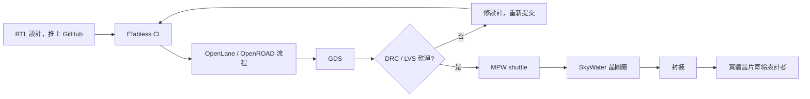

# 7.3 GoogleMPW與Efabless：開源晶片上天的制度創新

有了開源 PDK，還缺最後一塊：把設計送上晶圓的管道。晶圓流片的成本結構是殘酷的——一個 mask set 在 130nm 也要數十萬美元，這筆錢由單一設計者負擔是不可能的。產業界的解法由來已久：Multi-Project Wafer（MPW，多專案晶圓），把許多小設計拼在同一片 mask 上，成本分攤。這個模式的祖師爺是 1980 年代的 MOSIS，它讓 VLSI 研究從實驗室走進大學課堂。四十年後，Google 在 2020 年做了一個更大膽的版本：直接贊助 SKY130 的 MPW shuttle，讓任何人免費把開源晶片設計送上晶圓。

## Google MPW：贊助的邏輯

Google 從 2020 年開始贊助一系列 MPW shuttle（常被稱為 MPW-1 到 MPW-9 等），每次 shuttle 由 Google 付費，開放全球的設計者提交基於 SKY130 的開源設計，通過審核後免費獲得若干顆晶片樣品。這筆錢對 Google 是九牛一毛，但換來的效應是槓桿式的：

- 它直接驗證了「開源流程 + 開源 PDK + 真實流片」這條路是通的，把整個生態從理論推向實證。
- 它製造了示範效應：每一批 MPW 回來的晶片被測試、開箱、寫成文章，這些內容成為最好的教材與宣傳。
- 它養出了需求，讓 shuttle 服務（由 Efabless 等提供）能持續運營，而不只靠 Google 補貼。

從經濟學角度，這是典型的「公共財供給」：晶片設計的知識與工具是公共財，市場本身因為入場成本太高而供給不足，Google 用贊助打破僵局，讓生態開始自我維持。這個策略與 Google 過去資助 RISC-V、TensorFlow 開源、以及贊助大學研究的邏輯一脈相承——透過開放生態擴大整個市場的規模，而 Google 自己是生態中的一員，自然受益。

## Efabless 與 Caravel

與 Google MPW 配套的平台是 Efabless。這家新創公司提供「晶片設計即服務」：使用者把設計（通常是基於 SKY130 的 RISC-V SoC 或其他數位電路）推上 GitHub，Efabless 的 CI 流程（基於 OpenLane，一條以 OpenROAD 為核心的開源實體設計流程）自動跑完 placement、routing、DRC、LVS，產出 GDS，然後送進 MPW shuttle 流片，最後寄實體晶片給設計者。整個過程從「我有一個 RTL 想法」到「我手裡有一顆自己設計的晶片」，門檻低到個人可以在幾週內完成。

Efabless 的另一個關鍵貢獻是 Caravel——一個開源的 SoC 平台模板。Caravel 的核心是一顆 RISC-V 處理器（基於 PicoRV32 或 VexRiscv 等）、周邊（SPI、UART、GPIO、邏輯分析儀）、以及一塊留給使用者邏輯的「manage region」。設計者把自己的電路放進使用者區域，Caravel 負責處理 IO、電源、時脈、與主機通訊這些麻煩事。這個「模板 + 客製區」的設計，大幅降低了第一次做晶片的難度——就像 WordPress 之於網站，Caravel 之於自製晶片。實際上，許多 MPW 上的專案都是「Caravel + 我的電路」這個模式，整顆晶片變成一個「晶片界的 Arduino」。

## 制度層面的創新

把 Google MPW 與 Efabless 放在一起看，這個模式創新之處不在任何單一技術，而在制度：它把「流片」這件事從一個需要商業關係、保密協議、與數十萬預算的門檻，變成一個有 GitHub 帳號就能參與的開放活動。具體的制度要件包括：

第一，預審與品質控制。MPW 並非來者不拒，每個專案要通過 DRC 與 LVS 檢查，確保不會因為一顆爛晶片毀掉整批 shuttle。這種「社群級的品質把關」取代了傳統代工廠對商業客戶的審查，是新的信任機制。

第二，完全開源的流程鏈。從 RTL 到 GDS，用的是 OpenROAD、OpenLane、Magic、KLayout、netgen 這些開源工具，這使得每顆上天的晶片的「製造紀錄」都可以被公開審視與重現。這在傳統產業是不可想像的。

第三，社群回饋迴路。每一批 MPW 的成果——良率、測試結果、失敗案例——會在社群裡討論，回頭改善 PDK、工具與流程。這個迴路是傳統保密模式下做不到的，因為失敗案例通常不會公開。

從文化面看，這個模式讓「自製晶片」從專業的身分象徵變成一種創客文化，類似 DIY PC、自製無人機、自製衛星（CubeSat）的演化路徑。2020 到 2024 年間，數以百計的專案透過這個管道流片，包括 RISC-V 處理器、神經網路加速器、類比電路、感測器介面，甚至有一整批是來自大學課程的學生作品。這個「晶片界 Arduino 時刻」的出現，改變了人們對晶片設計的可及性想像。

## 2025 之後：生態的演進

值得注意的是，Efabless 在 2025 年結束營運，這是開源晶片生態在商業現實面前的一次震動。原因是多方面的：訂閱與服務收入難以支撐公司規模，主流晶片設計客戶仍偏向傳統商業流程，而開源社群的付費意願有限。但生態並沒有因此消失——PDK 仍是開源的，OpenROAD 與 OpenLane 仍在發展，其他 shuttle 服務（如 ChipFoundry 等後續組織、以及各 foundry 的學術 shuttle）持續存在，且 MPW 期間累積的設計、教材、經驗都留存下來。Efabless 的故事提醒我們：開源生態的永續不只靠理想，還需要可行的商業模式；工具與 PDK 可以開源，但「把設計送上矽」這個環節總得有人在經濟上撐住。

從歷史看，這也呼應了 MOSIS 的經驗：MOSIS 從 1980 年代走到今天，靠的是政府補助（NSF、DARPA）+ 商業客戶的混合模式。開源晶片流片生態要長期存續，很可能也需要類似的混合支撐，而不是純靠一次性的大公司贊助。無論如何，2020 到 2025 這段時期留下的遺產是明確的：數百顆由個人、學生、研究者設計的晶片真的被製造出來了，「開源晶片」從口號變成了事實。

當然，一顆 GDS 要能真的流片，最後一關是驗證：DRC 與 LVS 必須乾淨，這一關的把關者就是下一章的主角——Magic 與 KLayout。
