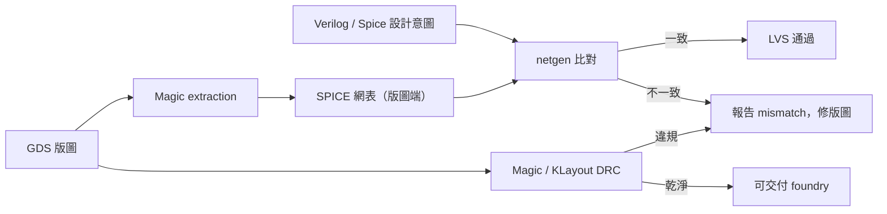

# 7.4 Magic與KLayout：DRC與LVS驗證

一條實體設計流程的最後一步，是讓一個獨立的工具確認「畫出來的東西是合法的、且電氣上等於設計意圖」。這兩件事分別叫 DRC（Design Rule Check，幾何設計規則檢查）與 LVS（Layout Versus Schematic，佈局與電路圖比對）。在開源生態裡，這兩件事的把關者主要是 Magic 與 KLayout（DRC），以及 netgen（LVS，常與 Magic 搭配）。本章把鏡頭轉到這兩個工具，它們是開源晶片能「被流片廠接受」的最後一道關卡。

## Magic：從 1980 年代走來的老前輩

Magic 是這份名單裡資歷最深的工具。它由 John Ousterhout 在 1980 年代於 UC Berkeley 開發——就是後來寫出 Tcl/Tk、以及做出 Raft 論文的同一位 Ousterhout。Magic 當年的革命性在於它是「互動式版圖編輯器 + 即時 DRC」的先驅：你在畫版圖的當下，工具就告訴你哪裡違規，而不是等畫完再跑一次檢查。這個即時回饋的概念，比後來的 IDE 即時編譯錯誤提示早了十幾年，是工具設計史上的重要里程碑。

Magic 之後的維護史跨越了多個機構：Berkeley 之後經歷了多所大學與研究機構的接手，最終穩定下來的是 Yale 大學（Ousterhout 任職 Yale 期間）與開源社群的長期維護。到今天 Magic 仍是活躍的開源專案，在 SKY130 的生態裡扮演兩個角色：一是 DRC 檢查器（它有針對 SKY130 的規則檔），二是 GDS 檢視與版圖編輯器。它的優點是輕量、穩定、對老製程與混合訊號設計的支援完整；缺點是介面老派、學習曲線偏陡，對新一代使用者不算友善。

從制度面看，Magic 的故事呼應了一個模式：學術界開發的工具常常活得比商業產品久，因為它沒有商業壓力，只有「有人還在用、有人在維護」這個樸素的存在條件。這也是為什麼開源 EDA 的很多角落還留著 1980 年代的影子。

## KLayout：現代的 GDS 瑞士刀

KLayout 是德國開發者 Matthias Koefferlein 從 2000 年代開始維護的開源版圖檢視與編輯工具。與 Magic 相比，KLayout 是「現代派」：GUI 介面現代化、對大型 GDS 的效能優異、支援 Ruby 與 Python 腳本擴充，這讓它可以被整合進自動化流程裡做批次處理。在開源晶片生態裡，KLayout 的角色是：

- GDS 檢視與檢查：快速打開大型設計、量測距離、檢查圖層。
- DRC 檢查：KLayout 有自己的 DRC 語言（基於 Ruby DSL），SKY130 與其他開源 PDK 都有社群維護的 KLayout DRC 規則檔。
- 圖層轉換與處理：GDS ↔ OASIS、圖層合併、boolean 運算等。

KLayout 與 Magic 的組合，在實務上形成「雙重檢查」的模式：同一份 GDS 用兩個工具各跑一次 DRC，兩邊都乾淨才算過關。這個做法的價值在於，兩個工具的規則實作與演算法不同，一個工具漏掉的 edge case 另一個可能會抓到。這種交叉驗證在傳統商業流程裡是罕見的（因為工具之間互相是競爭者），在開源生態裡卻是自然的文化。

## DRC 的技術本質

DRC 做的事情，幾何上說是把版圖拆成多邊形集合，然後對每一對（或每一組）多邊形檢查是否符合規則。典型規則包括：

- 寬度（width）：一個圖形的最小寬度不能低於規則值。
- 間距（spacing）：兩個不連通的圖形之間的最小距離。
- 包圍（enclosure）：一層圖形要包住另一層圖形，超出量有最小值（如 via 的金屬包圍）。
- 最小面積（min-area）：圖形不能太小（先進製程的蝕刻效應）。
- 密度（density）：某一層在某區域的覆蓋率要在範圍內（製造均勻性要求）。

這些檢查在數學上是計算幾何問題：spacing 檢查本質上是最近鄰查詢，density 檢查是區域覆蓋率計算，enclosure 是多邊形相對位置判斷。工具的效能取決於如何對數百萬個多邊形做高效的空間索引（通常用 corner stitching 或 quadtree）。Magic 的 corner stitching 是它當年的一個招牌技術，把版圖組織成可快速查詢的結構，這也是它能做「即時 DRC」的原因。

DRC 的實務難點不在演算法，而在「規則的正確性」：規則檔本身要與 foundry 的實際製造能力一致，而這只能靠長期的矽驗證與規則更新。SKY130 因為是真實量產製程，其 DRC 規則檔經過 SkyWater 的官方認證，這是它比 ASAP7 這類預測型 PDK 更值得信賴的地方。

## LVS 與 netgen

DRC 確認「幾何合法」，LVS 則確認「電氣正確」。LVS 的流程是：從版圖（GDS）反推電路（這叫 extraction，把多邊形轉回電晶體、電阻、電容的網表），然後把這個網表與設計意圖的網表（從 Verilog / Spice 來）做拓撲比對。如果兩邊的連接關係一致，LVS 通過；不一致（少了元件、多了短路、名字對不上）就報錯。

開源 LVS 的主力是 netgen，通常與 Magic 搭配：Magic 做版圖抽取（extraction）得到 SPICE 網表，netgen 做兩份網表的比對。這個組合在 SKY130 流程裡是標配。LVS 比對的技術核心是圖同構（graph isomorphism）問題，理論上 NP 難，但實務上用啟發式（分層比對、訊號名提示、局部分析）可以處理大型設計。實務上 LVS 常見的錯誤是「名字對不上」與「電源短路」，前者要靠 label 對齊，後者要靠版圖修改。

## 在流程裡的位置

回到整本書的脈絡：OpenROAD 產出 GDS 之後，要通過 Magic / KLayout 的 DRC 與 netgen 的 LVS，才算完成「開源簽核」。這個流程的價值不只是把關，還有一層「可驗證性」的意義：DRC 規則檔是公開的、LVS 比對的網表是公開的，任何第三方都可以重新跑一遍驗證。這種透明度在傳統晶片產業是不可想像的——商業流程裡，簽核結果是一份帶 NDA 的報告，只有代工廠與設計公司看得到。開源生態把這個環節也公開了，使得「這顆晶片真的乾淨」變成一個可以被社群檢驗的主張，而不是一個需要信任黑盒子的承諾。

從教育角度看，Magic 與 KLayout 也是最好的教材：它們的規則檔是明文的，使用者可以看到每一條規則對應製程上的什麼物理效應（蝕刻偏差、光學鄰近效應、電遷移餘量）。這種「規則與物理的對應」在商業工具裡被藏在封閉的規則語言背後，在開源工具裡則直接可讀。對一個想理解「為什麼晶片製造有這些限制」的學習者，讀一份 SKY130 的 Magic DRC 規則檔，比讀十篇概論論文更有收穫。

至此，從 RTL 到流片的整條開源路徑就完整了：OpenROAD 做實體設計，Magic / KLayout / netgen 做驗證，SKY130 給製程，shuttle 給流片管道。這條路在四十年前 Mead 與 Conway 時代是不可想像的，在二十年前商業 EDA 全盛期也看不到，但它今天真實存在，並且正在改變晶片設計的參與者結構。
