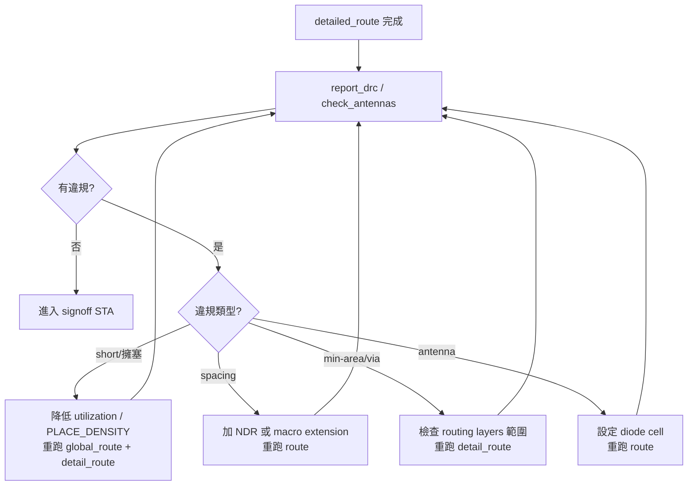

# B.1 DRC 與時序違規排查指南

實體設計流程的最後一哩，就是把 detailed route 後的 DRC 違規與 signoff STA 的時序違規清乾淨。本章整理在 OpenROAD 環境下（含 ORFS）實際可行的排查流程與修法。

## 排查總原則

1. 先確認資料是最新狀態：違規報告必須來自同一版 routing/parasitics，不要拿 pre-route 的估計結果判斷 post-route 問題。
2. 分類再動手：DRC 先分 short、spacing、min-area、via、antenna；時序先分 setup 與 hold，兩者修法常互相衝突，不可同時猛修。
3. 小步迭代：每次只改一個參數或跑一個修復命令，重跑 STA/DRC 確認改善，避免按下葫蘆浮起瓢。

## DRC 違規排查

### 確認違規

```tcl
# detailed route 之後
report_drc          ;# 列出違規類型、座標與數量
check_antennas      ;# antenna 違規另行檢查
```

ORFS 中亦可在 route 後的 log（`log/route/*.log`）直接搜尋 violation 統計，並用 GUI 開啟 `results/route/*.def` 定位違規座標。

### 常見違規類型與修法

| 違規類型 | 常見成因 | 修法 |
|---|---|---|
| short | 走線重疊、繞線擁塞 | 檢查 utilization 是否過高（建議 core utilization ≤ 60%）；降低 `PLACE_DENSITY`；重跑 `global_route` 前先 `repair_design` |
| spacing | 相鄰走線或 via 間距不足 | 增加該 net 的 NDR（`add_ndr`，常見於時脈）；對擁塞區域 `set_macro_extension` 擴大 keepout |
| min-area | 短跳層的 metal piece 面積不足 | 多為 via 附近短跳造成，可限制繞線層範圍（`set_routing_layers`）減少不必要的跳層 |
| via 規則 | via 疊層不合法、電流不足 | 確認 power grid 用 `repair_pdn_vias`；signal 部分重跑 `detail_route` 讓 router 自行換 via 陣列 |
| antenna | 長走線累積電荷損傷閘極 | 加入 diode cell（Flow 需設定 `DIODE_CELL` 與 `DIODE_CELL_PIN`），或讓 router 縮短跳層 |

### 排查流程



若迭代數輪仍有少量違規，先檢查 PDK 規則檔版本是否與 tech LEF 一致，再考慮手動在 GUI 中編輯走線（`edit_route` 相關的 ECO 指令）。

## 時序違規排查

### 確認違規

```tcl
# post-route：先萃取再報
extract_parasitics
report_checks -path_delay max_min -digits 3
report_tns
report_wns
report_worst_slack -min   ;# hold 最差 slack
```

看 `report_checks` 輸出時重點三處：startpoint/endpoint、critical path 上最差的 cell 延遲或 net 延遲、以及違規量（slack）。hold violation 一定出現在短路徑（hold slack 為負），setup 出現在長路徑。

### Setup violation 修法

```tcl
estimate_parasitics -placement   ;# pre-route 階段
repair_timing -setup -slack_margin 0.05
```

常見手段（依優先序）：

1. 檢查 SDC 是否過嚴：clock period、input delay、false path / multicycle path 有沒有設對，先修約束再修電路。
2. `repair_timing -setup`：讓 resizer 自動 upsize cell、insert buffer、gate clone。
3. 降低 congestion 壓力：utilization 太高會讓 buffer 放不進去，回到 floorplan/placement 調整。
4. 調整 CTS：clock path 延遲過長時，用 `set_clock_tree_options` 改用驅動力更大的 buffer，並 `repair_clock_nets`。
5. 仍無法收斂時，考慮縮短關鍵模組的擺放距離（macro 擺放調整）或放寬頻率目標。

### Hold violation 修法

```tcl
set_propagated_clock          ;# hold 修復必須在 propagated clock 下
repair_timing -hold -hold_margin 0.05
```

常見手段：

1. hold 修復主要靠插入 delay buffer（`repair_timing -hold`），須在 route 前的 placement/CTS 後階段做，否則 route 後只能靠 ECO。
2. hold margin 不要一次開太大，過度修 hold 會吃掉 setup margin 並增加面積。
3. CTS skew 控制不佳常是 hold 問題根源：檢查 `report_clock_skew`，必要時調整 CTS 的 skew target。

### 排查流程

```mermaid
flowchart TD
    A[extract_parasitics + report_checks] --> B{違規類型?}
    B -- setup --> C1[核對 SDC] --> C2[repair_timing -setup] --> C3{收斂?}
    B -- hold --> D1[set_propagated_clock] --> D2[repair_timing -hold] --> D3{收斂?}
    C3 -- 否 --> C4[降 utilization / 調 CTS<br>回到 place 階段]
    C4 --> A
    D3 -- 否 --> D4[調整 hold margin / CTS skew] --> A
    C3 -- 是 & D3 -- 是 --> E[signoff: report_drc 無違規<br>report_checks 無違規]
```

## 收尾檢查

signoff 前跑一輪完整確認，確保所有報告來自最終版本：

```tcl
report_drc
check_antennas
report_checks -path_delay max_min
report_tns
report_wns
report_design_area
report_power
```

全部通過後再 `write_def`、`write_verilog`、`write_spef`、`write_cdl` 輸出交付檔案。
