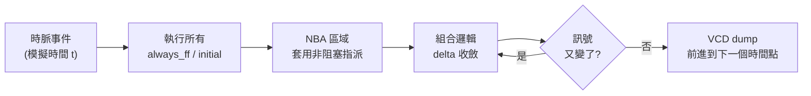
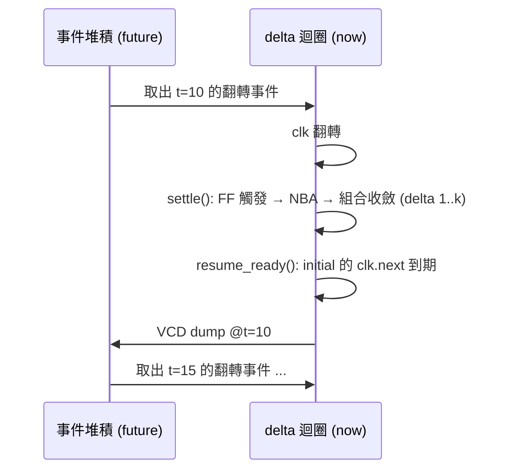

# 2.1 Delta 週期與 NBA 排程

> 原始碼：`veryl-sim/src/sim.rs`（核心）、`Design::settle` / `Design::run`（排程器）
> 上一章：[第 1 章 硬體描述與模擬的關係](01-*.md)　下一節：[2.2 Pratt 表示式剖析](02.2-Pratt表示式剖析.md)

---

## 2.1.1 為什麼模擬器需要「零時間」

硬體是並行的：上百個 `always_comb` 與 `always_ff` 區塊同時對訊號驅動。但 CPU 一次只能做一件事。事件驅動模擬器（event-driven simulator）的解法是把時間切成兩種：

- **模擬時間（simulation time）**：`#10`、時脈週期這種「真實」的前進，對應 `$time`。
- **delta 週期（delta cycle）**：在同一個模擬時間點內部的微觀迭代。每輪迭代讓「上一輪被改變的訊號」傳播到讀取它們的邏輯，直到整個組合邏輯網路穩定。

一個 posedge 到輸出翻轉，可能經過 5 層組合邏輯，就是 5 個 delta cycle——但 `$time` 一動也不動。Verilog LRM 把這稱為 *iteration*；業界慣稱 delta cycle。



## 2.1.2 阻塞 vs 非阻塞指派

Verilog 的老問題：為什麼有 `=` 和 `<=` 兩種指派？

- **阻塞指派（blocking, `=`）**：立刻寫入，下一行馬上看到新值。組合邏輯用它。
- **非阻塞指派（non-blocking, `<=`）**：先「排程」，等所有程序都讀完舊值後，再一次套用。序向邏輯（flip-flop）用它。

如果 flip-flop 用阻塞指派，`q <= d` 會立刻把 `q` 改掉，同一時脈緣上後面讀 `q` 的另一個 flip-flop 就會看到「穿越一級」的錯誤結果（race condition）。NBA（non-blocking assignment）區域的存在就是為了消除這個 race：**先全部讀、再全部寫**。

veryl-sim 把這個語意直接放進 IR：

```rust
// veryl-sim/src/sim.rs
pub struct Sim {
    ...
    pub changed: bool,
    pub nba: Vec<(usize, u32, u32, Val)>,   // 排程中的 NBA：(sig, bit lo, width, 值)
    ...
}

pub fn assign(&mut self, lv: &LValue, e: &Expr, nb: bool) {
    let Some((sig, lo, w)) = self.target(lv) else { return };
    let v = self.eval(e, w).resize(w);
    if nb { self.nba.push((sig, lo, w, v)); }   // <= : 只排程
    else  { self.write_bits(sig, lo, w, v); }   // =  : 立即寫
}

pub fn apply_nba(&mut self) {
    let q = std::mem::take(&mut self.nba);
    for (s, lo, w, v) in q { self.write_bits(s, lo, w, v); }
}
```

`Proc::Ff` 的 body 透過 `self.sim.exec(body, true)`（`nb = true`）執行，所以 flip-flop 內所有指派都是 NBA；`Proc::Comb` 則用 `nb = false`。這樣一分類，race condition 在架構上就不可能發生——不需要靠使用者紀律。

## 2.1.3 主迴圈的結構

`Design` 是排程器，持有 `Sim`（訊號狀態）、`procs`（程序列表）與 `inits`（initial 區塊的編譯結果）。`settle()` 就是「一個時間點內的全部 delta 活动」：

```rust
// veryl-sim/src/sim.rs  Design::settle
pub fn settle(&mut self) {
    for _ in 0..1000 {
        self.settle_comb();                      // (1) 組合邏輯收斂
        let n = self.sim.sigs.len();
        let (mut pos, mut neg, mut any) = (vec![false; n], vec![false; n], vec![]);
        // ... 對 watched 訊號比較前後值，偵測 posedge / negedge ...
        if !any { return; }                      // (2) 沒有任何事件 → 穩定
        // (3) initial 區塊的 clk.next(n) 計數
        for st in &mut self.inits {
            if let Some((c, ref mut k)) = st.wait {
                if pos[c] && *k > 0 { *k -= 1; }
            }
        }
        // (4) 觸發的 flip-flop：執行 body（NBA）
        for p in &self.procs {
            if let Proc::Ff { clk, pos: edge_pos, rst, body } = p {
                let mut trig = if *edge_pos { pos[*clk] } else { neg[*clk] };
                if let Some((r, low, asynch)) = rst {
                    if *asynch && ((*low && neg[*r]) || (!*low && pos[*r])) { trig = true; }
                }
                if trig { self.sim.exec(body, true); }
            }
        }
        self.sim.apply_nba();                    // (5) NBA 區域
    }
    self.sim.say(&format!("warning: event loop did not settle ..."), true);
}
```

其中 `settle_comb()` 是純組合的內層收斂：

```rust
// veryl-sim/src/sim.rs
fn settle_comb(&mut self) {
    for it in 0..500 {
        // 比較整輪 pass 前後的狀態：一個區塊寫同一訊號兩次
        // (`x = 0; x += 1;`) 是合法的，不能只看單一 write
        let before: Vec<(Bits, Bits)> = self.sim.sigs.iter().map(|s| (s.val.v, s.val.x)).collect();
        for p in &self.procs {
            if let Proc::Comb(b) = p { self.sim.exec(b, false); }
        }
        let same = self.sim.sigs.iter().zip(&before).all(|(s, b)| (s.val.v, s.val.x) == *b);
        if same { return; }
        if it == 499 { /* warning: combinational loop did not settle */ }
    }
}
```

### 收斂條件與複雜度

組合收斂的數學定義：把所有 `Proc::Comb` 視為一個總函數 $`F: \text{Sigs} \to \text{Sigs}`$ ，收斂即存在不動點：

$$
F^{(k)}(s_0) = F^{(k+1)}(s_0)
$$

因為訊號值域有限（ $`w`$ 位訊號有 $`3^w`$ 個 4 值狀態）而 $`F`$ 是確定性的，收斂或不動點循環必在有限步內出現。模擬器不偵測「循環」與「不收斂」的差別，直接以上限（500 輪）放棄並警告組合迴圈——實務上正常邏輯幾層就收斂，跑滿 500 輪幾乎必然是真的 comb loop。

每次 pass 的成本是 $`O(\sum_i |b_i|)`$ ——所有組合程序敘述數之和。總收斂成本 $`O(k \cdot \sum|b_i|)`$ ， $`k`$ 是最長組合路徑（邏輯深度）。與「事件佇列只重跑觸發程序」的 $`O(\text{觸發數})`$ 相比，輪詢在邏輯深度大、活動稀疏的設計上較慢；但 RTL 模擬的典型負載（時脈緣後大部分邏輯都活動）使兩者差距縮小，而輪詢省去的敏感度簿記與佇列操作是逐事件的固定開銷。

### 最長路徑與收斂輪數的關係

收斂輪數 $`k`$ 恰為組合邏輯的最長拓撲深度：每輪 pass 至少讓事件沿拓撲序推進一層。因此

$$
k \le \max_{\text{path}} \sum \text{depth(cell)}
$$

這給了一個實用的診斷：警告「did not settle」時，若設計本來就該是組合迴圈（如環形振盪器模型），警告是預期行為；否則幾乎必然有一條非預期的組合回授路徑，值得用 GTKWave 追訊號錐。

外層 `settle()` 的上限 1000 輪同理：每輪至少有一個 edge 事件，若 1000 輪不停止，代表 `always_ff` 在互相觸發（例如一個 FF 的輸出接另一個的 clock）。

### 為什麼「整輪重跑」而非事件佇列

教科書的事件驅動模擬器維護一個優先佇列（event wheel），只重跑「敏感訊號改變的程序」。veryl-sim 選擇**每輪重跑所有組合程序**（輪詢式，polling），原因：

1. **簡單正確**：不需要維護敏感度列表（sensitivity list）。SystemVerilog 的 `always_comb` 已隱含敏感度，但手動維護容易漏（經典 bug：`always @(a or b)` 漏了 `b`）。輪詢永遠等價於「敏感度 = 程序中讀的所有訊號」。
2. **夠快**：小到中型設計（數千訊號、數十程序）每輪 pass 只是把陣列掃一遍，常数小；與其省下重複執行，不如省下事件簿記的常数。
3. **可預測**：執行時間與程序數 × 收斂輪數成正比，沒有佇列病態退化。

代價是不必要的重複執行；`Design::settle_comb` 用「pass 前後整體狀態快照」來提早結束，把代價壓到收斂輪數的上限內。

## 2.1.4 時間前進：ClockGen 與事件堆積

真正的模擬時間只由兩件事推進：`Proc::ClockGen` 與 `initial` 的 `$finish`。時脈產生器不用程序輪詢，而是排進一個二元堆積（`BinaryHeap`）作為未來事件表（future event queue）：

```rust
// veryl-sim/src/sim.rs  Design::run
pub fn run(&mut self, max_time: u64) {
    let mut heap: BinaryHeap<Reverse<(u64, usize)>> = BinaryHeap::new();
    for (i, p) in self.procs.iter().enumerate() {
        if let Proc::ClockGen { half, .. } = p { heap.push(Reverse((*half, i))); }
    }
    self.sim.time = 0;
    self.settle();                       // t=0 的初始化與組合收斂
    for k in 0..self.inits.len() { self.run_init(k); }
    self.settle();
    while self.resume_ready() && !self.sim.finished { self.settle(); }
    self.dump();
    while !self.sim.finished {
        let Some(Reverse((t, _))) = heap.peek().copied() else { break };
        if t > max_time { /* 達到 --max-time */ break; }
        self.sim.time = t;
        // 同一時間點的所有時脈緣一起處理
        while let Some(Reverse((t2, i))) = heap.peek().copied() {
            if t2 != t { break; }
            heap.pop();
            if let Proc::ClockGen { sig, half } = &self.procs[i] {
                let cur = self.sim.sigs[*sig].val.v.bit(0);
                self.sim.write_bits(*sig, 0, 1, Val::bit(!cur));
                heap.push(Reverse((t + *half, i)));   // 半週期後再翻轉
            }
        }
        self.settle();                   // 這個 posedge 引發的全部 delta 活动
        while self.resume_ready() && !self.sim.finished { self.settle(); }
        self.dump();
    }
    ...
}
```

每個 `ClockGen` 在自己翻轉後把 `(t + half, 自己)` 推回堆積——這就是「半週期後再翻轉」的自我重排。堆積保證事件按時間遞增取出；同一時間戳的多個事件先全部取出（批次處理）再做 delta 收斂，符合「同一模擬時間內 delta 無限次」的語意。



## 2.1.5 initial 區塊：第三種程序

`initial` 不是在每個時間點反覆執行的程序，而是一個**會暫停的執行緒**。veryl-sim 把含 `clk.next(n)`（`Stmt::Wait`）的 initial 編譯成平坦的 op 序（`Op::Exec / Wait / Jmp / JmpIfNot`，見 `compile_initial`，sim.rs 尾端），執行時遇到 `Op::Wait` 就把 `(時脈, 次數)` 記在 `InitState::wait` 並交回控制權：

```rust
// veryl-sim/src/sim.rs  Design::run_init (節錄)
Op::Exec(s) => {
    self.sim.exec(std::slice::from_ref(&s), false);
    // 每個敘述後都 settle：同一 initial 中後面的讀取
    // 才能看到組合邏輯的最新值（delta cycles）
    self.settle();
}
Op::Wait(clk, n) => {
    let n = self.sim.eval(&n, 0).v.sat();
    if n > 0 { self.inits[k].wait = Some((clk, n)); return; }
}
```

`settle()` 裡的第 (3) 步在每次 posedge 時把 `k` 遞減；減到 0 後由 `resume_ready()` 重新調度。這是一個用「計數器 + 每輪檢查」實作的協作式多工，正確且免鎖——因為同一時間只有一個 initial 在跑。

**為什麼每條敘述後都 settle？** 因為 veryl-sim 支援「時脈less 組合 testbench」：initial 直接驅動輸入、讀輸出，中間沒有任何時脈事件。若不 settle，`a = 1; if b { ... }` 中的 `b` 還是舊值。細節在 2.5 節展開。

## 2.1.6 敏感度：watched 列表

edge 偵測只對 `watched` 中的訊號做（時脈、非同步 reset、`clk.next` 的目標）。這是**顯式敏感度列表**，由 elaboration 時填入：

```rust
// veryl-sim/src/elab.rs  always_ff()
self.watched.push(clk);
if let Some((r, _, true)) = rinfo { self.watched.push(r); }   // 只追非同步 reset
```

同步 reset 不需要進 `watched`——它只是 FF 資料路徑上的 mux，隨組合收斂自然傳播。非同步 reset 則必須能**在任何時刻**觸發 FF，所以每次訊號值變化都要檢查。這是「最小敏感度」原則：watched 越短，`settle()` 每輪的 edge 掃描越便宜。

## 2.1.7 與 Verilog 排程區域的對應

SystemVerilog LRM 定義了九個排程區域（Active → Inactive → NBA → Observed → Reactive → ...）。veryl-sim 簡化為三個有效階段：

| SystemVerilog 區域 | veryl-sim 對應 | 實作位置 |
|---|---|---|
| Active（阻塞指派、$display） | `exec(body, false)` | `settle_comb` / `run_init` |
| NBA | `apply_nba()` | `settle()` 第 (5) 步 |
| Reactive（$assert、initial） | `InitState` 執行緒 | `run_init` / `resume_ready` |

省略的區域（Observed、Re-Inactive 等）屬於程式塊內部的檢查語意，對 RTL 模擬正確性沒有影響。

## 為什麼這樣設計

1. **輪詢取代事件佇列做 delta**：正確性與簡單度優先。事件佇列的優勢（稀疏活動下省計算）在測試平台的規模上不明顯，而漏掉一條敏感度就是一個難查的模擬/綜合不一致 bug。
2. **NBA 用一個 `Vec` 而非獨立時槽**：Verilog 的 NBA 區域只需「全部讀完後一次套用」，一個 buffer 就夠；不需要支援 `#0` 延遲的細粒度排程（veryl-sim 不支援延遲控制，RTL 模擬也不需要）。
3. **收斂上限 + 警告而非 panic**：組合迴圈是使用者的設計錯誤，模擬器應該報告並繼續（也許使用者想看波形找問題），而不是直接崩潰。
4. **`Design::settle` 同時服務 t=0、每條 initial 敘述、與每個時脈緣**：單一函式承擔「把這個時間點跑穩」的全部責任，行為處處一致，也讓「時脈less testbench」成為自然結果而非特例。

## 本章重點

- Delta cycle 是同一模擬時間內的微觀迭代；收斂條件是組合總函數到達不動點。
- NBA 的本質是「先全讀、後全寫」；veryl-sim 把 `=`/`<=` 分別對應到 `exec(nb=false/true)` + `apply_nba()`。
- 模擬時間由 `ClockGen` 在二元堆積中的自我重排推進；每個時脈緣之後是一整段 delta 活动。
- 組合收斂用「整輪重跑 + 快照比較」取代事件佇列：正確、簡單、規模內夠快。
- edge 偵測有顯式 watched 列表（時脈與非同步 reset），由 elaboration 填入。
- `initial` 是協作式執行緒，被編譯成 `Op::Exec/Wait/Jmp` 平坦序列，每條敘述後都收斂。
