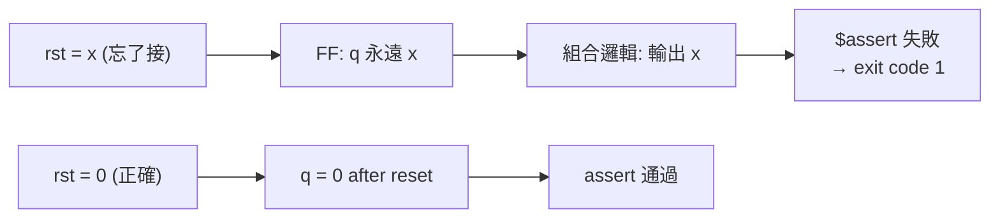

# 2.4 四值邏輯位元向量

> 原始碼：`veryl-sim/src/value.rs`
> 上一節：[2.3 精細化與層次展開](02.3-精細化與層次展開.md)　下一節：[2.5 時脈與測試平台](02.5-時脈與測試平台.md)

---

## 2.4.1 為什麼需要 x

SystemVerilog（Veryl 繼承之）的 `logic` 是四值型別：`0`、`1`、`x`（未知）、`z`（高阻；veryl-sim 將 z 併入 x）。x 不是「錯誤」，而是**精確的語意**：

- 未驅動的訊號在 t=0 是 x；
- 從 x 狀態讀取的暫存器輸出是 x，直到第一個 reset/clock；
- x 條件下的 if 是「不執行」（`truth() == None`），而 case 比對 x 是「不匹配」。

驗證流程**依賴** x 傳播：如果 reset 忘了接，所有下游訊號停在 x，`$assert` 會失敗——這就是 bug 被抓到的方式。2 值模擬器會把未初始化值當 0，「假通過」的機率高得多。這是 veryl-sim 用 4 值的核心理由：**模擬器的價值在於暴露錯誤，而 x 是暴露未初始化/未驅動的唯一訊號**。



## 2.4.2 表示法：v/x 雙軌 + 固定 4 limb

value.rs 的核心型別：

```rust
// veryl-sim/src/value.rs
/// 64-bit words per value: MAXW = 64 × LIMBS bits
pub const LIMBS: usize = 4;
pub const MAXW: u32 = 64 * LIMBS as u32;      // = 256

#[derive(Clone, Copy, PartialEq, Eq, Debug, Default, Hash)]
pub struct Bits(pub [u64; LIMBS]);            // 固定寬度小端 64-bit 字陣列

/// Invariant: wherever an `x` bit is set, the matching `v` bit is 0.
#[derive(Clone, Copy, Debug, PartialEq)]
pub struct Val {
    pub w: u32,     // 邏輯寬度（≤ MAXW）
    pub v: Bits,    // 已知位元的值
    pub x: Bits,    // x 遮罩：1 = 該位未知
    pub s: bool,    // 有號
}
```

設計要點逐一拆解：

1. **一對 `Bits`（v 與 x）表示四值**。每個邏輯位兩個實體位元：`x=0` 時 `v` 即值（0 或 1）；`x=1` 時該位未知（此時 `v` 必為 0——這是不變式，見註解）。這是 4 值表示的標準編碼（Verilog 模擬器如 Icarus 也用類似手法）。`z` 不單獨表示，併入 x（對 RTL 模擬足夠：z 只在三態匯流排出現，veryl-sim 不支援 inout）。
2. **固定 4×64=256 位，`Copy`**。`Bits` 沒有堆積：`[u64; 4]` 是 32 位元組的平凡型別，`Val` 是 40 位元組、可 `Copy`。所有運算零配置、無所有權問題。代價是 1 位訊號也佔 32 位元組狀態——對模擬器可接受（見 2.4.6 的效能討論），這也是整個專案「寬度上限 256 bit」限制的來源。
3. **`w` 是邏輯寬度，與 Bits 的實體寬度分離**。超過 `w` 的位元被 `mask(w)` 保持為 0；運算結果一律 `& mask(w)` 截斷。

## 2.4.3 Bits 的算術：u128 快速路徑

`Bits` 實作了加/減/乘/除/移位/比較，全部手寫在 limb 陣列上。乘法是教科書的長乘法：

```rust
// veryl-sim/src/value.rs
pub fn wrapping_mul(self, o: Bits) -> Bits {
    let mut r = [0u64; LIMBS];
    for i in 0..LIMBS {
        let mut c = 0u128;
        for j in 0..LIMBS - i {
            let t = self.0[i] as u128 * o.0[j] as u128 + r[i + j] as u128 + c;
            r[i + j] = t as u64;
            c = t >> 64;
        }
    }
    Bits(r)
}
```

除法有兩條路：低 128 位時直接用原生 `u128` 除法（快速路徑），否則逐位長除法：

```rust
// veryl-sim/src/value.rs  divrem()（節錄）
if LIMBS <= 2 || (self.0[2..].iter().all(|w| *w == 0) && o.0[2..]...== 0) {
    let (a, b) = (self.lo(), o.lo());
    return (Bits::from_u128(a / b), Bits::from_u128(a % b));   // u128 快速路徑
}
// 逐位恢復式長除法
for k in (0..MAXW - self.leading_zeros()).rev() {
    r = r << 1;
    if self.bit(k) { r.0[0] |= 1; }
    if r >= o { r = r.wrapping_sub(o); q.0[(k / 64) as usize] |= 1 << (k % 64); }
}
```

快速路徑的價值：實務上絕大多數運算（位址算術、計數器、資料路徑）≤ 128 位，走原生指令；256 位除法是罕見慢路徑。十進位列印 `to_dec()` 也用同手法：反覆除以 $`10^{19}`$ ，每次用快速路徑。

## 2.4.4 運算如何傳播 x

### 逐位邏輯：位元技巧

AND 與 OR 的 x 規則是：已知 0 與任何值 AND 為已知 0（0 吸收 x）；已知 1 與任何值 OR 為已知 1（1 吸收 x）。value 層無此邏輯——它實作在 sim.rs 的 `eval_bin`，但用的是純位元運算：

```rust
// veryl-sim/src/sim.rs  eval_bin()（節錄）
"&" => {
    // 已知 0 的位元：兩邊都「確定不是 1」
    let k0 = (!va.v & !va.x) | (!vb.v & !vb.x);
    Val { w, v: va.v & vb.v, x: (va.x | vb.x) & !k0 & m, s: sg }
}
"|" => {
    // 已知 1 的位元會吸收對方的 x
    let k1 = va.v | vb.v;
    Val { w, v: k1, x: (va.x | vb.x) & !k1 & m, s: sg }
}
"^" => { let x = va.x | vb.x; Val { w, v: (va.v ^ vb.v) & !x, x, s: sg } }
```

逐一驗證 AND 的編碼（依不變式：x=1 ⟹ v=0）：

| a | b | a·b 期望 | v = va.v & vb.v | x = (va.x ∨ vb.x) ∧ ¬k0 |
|---|---|---|---|---|
| 0 | 0 | 0 | 0 | k0=1 → 0（已知 0）✓ |
| 0 | x | 0 | 0 | k0=1（a 邊 `!v&!x`）→ 0 ✓ |
| 1 | x | x | 0 | k0=0 → x=1 ✓ |
| x | x | x | 0 | k0=0 → 1 ✓ |
| 1 | 1 | 1 | 1 | 0 ✓ |

OR 對稱。XOR 最簡單：任一邊 x 則 x（`v` 相應位清 0 維持不變式）。

### 整體運算：x 即全 x

算術（+ − × ÷ % **）與比較（除 `===`）採保守規則——**任一位元 x 則整體結果 x**：

```rust
// veryl-sim/src/sim.rs  eval_bin()（節錄）
_ => {
    if va.x != 0u128 || vb.x != 0u128 { return Val::allx(w).signed(sg); }
    ...  // 純 Bits 運算
}
```

這正是 SystemVerilog 的規定：進位鏈使進位輸入的 x 傳遍整個和，逐位模擬進位傳播既慢又與 LRM 不符。`"x != 0u128"` 的寫法利用 `Bits` 對 `u128` 的 `PartialEq`——x 遮罩非零即「含 x」，一次比較（實際是 4 limb 的 or）完成。`===`（case equality）則例外，它把 x 當普通位元比對：

```rust
"===" => Some(va.v == vb.v && va.x == vb.x),
```

### 條件與化約

`truth()` 把 x 化為三值：`Some(true)`（有已知 1）、`Some(false)`（全 0 無 x）、`None`（含 x 且無已知 1）：

```rust
// veryl-sim/src/value.rs
pub fn truth(&self) -> Option<bool> {
    if !self.v.is_zero() { Some(true) } else if self.x.is_zero() { Some(false) } else { None }
}
```

三元運算子（`Expr::Tern`）的 x 處理最細緻——**逐位合併兩分支**：

```rust
// veryl-sim/src/sim.rs  eval() 的 Tern 分支
None => {
    let diff = (va.v ^ vb.v) | va.x | vb.x;
    Val { w, v: va.v & vb.v & !diff, x: diff, s: false }
}
```

條件為 x 時：兩分支**相同的位**（且都已知）結果仍已知；不同的位為 x。這比「條件 x 就全 x」精確，也符合 LRM。例如 `x ? 4'b1z01 : 4'b1011`：bit0 兩邊都是 1 → 已知 1；bit1 是 z vs 1 → x；其餘為 x。

### 一元約化

約化運算（`&a`、`|a`、`^a`）的 x 規則在 `eval_un`：AND 約化「有已知 0 就得 0，有 x 才 x」；OR 約化「有已知 1 就得 1」：

```rust
// veryl-sim/src/sim.rs（節錄）
"&" | "~&" => {
    let r = if (!v.v & !v.x & m) != 0 { Val::bit(false) }      // 存在已知 0 位
            else if v.x != 0u128 { Val::allx(1) }
            else { Val::bit(true) };
    ...
}
"|" | "~|" => {
    let r = if v.v != 0u128 { Val::bit(true) }                  // 存在已知 1 位
            else if v.x != 0u128 { Val::allx(1) }
            else { Val::bit(false) };
```

## 2.4.5 寬度調整與符號擴展

`resize()` 處理兩個方向，並在有號值時擴展符號——**且 x 的符號位也擴展為 x**：

```rust
// veryl-sim/src/value.rs（節錄）
pub fn resize(&self, w: u32) -> Val {
    let w = w.clamp(1, MAXW);
    if w <= self.w {
        return Val { w, v: self.v & mask(w), x: self.x & mask(w), s: self.s };  // 截斷
    }
    let ext = mask(w) & !mask(self.w);
    let (mut v, mut x) = (self.v, self.x);
    if self.s {
        if self.v.bit(self.w - 1) { v = v | ext }          // 符號 1 → 補 1
        else if self.x.bit(self.w - 1) { x = x | ext }     // 符號 x → 補 x
    }
    Val { w, v, x, s: self.s }
}
```

無號值擴展為零填充（v、x 的高位本來就是 0）。算術的上下文寬度（`ctx`）由賦值目標寬度傳入（`eval(e, w)`），實作 Verilog 的「運算式寬度由上下文決定」：`u8` 目標的 `a + b` 以 8 位求值。

## 2.4.6 與 2 值模擬的效能比較

| 面向 | 4 值（veryl-sim） | 2 值（netsim，veryl-eda 的 `netsim.rs`） |
|---|---|---|
| 每訊號狀態 | 40 B（`Val`: 32+4+4） | ~1 B 或位元打包 |
| 邏輯運算 | 每位兩份位元運算 | 一份 |
| 算術 | x 檢查 + 原生 Bits | 純整數 |
| 未初始化偵測 | 天然（x 傳播到 assert） | 需另行插樁或失去 |
| 適用 | RTL 驗證、testbench | 閘級快速回歸 |

量化估算：4 值大約慢 1.5–3×、記憶體多 4–8×（與運算型態相關）。veryl-sim 仍選 4 值，因為它的使命是**讓 testbench 的 assert 可信**；veryl-eda 的 `netsim.rs` 才是 2 值的世界（閘級網表的暫存器都已由綜合確定初值與驅動）。兩個模擬器各司其職，這是本書第二章與第七章（`gates.rs`，2.7 節）之間的分工。

### 記憶體布局的取捨

`Val` 若改成 `Box<[u64]>`（可變寬度），1 位訊號只佔 8–16 B，對 256 位訊號則省一半。但：

1. 每次 eval 要多一次指標追逐與配置——模擬熱路徑每秒數千萬次 eval，配置是致命的；
2. `Copy` 消失，所有運算式的所有權管理進入熱路徑；
3. MAXW=256 的上限對 RTL（資料路徑寬度）罕見觸及，觸及時直接報錯即可（`w.clamp(1, MAXW)` + 各處的 MAXW 檢查）。

固定寬度是「模擬器常數小於理論最優」的典型案例：實測效能由分支預測與快取行為主導，而非理論位元組數。

## 2.4.7 x 的列印與 VCD

`fmt_bin`/`fmt_hex`/`fmt_dec` 尊重 x 位元：十六進位中「4 位全 x」印小寫 `x`、「部分 x」印大寫 `X`（Verilog 慣例）；十進位含 x 直接印 `x` 或 `X`：

```rust
// veryl-sim/src/value.rs  fmt_hex()（節錄）
if xm == valid { 'x' } else if xm != 0 { 'X' } else { std::char::from_digit(vv, 16).unwrap() }
```

VCD 輸出（2.6 節）同樣逐位判 x：`s.val.x & 1 == 1 → 'x'`。

## 為什麼這樣設計

1. **v/x 雙軌而非每位元列舉**：兩個 `Bits` 讓逐位運算退化為原生指令（無 per-bit match）；不變式「x=1 ⟹ v=0」把「值為 x」的位規範成單一表示。
2. **固定 256 位 + Copy**：零配置熱路徑；上限是接受的成本，換來所有運算的常數時間。
3. **保守算術、精確邏輯**：算術任一位 x 即全 x（LRM 語意、實作最簡），邏輯運算用吸收律保留已知位（`k0`/`k1` 位元技巧），三元逐位合併——每個運算的精確度與其實作複雜度匹配。
4. **z 併入 x**：無 inout、無三態匯流排支援，z 的獨立語意無用武之地；少一個表示層。
5. **與 netsim 分工**：4 值服務驗證可信度，2 值服務閘級回歸速度；同一專案內兩種表示並存而非折衷。

## 本章重點

- x 是語意不是錯誤：未初始化/未驅動偵測的唯一管道；`truth()` 的三值化（Some(true)/Some(false)/None）是 if/case/斷言的 x 行為基礎。
- `Val { w, v: Bits, x: Bits, s }`，不變式 x=1 ⟹ v=0；`MAXW = 64×4 = 256`，`Copy` 零配置。
- AND/OR 的吸收律位元技巧（`k0`/`k1`）；XOR x 即 x；算術任一位 x 即全 x；`===` 逐位含 x 比對。
- 三元條件 x 時逐位合併：兩分支相同且已知的位保持已知。
- `resize()` 對有號值擴展符號，符號位為 x 時擴展 x；上下文寬度 `ctx` 實作 Verilog 寬度規則。
- 相對 2 值慢 1.5–3×，但這是「驗證可信度」的價格；2 值模擬由 veryl-eda 的 netsim 承擔。
