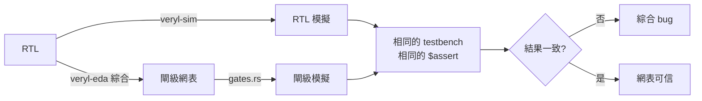
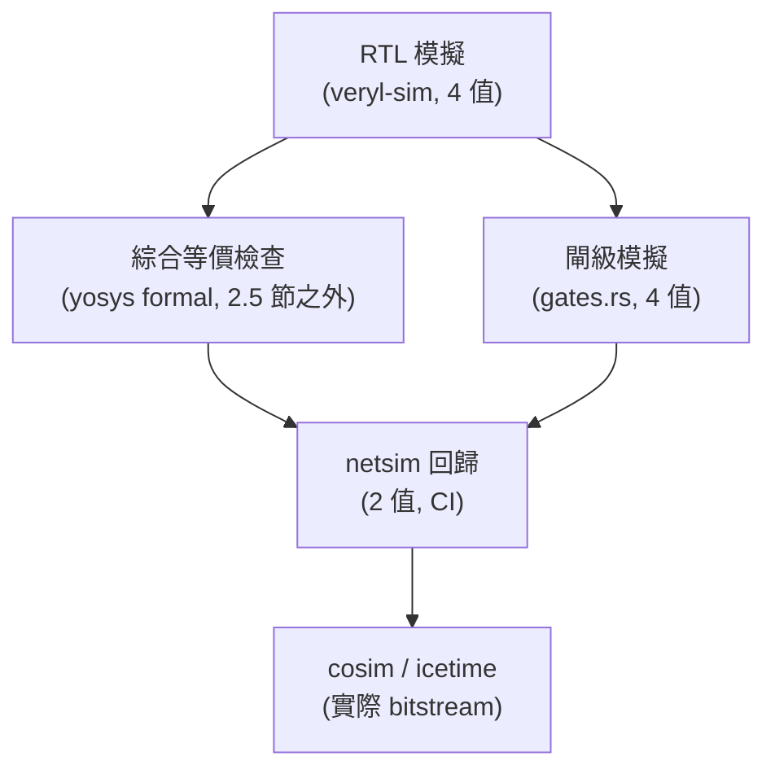

# 2.7 閘級模擬

> 原始碼：`veryl-sim/src/gates.rs`；背景：veryl-eda 的網表（`output.rs`、`ice40.rs`、`asic/lib.rs`）
> 上一節：[2.6 VCD 波型輸出](02.6-VCD波型輸出.md)　→ [第 3 章 邏輯綜合](03-*.md)

---

## 2.7.1 閘級模擬是什麼、為什麼需要

綜合流程把 RTL 變成閘級網表（yosys JSON）：`SB_LUT4`、`SB_DFFS`、標準單元……。**綜合是一種重寫**，重寫就可能出錯：優化器弄錯極性、時脈接錯緣、reset 值寫反。閘級模擬（gate-level simulation）是最後一道防線：



veryl-eda 自己的 `cargo test` 正是這個流程：綜合 `examples/` 的每個設計、用 netsim（2 值）跑網表上的 testbench、比對 assert。而 **veryl-sim 的閘級模式**讓**同一個 4 值模擬器、同一份 testbench** 可以對閘級網表執行——使用者不需要學第二套流程，也保留了 x 傳播的除錯能力。

使用方式（AGENTS.md）：`veryl-eda --gatesim opt|ice40|asic` 產生「可模擬的網表」，veryl-sim 在精細化時透過 `GateFn` 回呼取得它。

## 2.7.2 掛接機制：GateFn 與 elab_gates

```rust
// veryl-sim/src/gates.rs
/// Gives the gate netlist of a module for the given parameter overrides,
/// or None to simulate that module's RTL.
pub type GateFn<'a> = dyn Fn(&str, &HashMap<String, Val>) -> Result<Option<GateNetlist>, String> + 'a;

#[derive(Clone, Copy, PartialEq, Debug)]
pub enum Pin { C0, C1, W(u32) }       // 常數 0 / 常數 1 / 線網編號

#[derive(Clone, Debug)]
pub struct GCell {
    pub typ: String,                       // 單元型別，如 "SB_LUT4"
    pub conns: Vec<(String, Pin)>,         // (腳位名, 線網)
    pub params: Vec<(String, String)>,     // 參數（二進位字串）
}

#[derive(Clone, Debug)]
pub struct GateNetlist { pub ports: Vec<GPort>, pub cells: Vec<GCell> }
```

網表是中立的資料結構（yosys JSON 的直接投影）：腳位以名字引用（`"A"`、`"Y"`）、線網以編號、常數以 `Pin::C0/C1`。elab 的 `instantiate()` 在展開模組前先問 GateFn：

```rust
// veryl-sim/src/elab.rs  instantiate()（節錄）
let gate = match self.gates {
    Some(f) => {
        let mut ps: Vec<String> = ov.iter().map(|(n, v)| format!("{}={}", n, v.fmt_hex())).collect();
        ps.sort();
        let key = format!("{}#{}", kind, ps.join(","));
        if !self.gate_cache.contains_key(&key) { let g = f(&kind, &ov)?; self.gate_cache.insert(key.clone(), g); }
        self.gate_cache[&key].clone()
    }
    None => None,
};
```

兩個細節：

1. **參數化快取**：網表依「模組名 + 參數覆寫」快取（`gate_cache`）——`counter #(W:8)` 與 `counter #(W:16)` 是兩份網表。
2. **None = 走 RTL**：GateFn 回 `None`（例如網表檔裡沒有這個模組），該模組照常精細化 RTL。這讓「閘級 DUT + RTL 測試平台」混搭自然成立。

`elab_gates()` 則把網表**翻譯回既有的模擬 IR**，而不是為閘級另起執行引擎：

```rust
// veryl-sim/src/gates.rs  elab_gates()（節錄）
pub fn elab_gates(&mut self, g: &GateNetlist, prefix: &str) -> R<Scope> {
    let mut sc = Scope { prefix: prefix.to_string(), ..Default::default() };
    let mut wires: HashMap<u32, usize> = HashMap::new();
    // ports: full-width signals, connected bit by bit to the wires
    for p in &g.ports {
        let full = if prefix.is_empty() { p.name.clone() } else { format!("{}.{}", prefix, p.name) };
        let id = self.new_sig(full, p.bits.len().max(1) as u32);
        ...
        for (i, b) in p.bits.iter().enumerate() {
            ...
            if p.output {
                let src = self.gw(&mut wires, prefix, *b);
                self.procs.push(Proc::Comb(vec![Stmt::Assign(..., src)]));   // 線網 → 埠
            } else if let Pin::W(_) = b {
                let w = self.gw(&mut wires, prefix, *b);
                self.procs.push(Proc::Comb(vec![Stmt::Assign(lv(sig_of(&w)), bit)]));  // 埠 → 線網
            }
        }
    }
```

翻譯規則只有三條：

| 網表元素 | 模擬 IR |
|---|---|
| 每條線網 | 一個 1 位 `Signal`（`{prefix}.n{k}`，懶建立於 `gw()`） |
| 組合單元 | `Proc::Comb`（單一 `Stmt::Assign`，右值是該單元的運算式） |
| 時序單元（FF/RAM） | `Proc::Ff`（body 是普通 `Stmt` 序列） |

閘級模擬因此**完全重用** 2.1 節的排程器：組合收斂跑 `settle_comb`、FF 由 edge 觸發、NBA 照舊。沒有第二套模擬核心要維護。

## 2.7.3 組合單元：運算式，而非表格

簡單閘直接映射到 IR 運算子：

```rust
// veryl-sim/src/gates.rs（節錄）
let comb: Option<(&str, Expr)> = match t {
    "$_NOT_" | "INV" => Some(("Y", not(i!(self, "A")))),
    "$_AND_" | "AND2" => Some(("Y", bin("&", i!(self, "A"), i!(self, "B")))),
    "$_XOR_" | "XOR2" => Some(("Y", bin("^", i!(self, "A"), i!(self, "B")))),
    "AOI21" => Some(("Y", not(bin("|", bin("&", i!(self, "A"), i!(self, "B")), i!(self, "C"))))),
    ...
    "$_MUX_" | "MUX2" => { ... Some(("Y", Expr::Tern(Box::new(s), Box::new(b), Box::new(a)))) }
    ...
};
```

一張 match 同時涵蓋 yosys 內部閘（`$_AND_`）、iCE40/ECP5 專用閘與 vlib 標準單元（AOI21 等）——每個單元只是「輸出腳位 → 運算式」。

### LUT：mux tree 而非查表

FPGA 的 LUT（`SB_LUT4`/`LUT4`）在硬體上是 16 位元的真值表 + 多工器。最省事的模擬法是查表：`init >> (inputs as index)`。veryl-sim 刻意不用：

```rust
// veryl-sim/src/gates.rs
// a mux tree over a truth table (not an indexed read): an x input
// then only matters where the table really depends on it, as in RTL
fn tree(init: u128, ins: &[Expr], k: usize, base: usize) -> Expr {
    if k == 0 { return Expr::Num(Val::new(1, (init >> base) & 1)); }
    let half = 1usize << (k - 1);
    let part = |b: usize| (init >> b) & ((1u128 << half) - 1);
    // input k-1 does not matter here: one subtree
    if part(base) == part(base + half) { return tree(init, ins, k - 1, base); }
    let (lo, hi) = (tree(init, ins, k - 1, base), tree(init, ins, k - 1, base + half));
    Expr::Tern(Box::new(ins[k - 1].clone()), Box::new(hi), Box::new(lo))
}
```

展開成巢狀三元（mux 樹）。為什麼這是 x 語意的關鍵？考慮 LUT 實現常數函數（輸出與某輸入無關）：

- **查表法**：索引含 x → 取哪一項未知 → 輸出 x。即使真值表顯示該輸入根本不影響輸出。
- **mux 樹法**：`tree` 遞迴時若兩半 `part(base) == part(base + half)`（該輸入不影響此子樹），**不生成 mux**，直接收斂到單一子樹——x 輸入被正確地「無視」。

這正是 2.4.4 節三元運算子逐位 x 合併語意的紅利：`x ? 1 : 1` 的輸出是已知 1。**閘級模擬保留 x 傳播的精確性**，意味著網表中常數化的邏輯（綜合把無關輸入折掉後）不會因為測試平台暫時驅動 x 而誤報 x 錯誤——行為與 RTL 模擬一致，兩者才可比對。

### SB_CARRY 與 CCU2C

iCE40 的進位鏈：

```rust
// veryl-sim/src/gates.rs（節錄）
"SB_CARRY" => {
    let (a, b, ci) = (i!(self, "I0"), i!(self, "I1"), i!(self, "CI"));
    Some(("CO", bin("|", bin("&", a.clone(), b.clone()), bin("&", bin("|", a, b), ci))))
}
```

就是 majority 函數 $`CO = ab + (a+b)CI`$ 的運算式形式。ECP5 的 `CCU2C`（雙半進位單元）依 ECP5 techlib 展開：

```rust
// veryl-sim/src/gates.rs（節錄）
if t == "CCU2C" {
    // two carry-chain halves: S = LUT4 ^ CIN,
    // COUT = LUT4 ? CIN : LUT2 (INJECT1 = "YES" gates CIN and LUT2 off)
    let l4 = tree(init, &ins, 4, 0);
    let l2 = tree(init & 0xf, &ins[..2], 2, 0);
    let s = bin("^", l4.clone(), if inject { zero() } else { cin.clone() });
    let co = bin("|", bin("&", not(l4.clone()), if inject { zero() } else { l2 }), bin("&", l4, cin.clone()));
    ...
}
```

每個單元模型的權威來源都是**工具鏈自己的 cells_sim.v**（yosys techlib）——註解裡明白標注。這是閘級模擬正確性的第一原則：模型語意跟綜合工具的參考模擬模型一致，而不是跟「你以為這單元在做什麼」一致。

## 2.7.4 時序單元：DFF 家族

FF 的處理比組合單元繁瑣，因為每個家族的極性/同步性編碼不同：

```rust
// veryl-sim/src/gates.rs（節錄）
let ff: Option<(&str, bool, Option<(&str, bool, bool, bool)>)> = if t == "TRELLIS_FF" {
    // ECP5: clock and LSR polarity muxes, REGSET value, SRMODE ASYNC or synchronous
    dpin = "DI";
    let r = c.conns.iter().any(|x| x.0 == "LSR").then(|| ("LSR", param("LSRMUX") != "INV", param("SRMODE") == "ASYNC", param("REGSET") == "SET"));
    Some(("CLK", param("CLKMUX") != "INV", r))
} else if let Some(k) = t.strip_prefix("SB_DFF") {
    let neg = k.starts_with('N');
    let k = k.trim_start_matches('N');
    let (sync, k) = if k.len() == 2 { (true, &k[1..]) } else { (false, k) };   // SB_DFFSR vs SB_DFFS
    let r = match k { "R" => Some(("R", true, !sync, false)), "S" => Some(("S", true, !sync, true)), _ => None };
    Some(("C", !neg, r))
} else if let Some(k) = t.starts_with("$_DFF_") ... // yosys 內部 $_DFF_PN0_ 等
...
if let Some((ck, rising, rst)) = ff {
    let (clk, d, q) = (sig_of(&i!(self, ck)), i!(self, dpin), sig_of(&i!(self, "Q")));
    let mut body = vec![Stmt::Assign(lv(q), d)];
    let mut rinfo = None;
    if let Some((rp, high, asynch, val)) = rst {
        let active = if high { r.clone() } else { not(r.clone()) };
        body = vec![Stmt::If(vec![(active, vec![Stmt::Assign(lv(q), Expr::Num(...))])], body)];
        rinfo = Some((sig_of(&r), !high, asynch));
        if asynch { self.watched.push(sig_of(&r)); }   // 非同步 reset 進敏感度
    }
    if clk == usize::MAX { continue; } // constant clock: never fires
    self.watched.push(clk);
    self.procs.push(Proc::Ff { clk, pos: rising, rst: rinfo.filter(|x| x.0 != usize::MAX), body });
}
```

翻譯結果就是一個標準 `Proc::Ff`：

- body = `if (reset active) q = r else q = d`（reset 分支由 Stmt::If 表示）；
- 同步 reset 的話 rst 參數為 `None`（reset 已在 body 的資料路徑上，等價於 D 前的 mux）；
- 非同步 reset 訊號進 `watched`（2.1.6 節的最小敏感度）；
- **時脈接常數**（`clk == usize::MAX`）的 FF 直接跳過——clock 永不翻轉，FF 永不動作，等價於被綜合掉的常數（配合 2.1 節「時脈翻轉由事件堆積驅動」：常數不會產生事件）。

## 2.7.5 RAM 模型

`gate_ram()` 把 `SB_RAM40_4K` / vlib `SRAM` 翻譯為陣列 + 兩個同步程序：

```rust
// veryl-sim/src/gates.rs（節錄）
// the memory: `depth` element signals
let first = self.sim.sigs.len();
for k in 0..depth { self.sim.sigs.push(Signal { ..., val: Val::allx(width), ... }); }
self.sim.sigs[first].arr = Some(depth as u32);
...
// read register: one signal per data bit, then copied to the RDATA wires
let rreg = self.sim.sigs.len();
...
let read  = Stmt::If(vec![(re, vec![Stmt::Assign(lv(rreg), Expr::Elem(first, Box::new(raddr)))])], vec![]);
let write = Stmt::If(vec![(we, vec![Stmt::Assign(LValue { sig: first, sel: Sel::Elem(Box::new(waddr)) }, wdata)])], vec![]);
self.watched.push(clk);
self.procs.push(Proc::Ff { clk, pos: true, rst: None, body: vec![read, write] });
```

重點是**讀取暫存器**：同步讀的 RAM 在時脈緣把 `mem[raddr]` 打進 `rreg`，再由組合程序複製到 RDATA 線網——精確模擬「讀延遲一拍」的行為。這與 veryl-eda 的 `bram.rs` 對 RTL 記憶體的建模（同步讀才轉成 SB_RAM40_4K）兩端對齊：RTL 有同步讀 → 綜合出 RAM 單元 → 閘級模擬同樣有一拍延遲，行為不變。

RAM 初始值是 `Val::allx`（x 填滿）——與 iCE40 上電記憶體不定相符；若綜合器塞了 mem_init 參數，是另一條路徑的事（本函式未處理，晶片上的 init 由 bitstream 攜帶）。

## 2.7.6 與 netsim（2 值）的差別

veryl-eda 的 `netsim.rs` 是獨立的 2 值閘級模擬器。兩者並存的分工：

| 面向 | veryl-sim `gates.rs` | veryl-eda `netsim.rs` |
|---|---|---|
| 值域 | 4 值（x 傳播） | 2 值 |
| 引擎 | 重用 veryl-sim 排程器（`Proc::Comb/Ff`） | 專用拓撲排序評估 |
| 輸入 | yosys JSON 網表（經 GateFn） | 同一網表 |
| 用途 | testbench 級驗證、x 除錯、與 RTL 比對 | `cargo test` 快速回歸、FPGA cosim |
| 速度 | 慢（組合收斂 + 4 值開銷） | 快一個數量級以上 |

**為什麼不用 netsim 就好？** 三個理由：

1. **x 檢測**：netsim 上電全 0，永遠不會報 x；未 reset 的網表在 netsim 可能「碰巧通過」。
2. **同一份 testbench**：`gates.rs` 模式下 DUT 換成網表、testbench 一字不改；netsim 需要自己的驅動邏輯。
3. **RTL 對照**：同一模擬器跑 RTL 與網表（`--gatesim` 開關），任何行為差異都歸咎於綜合，歸因簡單。

netsim 的優勢是速度——它服務的是「每個測試都跑網表」的 CI 場景（veryl-eda/test.sh 的 DESIGNS 全跑）與 cosim 的隨機激勵（fpga/cosim.py 每個位址模式跑數萬週期）。

## 2.7.7 閘級模擬的驗證層級

把閘級模擬放在整個驗證金字塔中：



- **RTL 模擬**是黃金參考；
- **形式等價**（veryl-eda/test.sh 的 yosys `equiv` 流程，`-set-init-zero`）是數學證明，但覆蓋不到時脈/初始化以外的動態行為差異（如 x 語意的差）；
- **閘級模擬**補上「testbench 級的動態驗證」：reset 行為、記憶體讀延遲、進位鏈——這些正是等價檢查的盲區；
- **netsim/cosim** 在速度與覆蓋間取平衡，做回歸與 bitstream 級抽查。

## 為什麼這樣設計

1. **翻譯回 IR 而非第二引擎**：閘級單元變成 `Proc::Comb`/`Proc::Ff`，排程、NBA、VCD、斷言全部免費復用；新增單元支援 = match 加一行。
2. **LUT 用 mux tree**：x 語意與 RTL 一致是閘級/RTL 比對成立的前提；查表法的 x 誤報會淹沒真正的差異。代價是展開的運算式樹較大（16 項 LUT → 最多 15 個 tern），模擬慢一些。
3. **單元語意以工具鏈 techlib 為準**：`CCU2C` 的 INJECT1、`TRELLIS_FF` 的 CLKMUX/LSRMUX/REGSET/SRMROUTE 全部照 yosys cells_sim.v 的行為編碼，不做自創的「合理化」。
4. **參數化網表快取**：`gate_cache` 以「模組名+參數」為鍵；不同參數化的實例各自取得正確網表，且同參數多實例只翻譯一次。
5. **RAM 讀暫存器顯式建模**：同步讀的一拍延遲是 RTL↔網表行為一致最容易踩坑處，顯式 `rreg` 讓語意在兩邊都看得見。

## 本章重點

- 閘級模擬透過 `GateFn` 回呼注入網表（`GateNetlist` = ports + cells，`Pin::C0/C1/W(n)`）；`gate_cache` 依參數快取，`None` 退回 RTL。
- `elab_gates` 把網表翻譯回既有 IR：線網=1 位訊號、組合單元=`Proc::Comb` 指派、FF=`Proc::Ff`、RAM=陣列+讀暫存器；排程器零修改重用。
- LUT 模擬用 `tree()` 生成 mux 樹而非查表：真值表中無關的輸入不參與 mux，x 輸入只在真正影響輸出處傳播——閘級與 RTL 的 x 行為一致。
- 單元語意以 yosys techlib（cells_sim.v）為權威；常數時脈的 FF 直接跳過。
- 與 netsim 分工：4 值閘級模擬服務 testbench 級驗證與 x 除錯，2 值 netsim 服務快速回歸與 cosim。
