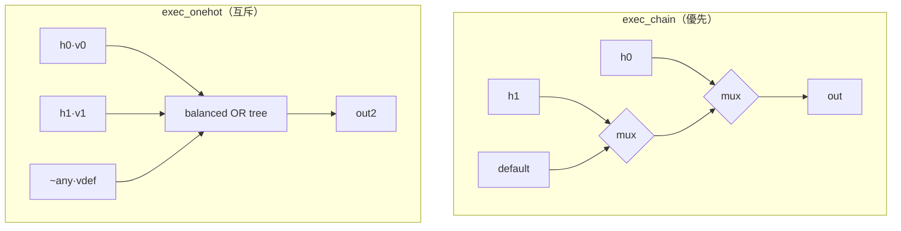

# 3.3 控制流到資料流：mux 樹、one-hot 合併、展開與內嵌

> 硬體沒有「跳躍」。`if`、`case`、迴圈、函式呼叫——所有程式控制流都必須
> 變成**資料路徑上的選擇器**。本節追蹤 `exec()` / `exec_chain()` /
> `exec_onehot()`（elab.rs:1298-1455）如何完成這個翻譯。

## 3.3.1 if：兩個分支都執行，再用 mux 合併

`Stmt::If` 先把每個分支條件歸約成單一位，然後交給 `exec_chain`：

```rust
Stmt::If { arms, els } => {
    let mut conds = vec![];
    for (c, body) in arms {
        let v = self.eval(sc, env, c, 0)?;
        conds.push((self.b.reduce_or(&v), body.as_slice()));
    }
    self.exec_chain(sc, &conds, els, env)?;
}
```

`exec_chain`（elab.rs:1379）是整個翻譯的心臟：

```rust
fn exec_chain(&mut self, sc: &Scope, conds: &[(Bit, &[Stmt])], els: &[Stmt], env: &mut Env) -> R<()> {
    let Some(((c, body), rest)) = conds.split_first() else { return self.exec(sc, els, env) };
    match *c {
        Bit::C1 => return self.exec(sc, body, env),      // 條件常真：直落
        Bit::C0 => return self.exec_chain(sc, rest, els, env), // 條件常假：刪除
        _ => {}
    }
    let mut et = env.clone();
    self.exec(sc, body, &mut et)?;                       // then 分支在複本上
    let mut ef = env.clone();
    self.exec_chain(sc, rest, els, &mut ef)?;            // else 鏈在另一個複本上
    ...
    for k in keys {
        ...
        let base = self.cur(sc, env, &k)?;
        let t = t.cloned().unwrap_or_else(|| base.clone());
        let f = f.cloned().unwrap_or(base.clone());
        ...
        let m = self.b.muxv(*c, &f, &t);                 // 逐位 mux
        env.insert(k, m);
    }
}
```

語義可以用數學式寫成：

$$
\text{env}'_k \;=\; c \,\cdot\, \text{env}^{then}_k \;+\; \overline{c}\,\cdot\, \text{env}^{else}_k
\qquad \text{（逐位：} b_i' = \text{MUX}(c,\; b_i^{then},\; b_i^{else})\text{）}
$$

三個省閘的細節：

1. **常數條件直落**：`if_reset` 之外若條件被參數摺成 `C1`/`C0`，直接執行
   對應分支，不產生任何閘——`generate if` 與參數化設計因此免費。
2. **兩分支相同的值直接共用**：`if t == f { ... continue; }`。
3. **分支沒碰的鍵**（`env` 中不存在）：以 `base` 填入，mux 兩端同值後被
   `Builder::mux` 摺掉。

## 3.3.2 case：優先鏈 vs one-hot 樹

case 有兩種合併策略，取決於分支條件是否互斥（elab.rs:1323-1354）：

```rust
// distinct constant labels are mutually exclusive: parallel one-hot merge
let mut labels: Vec<u128> = vec![];
let mut exclusive = true;
for (items, body) in arms {
    ...
    match it {
        CaseItem::V(e) => {
            let v = self.eval(sc, env, e, 0)?;
            match const_of(&v) {
                Some(k) if !labels.contains(&k) => labels.push(k),
                _ => exclusive = false,
            }
            self.b.eq(&sv, &v)
        }
        CaseItem::R(lo, hi, incl) => { ... exclusive = false; ... }  // 範圍標籤：不可證明互斥
    }
    ...
}
if exclusive { self.exec_onehot(sc, &conds, def, env)?; }
else         { self.exec_chain (sc, &conds, def, env)?; }
```

規則：**所有標籤都是互異的編譯期常數** ⇒ 各分支的 `hit` 天然 one-hot，
可以平行合併；只要有一個非常數標籤或範圍標籤（`lo..hi`），就退回優先鏈。

### 優先鏈（exec_chain 複用）

$$
\text{env}'_k = h_0 v^{(0)}_k + \overline{h_0}\big(h_1 v^{(1)}_k + \overline{h_1}(\cdots + \overline{h_{n-1}} v^{def}_k)\big)
$$

深度 $`O(n)`$ ，對應 Verilog 的 `casez`/`priority` 語義，也是 `switch`（條件
可重疊）唯一的選擇。

### one-hot 樹（exec_onehot，elab.rs:1412）

互斥分支用**平衡 OR 樹**：

$$
\text{env}'_k \;=\; \bigvee_i \big( h_i \cdot v^{(i)}_k \big) \;\vee\; \overline{\bigvee_i h_i}\cdot v^{def}_k
$$

每個位元是「命中項 OR 在一起」；深度 $`O(\log n)`$ 的 reduce_or 而不是串接
mux。`exec_onehot` 還做了兩個重要的合併：

```rust
// arms with the same value share one select; a signal most arms leave alone
// (a register held in other states) becomes a 2-way mux: changed ? new : old
let mut groups: Vec<(Vec<Bit>, &Vec<Bit>)> = vec![];
for (h, v) in &arms {
    match groups.iter_mut().find(|g| g.1 == *v) { Some(g) => g.0.push(*h), None => groups.push((vec![*h], *v)) }
}
...
let hold = groups.iter().position(|g| *g.1 == base);
let sel: Vec<(Bit, &Vec<Bit>)> = groups.iter().enumerate()
    .filter(|(i, _)| Some(*i) != hold)
    .map(|(_, g)| (self.b.reduce_or(&g.0), g.1)).collect();
let changed = if hold.is_some() { Some(self.b.reduce_or(&sel.iter().map(|x| x.0).collect::<Vec<_>>())) } else { None };
...
let new = self.b.reduce_or(&terms);
out.push(match changed { Some(c) => self.b.mux(c, at(&base, i), new), None => new });
```

- **同值分支共用一個選擇訊號**：FSM 裡多個 state 寫同一個輸出值時，
  它們的 `hit` 被 OR 成一個 enable。
- **hold 最佳化**：狀態機最常見的形態是「大多數 state 不動這個暫存器」。
  把「不動」的分支挑出來後，整個 mux 樹塌縮成兩輸入：

$$
b_i' = \text{MUX}(\textit{changed},\; b_i^{old},\; \textstyle\bigvee_j h_j b_i^{(j)})
$$

這個型態後續還會被技術映射器認成 flip-flop 的 clock-enable（§3.4）。



## 3.3.3 for 迴圈：必須展開

`lower_stmt` 的 `ForStatement` 分支（elab.rs:660）：

```rust
Statement::ForStatement(x) => {
    // loops are unrolled: the bounds must be constant
    let from = self.const_of(sc, &toks(|k| k.expression(&f.range.expression)))?.v.sat();
    let o = f.range.range_opt.as_ref().ok_or("for range needs `a..b`")?;
    let to = self.const_of(sc, &toks(|k| k.expression(&o.expression)))?.v.sat();
    ...
    for i in idx {
        sc.consts.insert(var.clone(), Val::new(32, i));
        out.extend(self.lower_block(sc, &f.statement_block)?);
    }
}
```

要點：

- 邊界必須常數折疊成功，否則直接報錯——硬體無法「動態重複未知次數的
  組合塊」而不需要狀態機，那是使用者的責任。
- 迴圈變數被塞進 `sc.consts`，因此迴圈體內它是**編譯期常數**：
  `a[i]` 這類索引在展開後全部摺疊成位替換（§3.2.6）。
- `down`（`step -1`）以 `idx.reverse()` 實作；`step` 在語句層不支援
  （generate for 支援，走 `veryl_sim::gen::for_indices`）。

`generate for` 走的是同一套（`pass2` 的 `GenerateForDeclaration`）：
每個索引 `i` 複製一個 scope、字首加上 `label[i]`，再遞迴 `items()`——
展開成 N 份子電路，訊號名帶著 `[i]`。

## 3.3.4 函式：內嵌執行 + return 的資料流化

函式在 `pass1` 先 lowering 成 `FnDef { params, ret, body }`（無遞迴、只有
input 參數）。呼叫時 `call()`（elab.rs:1457）建立一個小型 env：

```rust
let mut env = Env::new();
for ((p, ty), v) in f.params.iter().zip(args) { env.insert(p.clone(), self.fit(&v, ty.w, ty.signed)); }
env.insert("$ret".into(), vec![Bit::C0; ret.w as usize]);
env.insert("$done".into(), vec![Bit::C0]);
...
self.exec(&fsc, &f.body, &mut env)?;
Ok(env.remove("$ret").unwrap())
```

`return` 不是跳躍，而是兩個 env 更新（`Stmt::Return`）：

```rust
self.write(sc, env, "$ret", &Sel::All, &v)?;
env.insert("$done".into(), vec![Bit::C1]);
```

`$done` 之後任何賦值都被蓋掉（`write()` 尾端，elab.rs:1291）：

```rust
// after a `return`, later assignments must not take effect
if let Some(d) = env.get("$done").map(|v| v[0]) {
    if d != Bit::C0 && name != "$done" { nv = self.b.muxv(d, &nv, &cur); }
}
```

亦即 

$$
b_i' = \text{MUX}(\textit{done},\, b_i^{old},\, b_i^{new})
$$

——early
return 變成一層守門 mux。若函式根本沒有 early return，`done` 恆為 `C0`，
這層 mux 在 `Builder` 裡被摺成 0 閘。

> **為什麼不做真正的內嵌（函式體複製到呼叫點的 IR）？** 因為符號執行本身
> 就是內嵌：`call()` 在呼叫者的 Builder 上直接執行函式體，共享 hash-consing
> 快取。同一函式被呼叫兩次，若引數相同，`gate()` 快取會讓第二次呼叫
> 幾乎零成本。

## 3.3.5 一個完整例子

```veryl
always_comb {
    case state {
        IDLE:    out = 0;
        RUN:     out = cnt;
        default: out = 8'hFF;
    }
}
```

`state` 是 enum（寬度 1 位，兩個成員）→ 三個 `eq(sv, label)` 比較，
`hit` 皆為常數標籤 ⇒ 互斥 ⇒ `exec_onehot` ⇒

$$
out_i = (\overline{h_{IDLE}}\,\overline{h_{RUN}})\cdot \texttt{FF}_i
      \,\vee\, h_{RUN}\cdot cnt_i \,\vee\, h_{IDLE}\cdot 0
$$

`out = 0` 分支與 default 的 `FF` 值不同、`cnt` 分支又不同 ⇒ 三組不會被
group 合併；但若 `IDLE` 與 `default` 都寫同一個值，就只剩兩組——閘數
直接減半。技術映射後（iCE40 LUT4），整個 case 往往只需 2 顆 LUT。

## 為什麼這樣設計

- **優先鏈與 one-hot 樹並存**：優先鏈語義保守（任何 case 都對），one-hot
  樹只在可證明互斥時使用——正確性不用賭。
- **hold / 同值合併**發生在語義層而非閘層，因為符號執行手上有 `base`
  （「這個訊號原本的值」）這個資訊，AIG 管線要到最佳化才可能重新發現。
- 迴圈與函式都不需要 IR 層的機制：展開與內嵌是「執行 N 次」的自然結果。

## 本章重點

- `exec_chain` = if/else-if/else → 逐位 mux，條件常數時直落。
- `exec_onehot` = 互斥 case → 平衡 OR 樹；同值分支共用 enable、hold 分支
  把 mux 樹塌縮成 `changed ? new : old`。
- case 互斥性由「標籤皆為互異常數」這個可判定條件決定，範圍標籤一律走
  優先鏈。
- for/generate-for 以常數邊界展開，迴圈變數是編譯期常數。
- 函式內嵌 = 在呼叫者的 Builder 上執行函式體；`return` 經 `$ret`/`$done`
  變成守門 mux，常見情況下摺疊為零。
