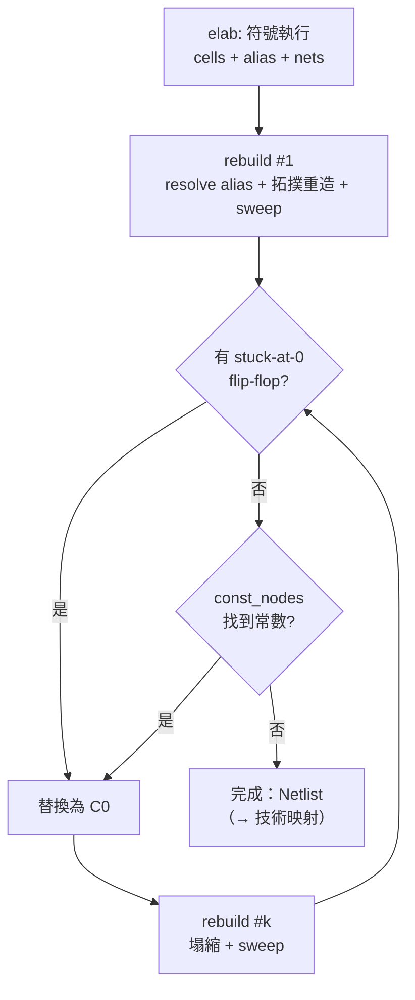

# 3.6 網表資料結構與別名解析：netlist.rs 的最佳化引擎

> `netlist.rs` 只有 666 行，卻承擔了傳統綜合器一整個「邏輯最佳化」部門的
> 工作：別名解析、常數摺疊、結構雜湊、組合迴圈偵測、stuck-at-0 暫存器掃除、
> 隨機模擬 + 窮舉證明的常數節點發現、死邏輯清除。本節逐層拆解。

## 3.6.1 資料結構

```rust
#[derive(Clone, Copy, PartialEq, Eq, Hash, Debug, PartialOrd, Ord)]
pub enum Bit { C0, C1, W(u32) }

#[derive(Clone, Debug)]
pub struct Cell {
    pub typ: String,                       // "$_AND_", "$_MUX_", "$_DFF_P_", ...
    pub conns: Vec<(&'static str, Bit)>,   // (port, bit)；輸出埠是 "Y"/"Q"
    pub params: Vec<(&'static str, String)>,
}

pub struct Netlist {
    pub name: String,
    pub ports: Vec<Port>,
    pub nets: Vec<(String, Vec<Bit>)>,     // 層級化訊號名 → 位向量
    pub cells: Vec<Cell>,                  // 組合閘（拓撲序）+ flip-flops
}
```

- **網表裡沒有「線」的獨立列表**：`Bit::W(w)` 的編號本身就是線；`nets`
  只是**命名**（除錯與 `$mem:` 標籤用）。
- 編號從 2 起（與 yosys JSON 相容，0/1 保留給常數）。
- cell 的輸出埠由 `is_out()` 統一判別（`"Y" | "Q" | "O" | "CO" | …`），
  讓同一套 sweep / rebuild 對 generic、iCE40、vlib、ECP5 cell 都有效。

## 3.6.2 Builder：hash-consing 與立即摺疊

所有閘的出生地是 `Builder::gate`（netlist.rs:69）：

```rust
fn gate(&mut self, typ: &'static str, ins: &[(&'static str, Bit)]) -> Bit {
    let mut key = [Bit::C0; 3];
    for (k, (_, b)) in ins.iter().enumerate() { key[k] = *b; }
    if let Some(&y) = self.cache.get(&(typ, key)) { return y; }   // 結構雜湊
    let y = self.wire();
    ...
    self.cache.insert((typ, key), y);
    y
}
```

**結構雜湊（hash-consing）**：`(型別, 輸入向量)` 相同的閘永遠共用同一個
輸出線。`x | x`、`a & b` 在兩處出現、兩個 if 分支寫出同一個 mux——全都
免費合併。快取鍵的輸入先經 `a.min(b)/a.max(b)` 排序（`and`/`or`/`xor` 都
這麼做），所以 `a & b` 與 `b & a` 是同一顆閘。

在 `gate` 之上，每個運算有語法級摺疊。以 `mux` 為例（§3.1 已見）：
`s ? x : x` → `x`；`s ? 0 : 1` → `s`；`s ? 0 : y` → `s & y`……九種 case。
加上 `not` 的 `inv` 快取（`x <-> !x` 雙向記錄，`!!x`、`x & !x` 自動消失），
這套規則就是一個**局部完備的重寫系統**：在符號執行的每一步被強制執行。

## 3.6.3 rebuild：拓撲重建 = 一次全域化簡

`optimize` 的主迴圈是「rebuild → 找常數 → 再 rebuild」直到不動點：

```rust
pub fn optimize(b: Builder, alias: &HashMap<u32, Bit>, ports: Vec<Port>, ...) -> R<Netlist> {
    let mut nl = rebuild(b, alias, ports, nets, name)?;
    loop {
        // stuck-at-0 flip-flops → 常數（ROM 例外）
        ...
        if stuck.is_empty() { stuck = const_nodes(&nl); }
        if stuck.is_empty() { return Ok(nl); }
        ...
        nl = rebuild(b, &stuck, nl.ports, nl.nets, name)?;
    }
}
```

`rebuild`（netlist.rs:441）做四件事：

1. **解析 alias**（§3.2.3 的 `resolve`，含組合迴圈偵測）。
2. **從輸出埠反向迭代 DFS**，把每顆組合閘**用摺疊 Builder 重新造一遍**：

```rust
let y = match c.typ.as_str() {
    "$_NOT_" => { let a = get("A", memo)?; nb.not(a) }
    "$_AND_" => { let (a, bb) = (get("A", memo)?, get("B", memo)?); nb.and(a, bb) }
    "$_OR_"  => ...,
    "$_XOR_" => ...,
    "$_MUX_" => { let (a, bb, s) = ...; nb.mux(s, a, bb) }
    t => return Err(format!("unknown cell type {}", t)),
};
```

   關鍵洞察：**摺疊規則是局部的**。把閘餵回同一個 `Builder`，凡是輸入裡
   出現了新常數（stuck-at-0 掃除、`const_nodes` 的結果）的閘都會被自動
   摺疊、重新雜湊；下游閘再因輸入變化繼續塌縮。全域化簡 = 局部規則 ×
   拓撲序傳播。
3. **flip-flop 特殊處理**：D/R/CE 等**輸入**重造，**Q 保持原線**——Q 是
   狀態節點，重造它會打斷 D=Q 的自保持結構（而那正是 stuck 檢測的輸入）。
4. **死邏輯掃除**（`sweep`）：從輸出埠（加上仍被讀的記憶體寫埠，§3.5.2）
   反向標活，其餘刪除。

> **為什麼用「重建」而不是「原地重寫」？** 原地重寫要處理刪除後的空洞、
> 引用計數、迭代順序；重建只是「按拓撲序把好閘重造一遍」，舊的整個丟掉。
> 對本專案的規模（數萬閘）重建成本可忽略，程式卻短了一個數量級。
> 代價是每輪都要 `Box` 一份新 Vec——`optimize` 的迴圈次數通常只有 2–3。

## 3.6.4 stuck-at-0 暫存器

`optimize` 每輪先找「永遠是 0 的 flip-flop」：

```rust
let is_stuck = |c: &Cell| {
    let (q, d) = (c.out(), c.port("D"));
    let zero_reset = c.port("R").is_none() || c.typ.ends_with("0_");
    c.is_ff() && zero_reset && (d == Some(q) || d == Some(Bit::C0))
};
```

iCE40 flip-flop 上電值是 0（AGENTS.md 的前提：**本專案假設暫存器上電為 0**），
所以「D 恆為 Q 或 0、無 reset 或 reset 值為 0」的暫存器永遠是 0 ⇒ 換成
常數 `C0`，觸發下一輪 `rebuild` 的大規模塌縮。**例外**：`rom` 集合保護
從未被寫的 `$mem:` 陣列——它可能等著被 `set_mem_init` 灌程式（§3.5.5）。

## 3.6.5 const_nodes：隨機模擬提案、窮舉證明

有些常數性是任何局部規則都看不見的。檔案註解給的例子：

> *e.g. a register-file write enable decoded from a constant ROM*

局部摺疊只知道「這顆閘的輸入是什麼」，不知道「整個支援集只有 5 個自由
變數」。`const_nodes`（netlist.rs:557）用兩段式：

**第一段：隨機模擬**（4 × 64 位字，xorshift � � 種子
`0x9e3779b97f4a7c15`）。flip-flop 輸出視為自由葉——這保證**健全性**：
暫存器的值是真正的未知數，不會被誤證成常數。

```rust
// random simulation: 4 x 64 patterns
let mut seed = 0x9e3779b97f4a7c15u64;
let mut rnd = move || { seed ^= seed << 13; seed ^= seed >> 7; seed ^= seed << 17; seed };
```

觀測值全 0 或全 1 的節點成為候選；**支援集**（free-variable closure，
$`|\text{sup}| \le 16`$ ，`MAXSUP`）相同的候選分組。

**第二段：窮舉證明**。對每組，以位平行（bit-parallel）方式模擬候選節點的
cone 覆蓋全部 $`2^{|\text{sup}|}`$ 個輸入組合：

$$
\text{node constant 0} \iff \forall x \in \{0,1\}^{n}:\; f(x) = 0,
\qquad n \le 16 \Rightarrow 2^{16} = 65536 \text{ 次求值（64 字 × 1024 輪）}
$$

```rust
for i in cands {
    let r = &cv[&i];
    ...
    if r.iter().all(|x| x & valid == 0) { out.insert(w, Bit::C0); }
    else if r.iter().all(|x| x & valid == valid) { out.insert(w, Bit::C1); }
}
```

這是 **SAT sweeping 的簡化版**：不求「哪些節點互相等價」，只求「哪些節點
是常數」；驗證用窮舉而非 SAT solver，因為支援集被 16 上限封住，窮舉
便宜且**絕對可信**（沒有 solver bug 的風險）。證出的常數回餵給下一輪
`rebuild`，讓整個 cone 塌縮。

## 3.6.6 sweep：死邏輯清除

```rust
pub fn sweep(cells: &mut Vec<Cell>, roots: &[Bit]) {
    let mut live: HashSet<Bit> = roots.iter().copied().collect();
    let by_out: HashMap<Bit, usize> = cells.iter().enumerate()
        .flat_map(|(i, c)| c.conns.iter().filter(|(p, _)| is_out(p))
            .map(move |(_, b)| (*b, i))).collect();
    let mut keep = vec![false; cells.len()];
    let mut work: Vec<Bit> = roots.to_vec();
    while let Some(x) = work.pop() {
        if let Some(&i) = by_out.get(&x) { ... keep[i] = true; /* 推入其輸入 */ }
    }
    cells.retain(|_| { i += 1; keep[i - 1] });
}
```

反向可達性：從輸出埠出發，凡是驅動不到輸出的 cell 全刪。這同時清掉
**死暫存器**（寫了但沒人讀的 DFF）、被 stuck-at-0 取代後的殘骸、以及
`rebuild` 摺疊後孤立的常數饋送邏輯。記憶體寫埠的保留規則（`rd` 位元仍
被使用時把 `:clk/:we/:wa/:wd` 加進 roots）確保未來可轉 RAM 的記憶體
不被誤殺。

## 3.6.7 名稱保留與除錯價值

`rebuild` 過程中每條重建後的線都可以透過 `net_name` 找回層級化名稱：

```rust
let net_name = |w: u32| -> String {
    nets.iter().find(|(_, bs)| bs.contains(&Bit::W(w)))
        .map(|(n, _)| n.clone()).unwrap_or_else(|| format!("${}", w))
};
```

組合迴圈錯誤因此能指出**訊號名**（`combinational loop through 'soc.state'`）
而非線編號。`Netlist::stats()`（netlist.rs:659）按 cell 型別統計數量，
是 `v2c synth` 與網頁 IDE 顯示「 $`_MUX_ × 231,`$ _DFF_PN0_ × 64 …」的來源。

`elab::Stages`（elab.rs:1698）把整條流程的中間產物一次帶出：

```rust
pub struct Stages {
    pub insts: Vec<(String, String)>,     // (實例路徑, 模組名)
    pub ports: Vec<(String, Dir, usize)>,
    pub signals: Vec<(String, usize)>,    // 命名訊號與寬度
    pub raw: Netlist,                     // 別名已解析、未最佳化
    pub opt: Netlist,                     // optimize 之後
    pub warnings: Vec<String>,
}
```

網頁 IDE 用 `raw` 與 `opt` 的差集呈現「最佳化省了多少」；`warnings` 收集
`initial/final 被忽略`、`input port left unconnected` 等非致命訊息。

## 3.6.8 完整流程圖



## 為什麼這樣設計

- **hash-consing 使「化簡」變成副作用**：不需要單獨的 simplification pass，
  也保證語法相同永遠共享——等價性由構造保證。
- **rebuild 而非重寫**：局部摺疊規則 × 拓撲傳播，程式簡單、正確性顯然；
  迴圈次數少，代價可忽略。
- **健全性優先**：暫存器輸出在 `const_nodes` 中是自由變數、ROM 豁免
  stuck 掃除、16 位支援上限是「窮舉可信」的代價——寧可漏掉最佳化，
  不放過任何改變行為的機會。最終裁決者是 `test.sh` 的 yosys 形式等價，
  但引擎自身的保守設計讓等價檢查幾乎從不失敗。

## 本章重點

- 網表 = `Cell` 列表 + `Bit` 編號線；`nets` 只是命名與 `$mem:` 標籤。
- `Builder::gate` 的 `(型別, 輸入)` 快取就是結構雜湊；每個運算子再疊
  語法級常數摺疊（`mux` 九例、`not` 的 `inv` 雙向表）。
- `rebuild` = alias 解析 + 拓撲序把閘餵回摺疊 Builder + `sweep`；
  flip-flop 的 Q 保持原線，輸入重造。
- stuck-at-0 暫存器（D≡Q/0、reset 值 0）折成常數；未寫過的 `$mem:` 陣列
  豁免（可能是 ROM）。
- `const_nodes` = 隨機模擬提案 + ≤16 輸入支援的窮舉證明，是簡化版的
  SAT sweeping。
- 整個 `optimize` 是「rebuild → 常數發現 → 再 rebuild」的不動點迭代。
