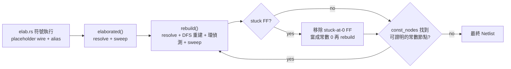
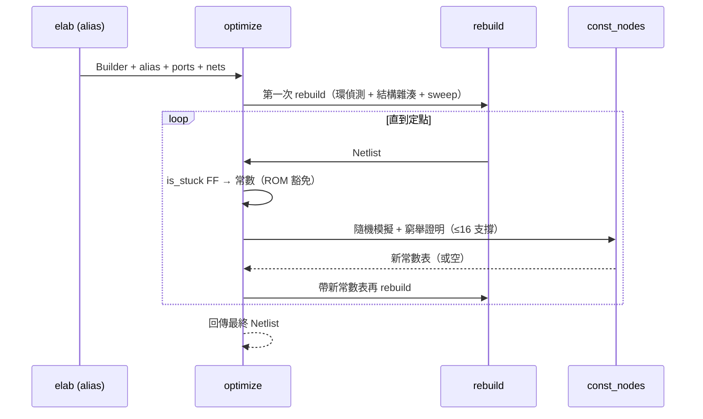

# 3.7 組合迴路與死邏輯：`netlist.rs` 的健全性清理

> 來源：`veryl-eda/src/netlist.rs`（`elaborated`、`rebuild`、`optimize`、`sweep`）

## 3.7.1 為什麼這兩件事要放在一起談

一個網表（netlist）在能被最佳化、映射、佈局之前，必須先滿足兩個前提：

1. **組合部分沒有環** —— 否則拓撲序不存在，任何「由輸入算輸出」的演算法（模擬、SAT、LUT 覆蓋、靜態時序分析）都會失敗或死循環。
2. **沒有不驅動任何輸出的死邏輯** —— 死邏輯不只佔面積，還會讓「最佳化不改變功能」的證明對象變得曖昧：一段沒人看的邏輯可以隨便化簡，甚至藏著一個會擋住等價性檢查的暫存器。

veryl-eda 把這兩件事做成同一條流水線的一部分：`elaborated()` 先做一次保守清理，`optimize()`（透過 `rebuild()`）再做主清理，兩者共用同一組環偵測與 `sweep()` 程式碼。



## 3.7.2 資料模型：placeholder、alias 與 `Bit`

elaborator（`elab.rs`）符號執行 Veryl 程式時，並不知道每個訊號最後由誰驅動 —— `assign`、if/case 的 mux 合併、always_ff 的非阻塞賦值，都先把目標訊號記成一個 **placeholder wire**，再把「wire → 真正的位元」寫進 `alias: HashMap<u32, Bit>`。`netlist.rs` 的位元型別因此有三種：

```rust
// netlist.rs:10-16
pub enum Bit {
    C0,      // 常數 0
    C1,      // 常數 1
    W(u32),  // 網線編號（與 yosys JSON 一樣從 2 開始）
}
```

「解 alias」就是沿著這張表把 `W(n)` 追到真正的驅動者。關鍵在於：**alias 表本身可能是環狀的**（這正是組合迴路在 IR 層的樣子），所以追蹤必須設步數上限：

```rust
// netlist.rs:375-383（elaborated 的 resolve 閉包）
let resolve = |mut x: Bit| -> R<Bit> {
    let mut n = 0;
    while let Bit::W(w) = x {
        match alias.get(&w) { Some(&y) => x = y, None => break }
        n += 1;
        if n > alias.len() + 1 { return Err(format!("combinational loop through net {}", w)); }
    }
    Ok(x)
};
```

### 為什麼這樣設計

步數上限 `alias.len() + 1` 是鴿籠論證：一條正確的 alias 鏈每步至少消耗一個不同的鍵，超過鍵的總數還沒落地，就必然在環裡打轉。這是 O(鏈長) 的單趟檢查，不必維護「已訪問集合」—— 對 elaborator 來說，alias 鏈通常一兩步就結束，這個寫法比建一個 `HashSet` 便宜得多。

## 3.7.3 環偵測：rebuild 的迭代式 DFS

alias 環只是一種迴路；更常見的迴路藏在真正的閘級 cell 裡（例如 elaborator 展開過的 mux 樹中，`y` 的 fanin 又依賴 `y`）。`rebuild()`（`netlist.rs:441`）把舊網表的每一個根（輸出埠、FF 輸入、記憶體腳位）用 **顯式堆疊的 DFS** 從頭重建，重建過程本身就是一次拓撲排序 —— 若排序失敗，就是組合迴路：

```rust
// netlist.rs:470-488（節錄）
let mut stack: Vec<(u32, bool)> = vec![(rw, false)];
let mut onstack: HashSet<u32> = HashSet::new();
while let Some((w, expanded)) = stack.pop() {
    if memo.contains_key(&w) { continue; }
    let Some(&ci) = driver.get(&w) else { memo.insert(w, Bit::W(w)); continue };
    let c = &b.cells[ci];
    if !expanded {
        if !onstack.insert(w) { return Err(format!("combinational loop through '{}'", net_name(w))); }
        stack.push((w, true));
        for (p, x) in &c.conns {
            if *p == "Y" { continue; }
            if let Bit::W(xw) = resolve(*x)? {
                if memo.contains_key(&xw) { continue; }
                if onstack.contains(&xw) { return Err(format!("combinational loop through '{}'", net_name(xw))); }
                stack.push((xw, false));
            }
        }
        continue;
    }
    ...
}
```

### 演算法原理

教科書做法是「白色/灰色/黑色」三色 DFS：再次碰到灰色節點 = 回邊 = 有環。這裡的對應關係是：

| 三色 DFS | 本實作 |
|---|---|
| 灰色（在遞迴棧上） | `onstack` 集合 |
| 黑色（已完成） | `memo` |
| 進入子節點 | 第一次 push `(w, false)` |
| 回到本節點收成 | 第二次 pop 到 `(w, true)` |

第二個檢查 `onstack.contains(&xw)`（push 前先看目標是否已在棧上）是額外的保險：即使因為某種順序問題沒有走到「重新 pop 到灰節點」那一步，只要有一條邊指回棧上的節點，立刻報錯。兩個檢查合起來，等價於「DFS 森林中存在回邊 ⇔ 有向圖有環」的完整判定。

### 為什麼不用遞迴？

組合邏輯錐（cone）深度在真實設計裡可以到幾百層（一個 32 位元 ripple-carry 加法器的 XOR 鏈就是 64 層以上），遞迴實作會撞上執行緒堆疊上限；顯式 stack 沒有這個問題。

### 為什麼環偵測「長在」重建裡？

`rebuild()` 順便做結構雜湊（hash-consing）：`nb.and(a, b)` 這類呼叫會查 `cache`，相同 `(型別, 輸入)` 的閘只留一份。要做到這件事，必須**先算完所有 fanin、再建父閘** —— 這恰好就是拓撲序。所以環偵測不是另寫一道檢查，而是「重建 = 拓撲排序」這件事的必然副產品。環偵測失敗時的錯誤訊息還帶著**階層式訊號名**（`net_name(w)`），使用者看到的是 `combinational loop through 'y'` 這種可以直接對回 Veryl 原始碼的訊息，而不是編號 `$123`。

## 3.7.4 死邏輯清除：`sweep`

```rust
// netlist.rs:639-656
/// Remove cells whose output reaches no output port (also dead registers).
pub fn sweep(cells: &mut Vec<Cell>, roots: &[Bit]) {
    let mut live: HashSet<Bit> = roots.iter().copied().collect();
    let by_out: HashMap<Bit, usize> = cells.iter().enumerate().flat_map(|(i, c)| c.conns.iter().filter(|(p, _)| is_out(p)).map(move |(_, b)| (*b, i))).collect();
    let mut keep = vec![false; cells.len()];
    let mut work: Vec<Bit> = roots.to_vec();
    while let Some(x) = work.pop() {
        if let Some(&i) = by_out.get(&x) {
            if keep[i] { continue; }
            keep[i] = true;
            for (p, y) in &cells[i].conns {
                if !is_out(p) && !y.is_const() && live.insert(*y) { work.push(*y); }
            }
        }
    }
    let mut i = 0;
    cells.retain(|_| { i += 1; keep[i - 1] });
}
```

這是標準的**標記—清除（mark & sweep）**，方向是反向資料流：

- `roots` 是「活著的種子」：所有輸出埠的位元。
- 從種子沿 fanin 反向走，能被走到（reachable）的 cell 打上 `keep`。
- `retain` 一次性刪掉其餘。

兩個值得注意的細節：

1. **死暫存器也會被砍**。FF 的 `Q` 若沒有被任何 root 可達的路徑用到，FF 本身就不會被保留（它驅動的 wire 不是 root，也沒人消費）。這比某些商業工具「FF 一律保留」更激進 —— 但 veryl-eda 的立場是：測試平台看得到的是埠，看不到內部訊號，砍掉不影響可觀察行為。
2. **`$mem:` 記憶體的例外**。`rebuild()` 在 sweep 之前會把「仍然被讀的記憶體」的寫埠也加進 roots（`netlist.rs:536-547`）：

```rust
// netlist.rs:540-547（節錄）
for (n, bits) in &nets2 {
    let Some(rest) = n.strip_prefix("$mem:") else { continue };
    let Some((q, port)) = rest.rsplit_once(':') else { continue };
    if !port.starts_with("rd") || !bits.iter().any(|b| used.contains(b)) { continue; }
    for (m, b) in &nets2 {
        if [":clk", ":we", ":wa", ":wd"].iter().any(|s| *m == format!("$mem:{}{}", q, s)) { roots.extend(b.iter().copied()); }
    }
}
```

一個永遠不被讀的記憶體，其寫入邏輯是死邏輯，該清；但只要有一個讀埠還活著，整條寫路徑（clk/we/wa/wd）都必須留下 —— 因為之後 `bram.rs` 要把它推斷成 `SB_RAM40_4K`，缺了寫埠就推斷不出來。

### 為什麼這樣設計

sweep 是 **保守的**：它只刪「證明上絕對安全」的東西（不可達 = 不影響任何輸出），不做任何重新計算。這讓它可以放心地在管線多處呼叫（`elaborated`、`rebuild`、`bram::find_mems`、`ice40::map` 之後的 nets 過濾），每次呼叫的結果都可預期。激進化簡（常數證明、邏輯重寫）全部集中在 `optimize` 迴圈，責任切得乾淨。

## 3.7.5 stuck-at-0 flip-flop 的移除

`optimize()`（`netlist.rs:406`）在 rebuild 之後多走一步：找出**永遠不會離開上電值 0** 的 FF，直接把它的輸出當常數 0：

```rust
// netlist.rs:408-427（節錄）
loop {
    let is_stuck = |c: &Cell| {
        let (q, d) = (c.out(), c.port("D"));
        let zero_reset = c.port("R").is_none() || c.typ.ends_with("0_");
        c.is_ff() && zero_reset && (d == Some(q) || d == Some(Bit::C0))
    };
    let cand: HashSet<Bit> = nl.cells.iter().filter(|c| is_stuck(c)).map(|c| c.out()).collect();
    let rom: HashSet<Bit> = /* 永不被寫的 $mem 記憶體的資料位 */;
    let mut stuck: HashMap<u32, Bit> = HashMap::new();
    nl.cells.retain(|c| {
        let q = c.out();
        if is_stuck(c) && !rom.contains(&q) {
            if let Bit::W(w) = q { stuck.insert(w, Bit::C0); }
            return false;
        }
        true
    });
    ...
}
```

判定條件讀起來是三條邏輯：

1. `c.is_ff()`：有 `Q` 腳位的 cell。
2. `zero_reset`：沒有非同步重置腳位（`R` 不存在），或重置值是 0（型別名以 `0_` 結尾，如 `$_DFF_PN0_`）。
3. 下一狀態 `D` 等於自己的 `Q`（永遠保持原值）或等於常數 0 —— 配合「上電值是 0」，這個 FF 的輸出在整個時間軸上恆為 0。

數學上寫成：

$$
q(t+1) = d(t) \in \{q(t),\ 0\}, \quad q(0) = 0 \;\Rightarrow\; \forall t:\; q(t) = 0
$$

歸納： $`q(0)=0`$ ；若 $`q(t)=0`$ ，則 $`q(t+1)=d(t)\in\{q(t),0\}=\{0\}`$ 。

### 為什麼敢做：FPGA 上電值為 0 的假設

iCE40 的所有 flip-flop 上電值確定是 0（晶片設計就是這麼做的，yosys 的 `-set-init-zero` 也依賴同一件事）。veryl-eda 在 AGENTS.md 裡明說：「The optimizer assumes flip-flops power up at 0 (true on iCE40); never-written registers become constants.」換句話說，這是一個**平台假設**，不是普適定理 —— 如果哪天要支援上電值隨機或可設定的平台，`is_stuck` 的前提就失效，整段必須重審。等價性檢查（第 3.12 節）在 gold 與 gate 兩邊都加 `-set-init-zero`，就是為了讓兩邊共享同一假設、檢查才公平。

### ROM 例外

`rom` 集合（`netlist.rs:415-418`）保護「從未被寫入的記憶體」：這種記憶體的元素 FF 全部落在 `cand` 裡（沒有寫埠驅動它們的 D），但它們不是 stuck —— 它們是 **ROM**，內容之後由 `bram::set_mem_init`（甚至已佈線 bitstream 的 `pnr::patch_ram`）填入程式。把它們當 0 砍掉，RISC-V SoC 的程式就不見了。這是整個最佳化器裡最容易被誤傷的地方，程式碼用一條獨立的通道（掃 `$mem:` 網名）來豁免，而不是在 `is_stuck` 裡塞特例。

## 3.7.6 收斂：optimize 主迴圈

```rust
// netlist.rs:428-435（節錄）
if stuck.is_empty() { stuck = const_nodes(&nl); }
if stuck.is_empty() { return Ok(nl); }
let mut b = Builder::new();
...
nl = rebuild(b, &stuck, nl.ports, nl.nets, name)?;
```

迴圈的數學性質：每次迭代要嘛把至少一個 wire 變成常數（wire 的總數有限且單調不增），要嘛結束。所以一定收斂，最壞情況 O(線數) 次迭代。每次迭代 = 一次 `rebuild` = 一次完整拓撲重建，所以整個最佳化是**定點（fixed-point）迭代**：

$$
N_{k+1} = \mathrm{rebuild}(N_k,\ \mathrm{const}(N_k)), \qquad \mathrm{const}(N) \neq \emptyset \Rightarrow \mathrm{cost}(N_{k+1}) < \mathrm{cost}(N_k)
$$



### 為什麼這樣設計（把常數證明做成迭代，而不是一次到位）

`rebuild` 的結構雜湊 + 常數折疊是**局部**規則（`and(C0,x) = C0` 這種一看就懂的）；`const_nodes` 是**全域**證明（要隨機模擬 + 窮舉）。兩者互相餵養：全域證明產生的新常數讓局部規則能繼續折疊出新的局部常數，反過來折疊後的結構又可能暴露新的可證明節點。做成定點迭代讓兩個引擎不必協調順序 —— 這是所有現代最佳化器（yosys 的 `opt` 亦然）的共同形狀。

## 3.7.7 測試如何把關

`tests.rs` 的每一個測試都走完整條管線：`synth()`（`tests.rs:11`）先合成，再用 `NetSim` 在閘級網表上跑測試平台斷言。也就是說，如果 `sweep` 砍了不該砍的、`is_stuck` 誤判了一個會動的 FF、環偵測漏放了一個環進來（模擬會無窮擺盪或 order 錯誤），`cargo test` 立刻失敗。`test.sh` 更進一步，用 yosys 對 `veryl build` 的 SystemVerilog 做正式等價性證明（第 3.12 節），這是比模擬更強的保證。

## 3.7.8 偽代碼：整個最佳化器的骨架

把 `optimize` → `rebuild` → `const_nodes` 的關係壓成一段可背誦的偽代碼：

```
optimize(builder, alias, ports, nets):
    nl = rebuild(builder, alias, ports, nets)         # 第一輪：解 alias + 環偵測 + sweep
    loop:
        stuck = { FF q : 無非同步重置或重置值 0, D ∈ {q, 0} }  −  ROM 成員
        if stuck 非空:
            把 stuck 當 alias，nl = rebuild(...)       # 常數直接折疊進結構
            continue
        stuck = const_nodes(nl)                        # 機率篩選 + 窮舉證明（3.8 節）
        if stuck 為空:
            return nl                                  # 定點：再也擠不出常數
        把 stuck 當 alias，nl = rebuild(...)

rebuild(b, alias, ports, nets):
    for root in 輸出埠 ∪ FF 輸入 ∪ $mem 寫埠（若仍被讀）:
        DFS(root):                                     # 顯式堆疊
            解 alias（步數上限 → 環 = 錯誤）
            若目標在 onstack → 環 = 錯誤
            葉子先算，父閘後算（= 拓撲序）
            每閘經 cache 折疊 / hash-consing
    sweep(cells, roots)                                # 反向可達性清除
```

兩個引擎的分工一目了然：`rebuild` 只做**局部**、**必真**的重寫；`const_nodes` 做**全域**、**被證明**的重寫。迴圈裡的順序（先 stuck FF、再 const_nodes）反映了成本排序：前者是 O(cells) 的模式比對，後者要做模擬與窮舉，先便宜後昂貴。

## 3.7.9 成本分析

| 步驟 | 複雜度 | 備註 |
|---|---|---|
| alias 解析 | O(鏈長) per bit，總 O(bits × 鏈長) | 實務鏈長 ≤ 3 |
| rebuild DFS | O(cells + edges) | 每個 cell 恰好處理一次（memo）|
| sweep | O(cells + edges) | 標記 + retain |
| stuck FF 掃描 | O(cells) | 每輪一次 |
| const_nodes | O(gates × 256)（篩選）+ Σ 每組 $`2^s \times \lvert \mathrm{cone}\rvert`$ （證明）| 3.8 節細談 |
| 迴圈輪數 | ≤ 常數節點數 + 1 | 每輪至少折疊一個節點或終止 |

對 RV32I SoC 這種規模（數萬 cells），整個 `optimize` 在 release build 下是亞秒級 —— 這也是它敢放進 wasm、在瀏覽器裡互動執行的原因。

## 3.7.10 本章重點

- 組合迴路在兩個層次被抓：alias 鏈（步數上限 + 鴿籠）與 cell 圖（DFS 的 `onstack` 檢查），錯誤訊息都帶階層式訊號名。
- `rebuild` = 拓撲排序 + 結構雜湊 + 常數折疊 + sweep，環偵測是重建的副產品而非獨立檢查。
- `sweep` 是反向可達性標記清除，保守且可重入；`$mem:` 寫埠有 ROM 豁免機制。
- stuck-at-0 FF 移除依賴「iCE40 FF 上電值為 0」的平台假設，等價性檢查用 `-set-init-zero` 對齊兩側。
- `optimize` 是定點迭代：局部折疊與全域常數證明互相餵養，單調收斂。
