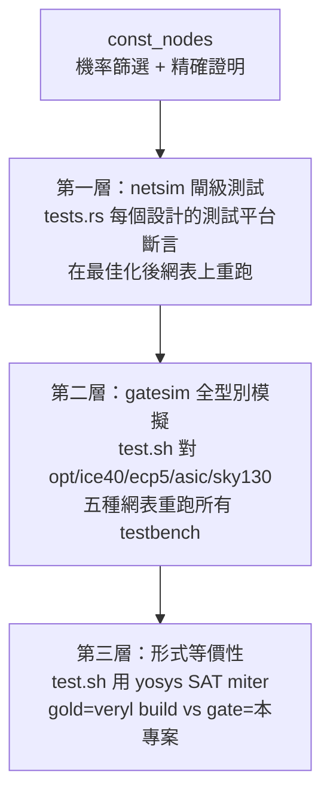

# 3.8 驗證驅動的最佳化：常數節點的機率性證明

> 來源：`veryl-eda/src/netlist.rs` 的 `const_nodes()`（557–637 行）、`optimize()`；把關者：`tests.rs`、`netsim.rs`、`test.sh` 的等價性檢查

## 3.8.1 問題：局部折疊看不到的常數

`Builder` 的折疊規則（`and(C0,x)=C0`、`mux` 的特例、`x & !x = C0`…）都是**單閘**的局部重寫。但很多常數是整個錐（cone）的性質。AGENTS.md 對 `const_nodes` 的註解給了一個真實例子：

> Find combinational nodes that are constant although no local folding rule sees it (e.g. a register-file write enable decoded from a constant ROM)

例如一個由常數 ROM 的某幾位解碼出的 write-enable：

$$
we = \overline{r_3}\,\overline{r_2}\,r_1\,\overline{r_0} \;\land\; (r_1 \oplus \overline{r_1})\ \text{…}
$$

若 ROM 的 $`r_1`$ 恆為 0，則 $`we \equiv 0`$ ，但沒有任何單一閘「看得見」這件事 —— 每個閘的兩個輸入都是變數。這類常數只能靠**全域分析**找出來。

## 3.8.2 演算法總覽

`const_nodes` 的策略是三段式：

```mermaid
flowchart TD
    A[拓撲序掃描<br/>計算每個節點的 support<br/>> 16 個輸入 → 放棄] --> B[第一段：隨機模擬<br/>xorshift 產生 4×64 位圖樣]
    B --> C{某節點 256 個位元<br/>全 0 或全 1?}
    C -- no --> D[不是常數，淘汰]
    C -- yes --> E[第二段：按 support 分組<br/>同組節點共用變數排列]
    E --> F[第三段：窮舉證明<br/>位元平行 (bit-parallel) 一次算 64 個圖樣]
    F --> G{全部 2^s 個圖樣<br/>輸出都相同?}
    G -- yes --> H[加入常數表<br/>回 optimize 重 rebuild]
    G -- no --> I[隨機模擬是假警報，放過]
```

這是經典的 **XOR-propagation / simulation-based SAT 篩選**思想的縮小版：用便宜的隨機模擬當過濾器（false positive 允許，false negative 絕不允許），只對少數候選做昂貴的精確證明。

## 3.8.3 第一段：support 的計算

```rust
// netlist.rs:557-584（節錄）
fn const_nodes(nl: &Netlist) -> HashMap<u32, Bit> {
    const MAXSUP: usize = 16;
    let gates: Vec<&Cell> = nl.cells.iter().filter(|c| !c.is_ff()).collect();
    ...
    // supports (None = too large)
    let mut sup: Vec<Option<Vec<u32>>> = Vec::with_capacity(gates.len());
    for c in &gates {
        let mut s: Option<Vec<u32>> = Some(vec![]);
        for b in ins(c) {
            let Bit::W(w) = b else { continue };
            let add: Option<Vec<u32>> = match idx.get(&w) { Some(&i) => sup[i].clone(), None => Some(vec![w]) };
            s = match (s, add) {
                (Some(mut a), Some(b)) => { for x in b { if !a.contains(&x) { a.push(x); } } if a.len() > MAXSUP { None } else { Some(a) } }
                _ => None,
            };
        }
        sup.push(s.map(|mut v| { v.sort(); v }));
    }
```

support（支撐集）= 一個節點的函數值真正依賴的自由變數集合。它是**沿拓撲序遞推**的：

$$
\mathrm{sup}(n) = \bigcup_{f \in \mathrm{fanin}(n)} \mathrm{sup}(f), \qquad \mathrm{sup}(\text{FF 輸出 / 模組輸入}) = \{n\}
$$

關鍵的健全性決定在第 578 行：

- `idx.get(&w)` 是 `None` → 這個 fanin 不是組合閘的輸出（是 FF 的 Q 或模組輸入），把它**自己**當作一個自由變數。
- fanin 的 support 是 `None`（太大）→ 聯集變 `None`，父節點整個放棄。

### 為什麼 FF 輸出當自由變數是健全的？

因為 FF 的下一狀態依賴時間，把它當成「任意自由變數」是**過度保守但正確**的抽象：如果組合錐在 FF 輸出取遍 $`\{0,1\}`$ 時仍是常數，那在真實電路（FF 輸出是時間的函數）中當然也是常數。反過來不成立 —— 這正是此演算法只做組合部分、不碰時序證明的原因。`ins()` 只看非輸出腳位，而 `is_out` 的清單（`"Y" | "Q" | "O" | ...`）裡 `Q` 也在其中，所以 FF 的 Q 不會被誤當成可計算節點。

### 為什麼上限是 16？

窮舉的成本是 $`2^s`$ 個圖樣，用位元平行（見 3.8.5）每個 `u64` 裝 64 個圖樣：

| support 大小 $`s`$ | 圖樣數 | `u64` 數 | 總評估值量級 |
|---|---|---|---|
| 8 | 256 | 4 | 廉價 |
| 16 | 65536 | 1024 | 可接受 |
| 20 | 1M | 16384 | 開始痛 |
| 32 | 4G | 不可行 | 必須放棄 |

16 是「窮舉仍便宜」與「涵蓋率夠高」之間的折衷 —— RV32I 的解碼器、狀態機解碼邏輯大多落在 12 個輸入以內。

## 3.8.4 第二段：隨機模擬篩選

```rust
// netlist.rs:587-598（節錄）
// random simulation: 4 x 64 patterns
let mut seed = 0x9e3779b97f4a7c15u64;
let mut rnd = move || { seed ^= seed << 13; seed ^= seed >> 7; seed ^= seed << 17; seed };
let mut leaf: HashMap<u32, [u64; 4]> = HashMap::new();
let mut val: Vec<[u64; 4]> = vec![[0; 4]; gates.len()];
for (i, c) in gates.iter().enumerate() {
    for b in ins(c) { if let Bit::W(w) = b { if !idx.contains_key(&w) { leaf.entry(w).or_insert_with(|| [rnd(), rnd(), rnd(), rnd()]); } } }
    let mut r = [0u64; 4];
    for k in 0..4 {
        r[k] = eval(c, &|b| match b { Bit::C0 => 0, Bit::C1 => !0, Bit::W(w) => match idx.get(&w) { Some(&j) => val[j][k], None => leaf[&w][k] } });
    }
    val[i] = r;
}
```

要點：

1. **xorshift PRNG**：64 位元 xorshift（shift 13/7/17），種子 `0x9e3779b97f4a7c15`（黃金比例常數）。它不是密碼學等級，但對「在 256 個位元裡找一個全 0/全 1 的」這種用途，統計品質綽綽有餘，而且一次 `^` 兩次移位，比 LCG 快。
2. **葉節點懶初始化**：只有真的被某閘引用的自由變數才拿到亂數值（`or_insert_with`），`leaf` 表按需增長。
3. **4 × 64 = 256 個測試圖樣**，每個節點的值存成 `[u64; 4]`，是一張位元平行真值表。
4. 評估閉包 `eval` 直接把 `$_AND_` 寫成 `&`、`$_MUX_` 寫成 `(s & b) | (!s & a)` —— **模擬器就是閘的語義本身**，沒有第二套解釋。

篩選準則（`netlist.rs:601-603`）：

```rust
let c = v.iter().all(|x| *x == 0) || v.iter().all(|x| *x == !0);
```

256 個圖樣全 0 → 候選常數 0；全 1 → 候選常數 1。

### 錯過的機率

一個**非常數**節點被 256 個均勻隨機圖樣全部打中同一個值的機率 ≤ $`2 \cdot 2^{-256}`$ 。一個有 $`10^6`$ 個節點的設計，union bound 下誤報率仍 $`\approx 10^6 \cdot 2^{-255}`$ —— 誤報幾乎不存在。**漏報**（非常數被判常數）則不可能：漏報只會發生在「窮舉證明也通過」的時候，而窮舉是精確的。這個方向性是整個設計的安全底線。

## 3.8.5 第三段：位元平行窮舉證明

候選按 support 分組（`netlist.rs:600-604`），同組共用同一套變數圖樣 —— 一個組裡有 10 個候選就省 9 倍：

```rust
// netlist.rs:606-634（節錄）
for (s, cands) in groups {
    let words = ((1usize << s.len()) / 64).max(1);
    let npat = 1usize << s.len();
    let var = |w: u32, k: usize| -> u64 {
        let i = s.iter().position(|x| *x == w).unwrap();
        (0..64).fold(0u64, |a, b| a | ((((k * 64 + b) >> i) & 1) as u64) << b)
    };
    // cone of the candidates, in topological order
    let mut cone = std::collections::BTreeSet::new();
    ...
    let mut cv: HashMap<usize, Vec<u64>> = HashMap::new();
    for &i in &cone {
        let mut r = vec![0u64; words];
        for k in 0..words {
            r[k] = eval(gates[i], &|b| ... var(w, k) ...);
        }
        cv.insert(i, r);
    }
    let valid = if npat >= 64 { !0u64 } else { (1u64 << npat) - 1 };
    for i in cands {
        let r = &cv[&i];
        let Bit::W(w) = gates[i].out() else { continue };
        if r.iter().all(|x| x & valid == 0) { out.insert(w, Bit::C0); }
        else if r.iter().all(|x| x & valid == valid) { out.insert(w, Bit::C1); }
    }
}
```

### 三個技巧

**（1）`var` 的圖樣構造。** 變數 $`x_i`$ 在第 $`j`$ 個圖樣的值是 $`(j \gg i) \bmod 2`$ ，把連續 64 個 $`j`$ 打包進一個 `u64`：

$$
\mathrm{var}(x_i, k)[b] = \left\lfloor \frac{(64k + b)}{2^i} \right\rfloor \bmod 2, \quad b \in 0..64
$$

這樣「全部 $`2^s`$ 個圖樣」的列舉就是整數 0 到 $`2^s-1`$ 的自然順序，k 塊之間首尾相接。

**（2）`valid` 掩碼。** support 不一定是 64 的倍數。 $`s=13`$ 時只有 8192 個圖樣 = 128 個滿的 `u64`，但如果 $`s=5`$ ，第 0 個 word 只該用低 32 位元。`valid = (1 << npat) - 1`（npat < 64 時）把無效高位蓋掉，判定式 `x & valid == 0` 才不會被垃圾位元污染。`npat >= 64` 時 `valid = !0`，全部有效。

**（3）只算 candidate cone。** 證明只需要候選節點的傳遞 fanin（`cone`，用 `BTreeSet` 順帶給出拓撲序），與候選無關的兄弟邏輯完全不碰。一個大設計的候選錐通常只有幾十個閘。

### 為什麼這就是「證明」

窮舉所有 $`2^s`$ 個輸入組合，等價於對布琳函數做全空間檢查：

$$
f \equiv 0 \iff \forall x \in \{0,1\}^s : f(x) = 0
$$

這在數學上與 SAT 求解等強（SAT 的 `miter` 檢查也是窮舉，只是更聰明地剪枝）。本實作沒有學子句、沒有 conflict-driven learning，但對 $`s \le 16`$ 的錐，暴力窮舉的常數因子小到反而更快 —— 65536 個圖樣 × 幾十個閘 × 每閘一次 `u64` 運算，微秒級。

## 3.8.6 機率性方法的風險與對策

| 風險 | 後果 | 對策 |
|---|---|---|
| 隨機模擬誤報（非常數被判常數） | 電路被改壞 | 每個候選都必須再過窮舉證明；證明是精確的，所以誤報**不可能**通過 |
| support 計算錯誤 | 窮舉空間錯、結論錯 | support 從拓撲序遞推，`rebuild` 保證細胞已拓撲排序；FF 當自由變數是保守抽象 |
| support 太大被放棄 | 少最佳化（正確但浪費） | `MAXSUP=16` 的 `None` 傳播，只損失機會不損失正確性 |
| 常數被錯誤套用到時序域 | FF 初始化行為改變 | `const_nodes` 只處理 `!c.is_ff()` 的節點；FF 相關常數只走 `is_stuck` 的嚴格條件 |
| 平台假設（FF 上電 0）不成立 | never-written FF 被誤刪 | ROM 豁免（`$mem:` 檢查）+ test.sh 的 `-set-init-zero` 讓 gold/gate 共享假設 |
| eval 與真實閘語義不一致 | 全鏈失效 | `eval` 的 match 分支逐字對應 yosys `$_*` 閘語義；`netsim.rs`、gatesim、等價性檢查三重驗證同一語義 |

核心原則可以總結成一句話：**機率只允許出現在「選出候選」這一步；「下結論」那一步必須是精確的。** 這正是大工業界 simulation-assisted 的 ATPG/等價性流程共同遵守的界線。

## 3.8.7 為什麼敢做：三層把關

veryl-eda 是一個給學生用的教學 EDA，它敢在最佳化器裡做機率性推理，是因為外圍有完整的驗證金字塔：



1. **`tests.rs` 的閘級測試平台**：`synth()`（tests.rs:11）先合成再模擬，斷言在閘級網表上重跑 —— 最佳化器任何改壞行為的 bug 會在 `cargo test` 就地爆炸。`adder_exhaustive` 甚至是窮舉測試。
2. **`test.sh` 的 `--gatesim opt`**：所有設計的 testbench 在「最佳化後的 generic 閘網表」上再跑一遍，這一層直接針對 `optimize()` 本身。
3. **`test.sh` 的形式等價性**（DESIGNS 表中 `comb` 模式的設計用 `sat -verify -prove-asserts miter` 完全證明）：這是數學級的保證，與隨機模擬獨立。就算 `const_nodes` 的窮舉證明有 bug，等價性檢查也會抓到。

### 為什麼這樣設計（而非直接上 SAT solver？）

把 yosys 嵌進來做每一步最佳化的證明，依賴重、速度慢、且違反本專案「自包含教學實作」的定位。`const_nodes` 用 200 行 Rust 換到了：對 ≤16 support 的錐與 SAT 等強的證明力，對更大的錐**正確地放棄**。它放棄的部分（多輸入錐裡藏的常數）交給映射器的覆蓋演算法自然吸收 —— 一個常數錐的 LUT 覆蓋本來就會退化成小電路。這是「不追求全域最佳、但每一步都有證明或放棄」的工程取捨。

## 3.8.9 一個具例：常數 ROM 解碼的 write-enable

把 AGENTS.md 提到的情境具體化。假設一個 4 深度的 ROM 由 2 位元常數索引：

- ROM 輸出 $`r_1 r_0 = 01`$ （常數 $`r_0 = 1`$ , $`r_1 = 0`$ ，但 elaborator 尚未折疊掉 —— 它們來自 `$mem:` 記憶體的元素 FF，在 `const_nodes` 看來是**自由變數**）。
- 某處邏輯： $`we = \overline{(r_1 \oplus r_0)} \cdot (r_1 \lor \bar r_1)`$ 。

局部規則能看到 $`r_1 \lor \bar r_1`$ ？能看到 —— `or` 的 `is_inv` 檢查（`netlist.rs:115`）會折疊成 `C1`，於是 $`we = \overline{r_1 \oplus r_0}`$ 。但 $`\overline{r_1 \oplus r_0}`$ 呢？兩個輸入都是變數，單閘規則束手無策。

`const_nodes` 的流程：

1. support 計算：`we` 的 support = $`\{r_0, r_1\}`$ ，大小 2 ≤ 16。
2. 隨機模擬：256 個圖樣裡 $`r_0 \ne r_1`$ 的佔一半 → XOR 為 1 → NOT 為 0 → **全 0** → 候選。
3. 窮舉證明：4 個圖樣（ $`2^2`$ ）逐一檢查，全部 0 → 證明 $`we \equiv 0`$ 。
4. 回到 `optimize`：`stuck = {we → C0}`，`rebuild` 折疊下游。

注意步驟 2 若隨機圖樣碰巧沒有蓋到「 $`r_0 \ne r_1`$ 」的情況（機率 $`2^{-256}`$ ），篩選會**漏掉**這個常數 —— 這是可接受的損失（少最佳化一個節點），而絕不會反過來「誤把非常數當常數」，因為步驟 3 是精確的。

## 3.8.10 eval 閉包與閘語義的單一來源

```rust
// netlist.rs:562-571
let eval = |c: &Cell, v: &dyn Fn(Bit) -> u64| -> u64 {
    let g = |p: &str| v(c.port(p).unwrap());
    match c.typ.as_str() {
        "$_NOT_" => !g("A"),
        "$_AND_" => g("A") & g("B"),
        "$_OR_"  => g("A") | g("B"),
        "$_XOR_" => g("A") ^ g("B"),
        _ => { let s = g("S"); (s & g("B")) | (!s & g("A")) }
    }
};
```

這五個分支與 `ice40.rs::truth` 的真值表遞推（3.9 節）逐字對應，也與 yosys 內部閘的語義文件對應。本書反覆出現的設計原則在此再次成立：**閘語義只有一份定義，所有引擎（模擬器、真值表生成器、隨機模擬器）各自重新表達它，然後靠等價性檢查保證表達一致**。這比「共用一份語義庫」多了冗餘，但換來每個引擎都能用最適合自己的表示（位圖、真值表、閉包），且共用庫的 bug 不會同時打穿所有層。

## 3.8.11 偽代碼總結

```
const_nodes(netlist):
    for each combinational gate n in topological order:
        sup[n] = union of sup(fanin) ∪ {f for non-gate fanin f}   # None if > 16
        val[n] = simulate with 4×64 random bits                   # bit-parallel
    for each gate n with val[n] all-0 or all-1 and sup[n] != None:
        group candidates by sup
    for each group (s, candidates):
        cone  = transitive fanin of candidates
        table = evaluate cone over all 2^|s| patterns             # bit-parallel
        for each candidate c in group:
            if table[c] is constant over all valid patterns:
                emit (c.out, C0 or C1)
    return constants   # optimize 把它們當 alias 再 rebuild
```

## 本章重點

- `const_nodes` 是「隨機模擬篩選 + 對 ≤16 support 的窮舉證明」，機率只在篩選階段，結論階段精確，因此**不可能把非常數誤判成常數**。
- support 沿拓撲序遞推；FF 輸出與模組輸入被當作自由變數，這個保守抽象保證了健全性。
- 位元平行（一個 `u64` 裝 64 個圖樣）+ 按 support 分組共用圖樣 + 只算 candidate cone，讓窮舉的成本常數極小。
- `MAXSUP=16` 超限就 `None` 放棄 —— 只損失最佳化機會，不損失正確性。
- 敢做這種最佳化的根本原因是有驗證金字塔：閘級測試平台、五種網表的 gatesim、以及 `test.sh` 的 yosys SAT 形式等價性檢查。
